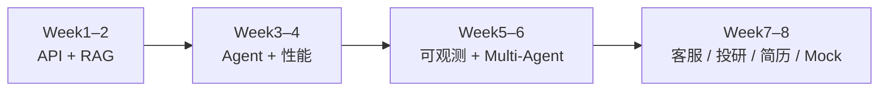

# Agent Dev Practice

**两条可跟学习轨**：① AgentGuide 开发岗 Day1–60；② WorkBuddy 风格 Harness 深挖（s01–s06 可跑）。

[AgentGuide](https://github.com/adongwanai/AgentGuide) / [learn-workbuddy](https://github.com/adongwanai/learn-workbuddy) 告诉你学什么；本仓库给你：**可验收的代码 + 零基础长文**。  
阶段①带走两套简历级项目（智能客服 RAG + 投研 Multi-Agent）；阶段②看清桌面 Agent 的循环、分发、延迟加载与权限治理。

[](https://www.python.org/)
[](https://docs.astral.sh/uv/)
[](https://ollama.com/)
[](docs/ROADMAP.md)
[](tracks/harness/)
[](LICENSE)

> **目录小提示：** 第 7–8 周共用 [`tracks/agentguide/week07/`](tracks/agentguide/week07/README.md)（上游把工业项目与面试合成一块），不是少做一周。  
> **轨怎么登记：** 见 [`docs/TRACKS.md`](docs/TRACKS.md)（加第 3 条学习轨从这张表开始）。

---

## 两条学习轨（先选轨）

| 轨 | 适合谁 | 公开代码 | 长文 | 状态 |
|----|--------|----------|------|------|
| **① AgentGuide** | 按 8 周把 API / RAG / Agent / 可观测 / 工业项目跑通 | [`tracks/agentguide/`](tracks/agentguide/) | [`notes/weekXX/`](notes/) | `available` |
| **② Harness** | 通关后深挖桌面 Agent 工程（loop → 权限 → 进程壳 → Sidecar） | [`tracks/harness/`](tracks/harness/) | [`notes/learn-workbuddy/`](notes/learn-workbuddy/) | `in_progress`（s01–s06 `available`） |

```bash
# 阶段①：最小 API
cd tracks/agentguide/week01/day01-fastapi-hello && uv sync && uv run uvicorn main:app --reload --port 8000

# 阶段②：离线 Harness demo（无 Key）
cd tracks/harness && pip install -r requirements.txt && python3 s01_agent_loop/code.py --demo
```

---

## 本仓解决什么问题

| 常见卡点 | 这里怎么处理 |
|----------|--------------|
| 路线很长，不知道从哪动手 | `tracks/` 分轨；每天/每章独立目录 + 可抄验收命令 |
| 教程只讲概念，没有验收 | README：**文件说明 → 推荐顺序 → 验收命令** |
| 工业项目缺可写进简历的证据 | 客服有 Locust QPS/P99 + Compose 监控；投研有三人 Crew + 中间产出 |
| 面试不会讲系统设计 | Day59–60：四步骨架 + 追问卡 + Mock 复盘 |
| 会调 API Agent，不懂桌面 Harness | 轨②：loop → 分发 → 延迟加载 → 权限 → 三进程壳（`--demo` 可离线） |

**和上游的分工**

| | 上游路线 | 本仓库 |
|--|----------|--------|
| 轨① | [AgentGuide](https://github.com/adongwanai/AgentGuide)：学什么 / 面试地图 | [`tracks/agentguide/`](tracks/agentguide/) + [`notes/weekXX/`](notes/) |
| 轨② | [learn-workbuddy](https://github.com/adongwanai/learn-workbuddy)：Harness 蓝图 | [`tracks/harness/`](tracks/harness/) + [`notes/learn-workbuddy/`](notes/learn-workbuddy/) |

---

## 60 秒跑通 Day 1

**前置：** Python 3.12+ · [uv](https://docs.astral.sh/uv/) · [Ollama](https://ollama.com/)（先 `ollama pull qwen2:7b` 或任意 chat 模型）

```bash
git clone https://github.com/moyunzero/agent-dev-practice.git
cd agent-dev-practice/tracks/agentguide/week01/day01-fastapi-hello
cp .env.example .env          # 纯 Ollama 可不填 Key
uv run uvicorn main:app --reload --port 8000
```

另开终端：

```bash
curl -s http://127.0.0.1:8000/health
curl -s http://127.0.0.1:8000/chat \
  -H 'Content-Type: application/json' \
  -d '{"prompt":"用一句话介绍 FastAPI","provider":"ollama","temperature":0}'
```

Swagger：[http://127.0.0.1:8000/docs](http://127.0.0.1:8000/docs) · 教程：[Day1 长文](notes/week01/day01-fastapi.md)

---

## 推荐体验（先跑这几个建立体感）

### 轨① AgentGuide

| # | 体验 | 你会看到 | 入口 |
|:-:|------|----------|------|
| 1 | **最小 API** | FastAPI + Ollama | [Day1](tracks/agentguide/week01/day01-fastapi-hello/) |
| 2 | **Naive RAG** | `POST /ask` + sources | [Day5–6](tracks/agentguide/week01/day05-06-naive-rag/) |
| 3 | **研究助手** | RAG + Web 工具 Agent | [Day21](tracks/agentguide/week03/day21-research-assistant/) |
| 4 | **客服整栈** | Compose + Prom/Grafana + Locust | [Day48–51](tracks/agentguide/week07/day48-51-customer-service-optimize/) |
| 5 | **投研 Crew** | 三人 sequential + ≥5 工具 | [Day52–56](tracks/agentguide/week07/day52-56-research-agent/) |

```bash
# Day 5–6 快速验收（首次 uv sync 会拉 Embedding，稍慢）
cd tracks/agentguide/week01/day05-06-naive-rag && uv sync
uv run uvicorn main:app --reload --port 8002
curl -s -X POST http://127.0.0.1:8002/ask \
  -H 'Content-Type: application/json' \
  -d '{"question":"chunk_overlap 是干什么的？"}'
```

收官文档：[简历怎么写量化](notes/week07/day57-58-resume.md) · [系统设计怎么口述](notes/week07/day59-60-interview-mock.md)

### 轨② Harness（建议通关轨①后再深入）

| # | 体验 | 你会看到 | 入口 |
|:-:|------|----------|------|
| A | **Agent Loop** | 离线 `--demo` 讲清循环位置 | [s01](tracks/harness/s01_agent_loop/) |
| B | **Permission & Hooks** | 决策 → 审批 → 执行三岗 | [s04](tracks/harness/s04_permission_hooks/) |
| C | **Electron Shell** | Main / Renderer / Preload + IPC | [s05](tracks/harness/s05_electron_shell/) |
| D | **Sidecar Server** | 宿主 + JSON-RPC + RingBuffer | [s06](tracks/harness/s06_sidecar_server/) |

```bash
cd tracks/harness
pip install -r requirements.txt
python3 s01_agent_loop/code.py --demo
python3 s04_permission_hooks/code.py --demo
python3 s05_electron_shell/code.py --demo
python3 s06_sidecar_server/code.py --demo
```

长文索引：[notes/learn-workbuddy](notes/learn-workbuddy/) · 轨说明：[tracks/harness](tracks/harness/)

---

## 8 周你将走上的路



| 周 | 主题 | 状态 | 结束时能演示 |
|:--:|------|:----:|--------------|
| 1 | FastAPI + Naive RAG | `available` | 文档问答 API + Docker |
| 2 | Advanced RAG | `available` | Hybrid / Milvus / RAGAs |
| 3 | Agent + Tools | `available` | 研究助手（含重试降级） |
| 4 | 性能 | `available` | Redis · 异步 · 压测 |
| 5 | 可观测与部署 | `available` | Trace · Prom · Grafana · 故障演练 → [week05](tracks/agentguide/week05/README.md) |
| 6 | Multi-Agent | `available` | AutoGen + CrewAI → [week06](tracks/agentguide/week06/README.md) |
| 7–8 | 工业项目 + 面试 | `available` | 客服 · 投研 · 简历 · Mock → [week07](tracks/agentguide/week07/README.md) |

落地细则：[docs/ROADMAP.md](docs/ROADMAP.md)

---

## 关键特性

- **分轨清晰**：新学习项目先登 [`docs/TRACKS.md`](docs/TRACKS.md)，代码进 `tracks/<id>/`
- **一天 / 一章一目录**：轨①多数 day 自带 `uv.lock`；轨②章脚本支持离线 `--demo`
- **验收可抄**：README 写清文件说明、推荐顺序、curl / compose / `--demo` 命令
- **本地优先**：轨①默认 Ollama；轨②默认无 Key demo；付费 API 可选
- **长文自洽**：[`notes/`](notes/) 名词表 + 代码 + 坑 + 边界，可单独转发
- **对齐上游**：轨①跟 [AgentGuide](https://github.com/adongwanai/AgentGuide)；轨②跟 [learn-workbuddy](https://github.com/adongwanai/learn-workbuddy)（教学切片，见 [NOTICE](tracks/harness/NOTICE.md)）

---

## Tech Stack

**轨①：** Python 3.12 · uv · FastAPI · LangChain / LangGraph · Chroma / Milvus · PostgreSQL · Ollama · Redis · AutoGen AgentChat · CrewAI · Prometheus / Grafana · Locust · Docker Compose · RAGAs · LangSmith（可选）

**轨②：** Python 3 · `mini_workbuddy` 教学辅助 · Anthropic Messages 风格协议 · 可选 DeepSeek / Anthropic（`--provider`）

---

## 适合谁 / 不适合谁

**适合**

- 有一点 Python，想按工程顺序把 Agent / RAG 跑通（轨①）
- 在跟 AgentGuide，缺「配套代码 + 教程」
- 求职需要**可量化项目经历**和**系统设计口述**
- 通关后想搞懂桌面 Agent 的 loop / 工具治理 / 权限（轨②）

**不太适合**

- 要开箱 SaaS → 看 [Dify](https://github.com/langgenius/dify) / [RAGFlow](https://github.com/infiniflow/ragflow)
- 零编程基础 → 先补 Python
- 要 WorkBuddy 产品源码 → 本仓是 clean-room 教学切片，不是逆向

---

## 环境与依赖（摘要）

| 层级 | 需要什么 |
|------|----------|
| 轨①几乎所有 day | Python 3.12+ · uv · Ollama |
| Embedding 日（Day4+） | 首次 sync 拉 torch，约 5–15 分钟，磁盘预留 ~2GB |
| 向量库 / 缓存 / 监控 | Docker Desktop（Milvus、Redis、Grafana、客服整栈等） |
| 工业客服 Day48–51 | Compose：API + Postgres + Prom + Grafana；Locust |
| 投研 Day52–56 | CrewAI + Ollama；默认 fixture，无付费 Key |
| 轨② Harness | `pip install -r tracks/harness/requirements.txt`；纯 `--demo` 可不填 Key |

某天 / 某章要 Docker / 端口 / Key，以**该目录 README**为准。

---

## 仓库结构

```text
agent-dev-practice/
├── tracks/
│   ├── agentguide/        # 轨①：week01/ … week07/
│   └── harness/           # 轨②：s01–s06 可跑切片
├── notes/
│   ├── weekXX/            # 轨① 长文
│   └── learn-workbuddy/   # 轨② 长文
├── docs/
│   ├── TRACKS.md          # 全仓学习轨登记
│   └── ROADMAP.md         # 轨① 8 周落地
├── CONTRIBUTING.md
└── README.md
```

---

## 轨① · Day 1–60 完整索引

| Day | 主题 | 代码 | 教程 |
|:---:|------|------|------|
| 1 | FastAPI 最小 API | [day01](tracks/agentguide/week01/day01-fastapi-hello/) | [📖](notes/week01/day01-fastapi.md) |
| 2 | LangChain LCEL + Memory | [day02](tracks/agentguide/week01/day02-langchain-lcel/) | [📖](notes/week01/day02-langchain-lcel.md) |
| 3 | 文档加载 + 分块 | [day03](tracks/agentguide/week01/day03-rag-load-split/) | [📖](notes/week01/day03-rag-load-split.md) |
| 4 | Embedding + Chroma | [day04](tracks/agentguide/week01/day04-rag-embed-store/) | [📖](notes/week01/day04-rag-embed-store.md) |
| 5–6 | Naive RAG API | [day05-06](tracks/agentguide/week01/day05-06-naive-rag/) | [📖](notes/week01/day05-06-naive-rag.md) |
| 7 | Docker 打包 | [day07](tracks/agentguide/week01/day07-docker/) | [📖](notes/week01/day07-docker.md) |
| 8 | Query Transformation | [day08](tracks/agentguide/week02/day08-query-transform/) | [📖](notes/week02/day08-query-transform.md) |
| 9 | 混合检索 + Rerank | [day09](tracks/agentguide/week02/day09-hybrid-rerank/) | [📖](notes/week02/day09-hybrid-rerank.md) |
| 10–11 | RAGAs 评估 | [day10-11](tracks/agentguide/week02/day10-11-ragas-eval/) | [📖](notes/week02/day10-11-ragas-eval.md) |
| 12 | Milvus | [day12](tracks/agentguide/week02/day12-milvus/) | [📖](notes/week02/day12-milvus.md) |
| 13 | 复杂 PDF | [day13](tracks/agentguide/week02/day13-unstructured-pdf/) | [📖](notes/week02/day13-unstructured-pdf.md) |
| 14 | 周度 RAG 升级 | [day14](tracks/agentguide/week02/day14-rag-upgrade/) | [📖](notes/week02/day14-rag-upgrade.md) |
| 15 | ReAct Agent | [day15](tracks/agentguide/week03/day15-react-agent/) | [📖](notes/week03/day15-react-agent.md) |
| 16 | 自定义天气工具 | [day16](tracks/agentguide/week03/day16-custom-weather-tool/) | [📖](notes/week03/day16-custom-weather-tool.md) |
| 17 | SQL Agent | [day17](tracks/agentguide/week03/day17-sql-agent/) | [📖](notes/week03/day17-sql-agent.md) |
| 18 | Function Calling | [day18](tracks/agentguide/week03/day18-function-calling/) | [📖](notes/week03/day18-function-calling.md) |
| 19 | Agent Memory | [day19](tracks/agentguide/week03/day19-agent-memory/) | [📖](notes/week03/day19-agent-memory.md) |
| 20 | Agent 错误处理 | [day20](tracks/agentguide/week03/day20-agent-error-handling/) | [📖](notes/week03/day20-agent-error-handling.md) |
| 21 | 研究助手 Agent | [day21](tracks/agentguide/week03/day21-research-assistant/) | [📖](notes/week03/day21-research-assistant.md) |
| 22 | 性能画像 | [day22](tracks/agentguide/week04/day22-perf-profile/) | [📖](notes/week04/day22-perf-profile.md) |
| 23 | Redis 缓存 | [day23](tracks/agentguide/week04/day23-redis-cache/) | [📖](notes/week04/day23-redis-cache.md) |
| 24–25 | 异步处理 | [day24-25](tracks/agentguide/week04/day24-25-async/) | [📖](notes/week04/day24-25-async.md) |
| 26 | 批处理 | [day26](tracks/agentguide/week04/day26-batching/) | [📖](notes/week04/day26-batching.md) |
| 27 | vLLM-Metal | [day27](tracks/agentguide/week04/day27-vllm/) | [📖](notes/week04/day27-vllm.md) |
| 28 | Locust / JMeter | [day28](tracks/agentguide/week04/day28-load-test/) | [📖](notes/week04/day28-load-test.md) |
| 29 | LangSmith | [day29](tracks/agentguide/week05/day29-tracing/) | [📖](notes/week05/day29-tracing.md) |
| 30 | Prometheus | [day30](tracks/agentguide/week05/day30-prometheus/) | [📖](notes/week05/day30-prometheus.md) |
| 31 | Grafana | [day31](tracks/agentguide/week05/day31-grafana/) | [📖](notes/week05/day31-grafana.md) |
| 32 | Dockerfile | [day32](tracks/agentguide/week05/day32-docker/) | [📖](notes/week05/day32-docker.md) |
| 33 | Compose + Redis | [day33](tracks/agentguide/week05/day33-compose/) | [📖](notes/week05/day33-compose.md) |
| 34 | JSON 日志 | [day34](tracks/agentguide/week05/day34-logging/) | [📖](notes/week05/day34-logging.md) |
| 35 | 故障演练 | [day35](tracks/agentguide/week05/day35-incident/) | [📖](notes/week05/day35-incident.md) |
| 36–37 | AutoGen 核心 | [day36-37](tracks/agentguide/week06/day36-37-autogen-core/) | [📖](notes/week06/day36-37-autogen-core.md) |
| 38 | AutoGen 三人实战 | [day38](tracks/agentguide/week06/day38-autogen-team/) | [📖](notes/week06/day38-autogen-team.md) |
| 39–40 | CrewAI 核心 | [day39-40](tracks/agentguide/week06/day39-40-crewai-core/) | [📖](notes/week06/day39-40-crewai-core.md) |
| 41 | CrewAI 旅行实战 | [day41](tracks/agentguide/week06/day41-crewai-travel/) | [📖](notes/week06/day41-crewai-travel.md) |
| 42 | 框架对比 | [day42](tracks/agentguide/week06/day42-framework-compare/) | [📖](notes/week06/day42-framework-compare.md) |
| 43–47 | 智能客服 RAG | [day43-47](tracks/agentguide/week07/day43-47-customer-service-rag/) | [📖](notes/week07/day43-47-customer-service-rag.md) |
| 48–51 | 客服优化与部署 | [day48-51](tracks/agentguide/week07/day48-51-customer-service-optimize/) | [📖](notes/week07/day48-51-customer-service-optimize.md) |
| 52–56 | 投研 Agent | [day52-56](tracks/agentguide/week07/day52-56-research-agent/) | [📖](notes/week07/day52-56-research-agent.md) |
| 57–58 | 简历与项目总结 | [day57-58](tracks/agentguide/week07/day57-58-resume/) | [📖](notes/week07/day57-58-resume.md) |
| 59–60 | 系统设计 Mock | [day59-60](tracks/agentguide/week07/day59-60-interview-mock/) | [📖](notes/week07/day59-60-interview-mock.md) |

---

## 轨② · Harness 章节（已发布）

| 章 | 主题 | 代码 | 教程 |
|----|------|------|------|
| s01 | Agent Loop | [s01](tracks/harness/s01_agent_loop/) | [📖](notes/learn-workbuddy/s01-agent-loop.md) |
| s02 | Tool Dispatch | [s02](tracks/harness/s02_tool_dispatch/) | [📖](notes/learn-workbuddy/s02-tool-dispatch.md) |
| s03 | Deferred Loading | [s03](tracks/harness/s03_deferred_loading/) | [📖](notes/learn-workbuddy/s03-deferred-loading.md) |
| s04 | Permission & Hooks | [s04](tracks/harness/s04_permission_hooks/) | [📖](notes/learn-workbuddy/s04-permission-hooks.md) |
| s05 | Electron Shell | [s05](tracks/harness/s05_electron_shell/) | [📖](notes/learn-workbuddy/s05-electron-shell.md) |
| s06 | Sidecar Server | [s06](tracks/harness/s06_sidecar_server/) | [📖](notes/learn-workbuddy/s06-sidecar-server.md) |
| s07–s24 | Session → 综合 | `planned` | — |

完整说明：[tracks/harness/README.md](tracks/harness/README.md)

---

## FAQ

<details>
<summary><strong>为什么代码在 <code>tracks/</code> 下，而不再是根目录 <code>week01/</code>？</strong></summary>

两轨并存后，公开代码统一放在 `tracks/<轨名>/`，方便以后加第 3 条学习轨。轨①仍是原来的 `week01/`…`week07/`，只是挪到了 [`tracks/agentguide/`](tracks/agentguide/)。
</details>

<details>
<summary><strong>为什么是 8 周，文件夹却只有 week01–week07？</strong></summary>

上游第 7–8 周是一块（工业项目 + 面试）。本仓放在 [`tracks/agentguide/week07/`](tracks/agentguide/week07/README.md)，不另建空的 `week08/`。
</details>

<details>
<summary><strong>必须按 Day 1→60 顺序吗？轨②呢？</strong></summary>

轨①建议按序；跳关前看该 day README「前置」。轨②建议先通关轨①，再按 s01→s04… 顺序；章与章有依赖（loop → 分发 → 可见性 → 权限）。
</details>

<details>
<summary><strong>没有 NVIDIA GPU 能跟完吗？</strong></summary>

可以。轨①默认 Ollama（CPU / Apple Metal）。Day27 走 vLLM-Metal，不是 CUDA 官方 vLLM。轨② `--demo` 完全离线。
</details>

<details>
<summary><strong><code>uv sync</code> 很慢或 OOM？</strong></summary>

Day4+ 会装 torch。关其它占内存程序，或只进单个 day 目录 sync。学完可删 `.venv`。
</details>

<details>
<summary><strong>8 周主线 / Harness 更新到哪了？</strong></summary>

轨①：**Day 1–60 全部 `available`。** 轨②：s01–s06 `available`，后续章节按进度发布。
</details>

---

## 贡献

- 跑不通 → [提 Issue](https://github.com/moyunzero/agent-dev-practice/issues/new/choose)（写明轨 + Day/章 + 环境）
- 改教程/代码 → [CONTRIBUTING.md](CONTRIBUTING.md)

觉得有用可以给本仓、[AgentGuide](https://github.com/adongwanai/AgentGuide) 和 [learn-workbuddy](https://github.com/adongwanai/learn-workbuddy) 点个 Star。

**建议路径：** 轨①体验 #1–#3 → Week7–8 工业项目写进简历 → 再跑轨② s01 / s04 `--demo`。

---

## Acknowledgments

- 轨①路线：[AgentGuide · 开发岗 8 周计划](https://github.com/adongwanai/AgentGuide/blob/main/docs/05-roadmaps/learning-roadmap-development.md)（[@adongwanai](https://github.com/adongwanai)）
- 轨②蓝图：[learn-workbuddy](https://github.com/adongwanai/learn-workbuddy)（教学切片说明见 [tracks/harness/NOTICE.md](tracks/harness/NOTICE.md)）

## License

[MIT](LICENSE) · Copyright (c) 2026 [moyunzero](https://github.com/moyunzero)
