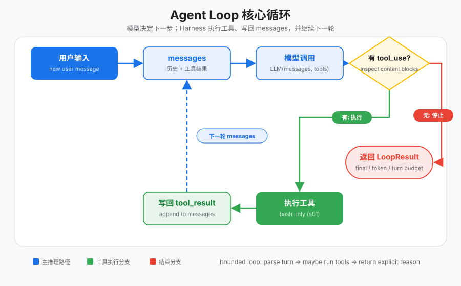
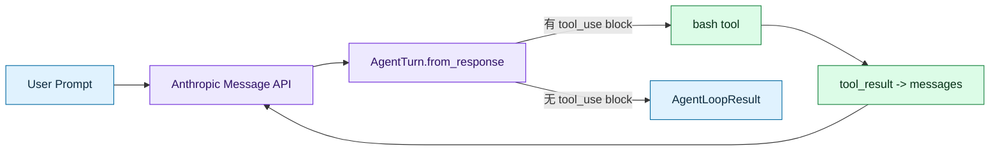

# 手写 Agent Loop：tool_use 驱动继续，显式契约决定停止

只会「调一次大模型」时，模型可以写出 `ls` 或「请运行 XXX.py」，但**不会自己执行**，也**看不到命令输出**。你若每次手动跑命令、再把 stdout 粘回对话框，其实是在充当中间层。  
把这个中间层自动化，就是 **Agent Loop**：有工具调用就执行并回灌，没有工具调用（或预算用尽）就停。本文把循环拆到可以默写的粒度——**不依赖 LangChain / CrewAI**，先看清 Harness 的心跳。

> 可跑代码：[`tracks/harness/s01_agent_loop`](../../tracks/harness/s01_agent_loop/)（`python3 …/code.py --demo`）  
> 配图与流程图便于直接复制到 Notion：正文里的 **SVG** 文件在同目录 `images/`；**Mermaid** 块可粘进 Notion 的代码/图表块（或先在支持 Mermaid 的编辑器里导出再贴图）。

## 你将会得到什么

1. 说清「一次 LLM 调用」和「Agent」差在哪两个动作  
2. 认识 `tool_use` / `tool_result`、`AgentTurn`、停止契约  
3. 能按图讲清循环分支，并能手写最小 loop 伪代码  
4. 避开三个坑：只信 provider 的 `end_turn`、无界 `while True`、把 Agent 写成一次性 prompt  

---

## 零基础名词表

> 建议先读完本节。每个词按「是什么 → 在本文干什么 → 怎么区分」展开。

### LLM 一次响应里的内容块

| 层 | 说明 |
|----|------|
| **是什么** | 现代 Chat / Messages API 里，模型一轮回复常是**若干块**的列表，而不只是一段纯文本。常见块类型包括：普通 **text**，以及 **tool_use**（请求调用某个工具） |
| **在本文干什么** | 循环先解析这些块：有 text 就拼成给人看的话；有 tool_use 就进入「执行工具」分支 |
| **怎么区分** | 「模型说了一句话」≠「模型请求执行」。text 是自然语言；tool_use 是结构化意图（工具名 + 参数） |

### tool_use / tool_result

| 层 | 说明 |
|----|------|
| **是什么** | **tool_use**：模型发出的「请帮我调某某工具」；**tool_result**：Harness 执行后，把 stdout / 错误等打包成协议块，再喂回模型 |
| **在本文干什么** | 有 tool_use → 本地跑 bash → 生成 tool_result → 追加进对话 → 再调模型。这就是 loop 的一条腿 |
| **怎么区分** | tool_use 来自**模型**；tool_result 来自**本地执行**（或模拟执行）。二者用同一个 `tool_use_id` 对齐 |

人话类比：tool_use 像点餐小票；tool_result 像后厨端上的菜。没有后厨，餐厅只停在「写好了菜单」。

### Agent / Agent Loop / Harness

| 层 | 说明 |
|----|------|
| **是什么** | **Agent**：能多步行动、并根据环境反馈继续决策的系统。**Agent Loop**：反复「问模型 →（可选）执行工具 → 回灌」的循环。**Harness**：围绕模型的「操作系统」——调度工具、管会话、权限、记忆等；loop 是它的第一道心跳 |
| **在本文干什么** | 实现一个有界 for 循环 + 单 bash 工具，返回可观察的停止原因 |
| **怎么区分** | 一次 `messages.create` 是**单轮推理**；Agent Loop 是**多轮直到停**。LangChain `create_agent` 内部也有 loop，但本篇故意手写，避免框架把边界藏起来 |

### ReAct

| 层 | 说明 |
|----|------|
| **是什么** | Reasoning + Acting：边想边做。经典叙述里出现 Thought / Action / Observation |
| **在本文干什么** | Action ≈ tool_use；Observation ≈ tool_result；Thought 常常折叠进「决定调哪个工具」 |
| **怎么区分** | ReAct 是**工作流想法**；本篇的 loop 是用 tool calling 协议落地的一种实现，不一定在文本里打印 `Thought:` |

### AgentTurn（一轮归一结果）

| 层 | 说明 |
|----|------|
| **是什么** | 把 provider 的原始 response **解析一次**后得到的结构：原始 `content`、自然语言 `text`、工具列表 `tool_calls`、以及 provider 自带的 `stop_reason` 副本 |
| **在本文干什么** | 后续「要不要继续」「执行哪个工具」都只读 `AgentTurn`，避免循环里东一块西一块地抠 SDK 对象 |
| **怎么区分** | `text` 是模型**这一轮说过的话**（text 块拼接），**不是**用户 prompt，也**不是** bash 的目录列表（那是工具跑完才有的） |

### stop_reason：provider 的 vs Harness 的

| 层 | 说明 |
|----|------|
| **是什么** | Provider（如 Anthropic）会在响应上带 `stop_reason`（例如 `end_turn`、`max_tokens`）。Harness 另有自己的停止枚举：`final_answer` / `max_tokens` / `max_turns` |
| **在本文干什么** | **是否继续**优先看有没有 `tool_calls`；provider 的字段用来**解释**无工具时是正常答完还是被截断。轮次用尽则是 Harness 自己的 `max_turns` |
| **怎么区分** | `end_turn` 只表示「这一轮 API 响应结束了」，**不等于**「Agent 任务做完了」。有 tool_use 时仍应继续执行工具 |

### AgentLoopResult（循环退出契约）

| 层 | 说明 |
|----|------|
| **是什么** | 循环结束时返回的可测试结果：为何停、跑了几轮、调了几次工具、最终文本、provider 原始 stop 等 |
| **在本文干什么** | CLI / 测试 / 后续章节都读这一份，而不是猜「函数是 return 了字符串还是异常」 |
| **怎么区分** | 中间某一轮的 `AgentTurn` 是「这一拍」；`AgentLoopResult` 是「整首歌放完了」 |

---

## 问题：没有中间层会卡在哪

用户说：`列出当前目录，再根据结果读某个文件`。

| 方式 | 发生什么 |
|------|----------|
| 只调一次 LLM | 模型可能输出「请运行 ls」或发出 tool_use → **停**。磁盘没动，它也看不到 stdout |
| 你当中间人 | 你跑命令 → 粘贴输出 → 模型再下指令 → 你再跑……你在干 Harness 的活 |
| Agent Loop | 见 tool_use → 执行 → tool_result 回灌 → 再调模型 → 直到无工具或触达预算 |

缺的两个动作永远是：

1. **执行工具**  
2. **把结果塞回 messages，再调模型**

---

## 架构图与流程图

### 总览图（SVG）

模型决定下一步；Harness 执行工具、写回 messages，并继续下一轮：



> Notion：把 `notes/learn-workbuddy/images/s01-agent-loop.svg`（或同内容的 PNG 导出）拖进页面即可。英文章节版：`s01-agent-loop-en.svg`。

### 代码架构图（Mermaid）



读图要点：

- **上半圈**：Prompt → 调模型 → 归一成 `AgentTurn`  
- **绿线（有工具）**：bash → `tool_result` 写回 messages → 再调模型  
- **红线（无工具）**：直接落到 `AgentLoopResult` 停止  

### 六步心跳（文字版）

```text
1. messages = [{role: user, content: query}]
2. response = messages.create(model, system, messages, tools)
3. turn = AgentTurn.from_response(response)
   messages.append({role: assistant, content: turn.content})
4. stop_reason = stop_reason_for(turn)
   若非 None → return AgentLoopResult（停）
5. results = [execute_bash_call(call) for call in turn.tool_calls]
6. messages.append({role: user, content: results}) → 回到第 2 步
```

### 停止契约表

| 观察结果 | Harness 解释 | 循环动作 |
|----------|--------------|----------|
| 有 `tool_use` block | 模型请求执行真实 I/O | 执行 → 结果喂回去 → 继续 |
| 无工具块，普通结束 | 模型给出最终回答 | 返回 `final_answer` |
| 无工具块，`max_tokens` | 回答被 provider 截断 | 返回 `max_tokens`，保留部分文本 |
| 达到 `max_turns` | Harness 预算耗尽 | 返回 `max_turns`，不再发起新模型调用 |

硬规则：

```text
「要不要继续」看 tool_calls（内容块）
「为何停止」看 stop 契约（含 provider 元数据与 max_turns）
不要只信 provider 的 end_turn
```

### 生产里 loop 常住哪（对照，非本篇实现）

桌面 Agent 往往**不**在 UI 主进程里跑 loop，而在会话子进程中：

```text
Electron Main Process
  └─ SidecarServer
       └─ JSON-RPC over Unix Socket
            └─ CLI Session Process
                 └─ ACP HTTP Server
                      └─ Agent Loop   ← 心跳在这里
```

教学版先用**单进程 + 同步调用**把心跳看清；Sidecar / Session 是后面章节的事。

| 生产常见形态 | 教学版简化 |
|--------------|------------|
| 多进程 Sidecar | 单进程直接调用 |
| 流式响应 | 同步 `messages.create` |
| RingBuffer 有界输出 | 普通列表 / 截断字符串 |
| ACP HTTP | 函数调用 `agent_loop(...)` |

---

## 核心代码（教学版形状）

便于对照默写（完整工程里还有危险命令粗过滤、CLI 入口等）。

### 归一：AgentTurn

```python
@classmethod
def from_response(cls, response):
    """把 provider 杂乱响应解析成一份 AgentTurn，后续只读这一份。"""

    # 保留原始 content 块列表：回灌 messages 时要整段塞给 assistant
    content = list(response.content or [])
    text_parts, tool_calls = [], []

    for block in content:
        if block.type == "text":
            # 自然语言片段（还不是最终「任务完成」的标志）
            text_parts.append(block.text)
        elif block.type == "tool_use":
            # 结构化意图：要调哪个工具、参数是什么
            tool_calls.append(
                ToolInvocation(
                    tool_use_id=block.id,           # 与后续 tool_result 对齐的 id
                    name=block.name,                # 如 "bash"
                    arguments=dict(block.input or {}),  # 如 {"command": "ls"}
                )
            )

    return cls(
        content=content,                            # 原块，供 append assistant 使用
        provider_stop_reason=response.stop_reason,  # 先存着，判停时作「为何停」的参考
        tool_calls=tuple(tool_calls),               # 空元组 ⇒ 本轮可能该停
        text="".join(text_parts),                   # 仅 text 块拼接，不是工具 stdout
    )
```

### 停止：内容块优先

```python
def stop_reason_for(turn):
    """返回 None = 继续循环；返回枚举 = 立刻停并带上原因。"""

    # 硬规则：有工具调用就继续——不要只信 provider 的 end_turn
    if turn.tool_calls:
        return None

    # 无工具：区分「被截断」还是「正常终答」
    if turn.provider_stop_reason == "max_tokens":
        return LoopStopReason.MAX_TOKENS

    return LoopStopReason.FINAL_ANSWER
```

### 循环：assistant 入库 → 判停 → 执行 → user 回灌

```python
def agent_loop(messages, max_turns=8):
    """有界心跳：调模型 → 归一 → 判停 →（可选）执行工具并回灌。"""

    tool_call_count = 0
    last_turn = None

    # 用 for + max_turns，禁止无界 while True
    for turn_number in range(1, max_turns + 1):
        # ① 把当前对话 + 工具 schema 交给模型
        response = client.messages.create(
            model=MODEL,
            system=SYSTEM,
            messages=messages,
            tools=TOOLS,
            max_tokens=8000,
        )

        # ② 解析一次，得到 text / tool_calls / provider_stop_reason
        turn = AgentTurn.from_response(response)
        last_turn = turn

        # ③ 先把整轮 assistant 内容写入历史（含 tool_use 块）
        messages.append({"role": "assistant", "content": turn.content})

        # ④ 判停：非 None 表示本轮无待执行工具（或已标截断）
        stop_reason = stop_reason_for(turn)
        if stop_reason is not None:
            return AgentLoopResult(
                stop_reason=stop_reason,
                turns=turn_number,
                tool_calls=tool_call_count,
                final_text=turn.text,
                provider_stop_reason=turn.provider_stop_reason,
            )

        # ⑤ 真执行工具；每条结果带 tool_use_id，方便模型对上号
        results = [execute_bash_call(call) for call in turn.tool_calls]
        tool_call_count += len(results)

        # ⑥ 协议习惯：tool_result 挂在 user 轮，然后进入下一圈 for
        messages.append({"role": "user", "content": results})

    # for 自然结束：预算用尽，即使模型还想调工具也不再 create
    return AgentLoopResult(
        stop_reason=LoopStopReason.MAX_TURNS,
        turns=max_turns,
        tool_calls=tool_call_count,
        final_text=last_turn.text if last_turn else "",
        provider_stop_reason=last_turn.provider_stop_reason if last_turn else None,
    )
```

一轮**有工具**时，相对进入本轮前，`messages` 固定多两条：

1. `assistant` — 整轮模型输出（含 tool_use 块）  
2. `user` — `tool_result` 列表（用 `tool_use_id` 对齐）

协议习惯：工具结果挂在 **user** 轮，而不是再开一个 assistant。

工具结果块形状示例：

```python
{
    "type": "tool_result",          # 协议类型：这是工具执行结果，不是普通聊天
    "tool_use_id": call.tool_use_id,  # 必须对应刚才那次 tool_use 的 id
    "content": output,              # bash 的 stdout/stderr，或错误字符串
}
```

---

## 最小可默写版（假模型也行）

不接真 API 时，把 `call_model` 换成你的假函数，逻辑不变：

```python
def agent_loop(messages, max_turns=8):
    """默写骨架：假模型也能跑通「执行 → 回灌 → 再问」。"""

    for _ in range(1, max_turns + 1):
        # 调模型（真 API 或本地假响应均可）
        response = call_model(messages)

        # 从 content 块里拆出工具意图 & 自然语言
        tool_calls = [b for b in response.content if b.type == "tool_use"]
        text = "".join(b.text for b in response.content if b.type == "text")

        # 先记录本轮 assistant（完整 content，别只存 text）
        messages.append({"role": "assistant", "content": response.content})

        # 没工具 ⇒ 当作最终回答，结束循环
        if not tool_calls:
            return text

        # 有工具 ⇒ 逐个执行，打成 tool_result 列表
        results = []
        for call in tool_calls:
            out = run_bash(call.input["command"])  # SDK 里参数常在 input
            results.append({
                "type": "tool_result",
                "tool_use_id": call.id,  # 与 tool_use 对齐
                "content": out,
            })

        # 回灌：role 必须是 user，下一轮模型才能「看到」执行结果
        messages.append({"role": "user", "content": results})

    # 轮次用尽仍未终答：显式返回，避免死循环
    return "max_turns"
```

---

## 新手坑

| 现象 | 原因 | 处理 |
|------|------|------|
| 模型写出了命令，但循环立刻结束 | 只信了 provider 的 `end_turn`，没先看 `tool_calls` | 停止判定：**有 tool_calls → 继续** |
| Agent 一直调工具不收尾，进程挂死 | 无界 `while True` 且模型不停发 tool_use | 使用 `max_turns`（或等价预算）返回 `max_turns` |
| 以为 `AgentTurn.text` 是目录列表 | 把工具输出和模型 text 块搞混 | `text` 只来自 text 块；目录列表在 tool_result 的 `content` |
| 框架一包就「会跑」，却讲不清边界 | 过早依赖 Agent 框架 | 先手写本篇 loop，再对照框架内部 |

---

## 边界：本篇做了什么 / 故意没做什么

**做了**

- 有界 Agent Loop + 单 bash 工具  
- tool_use / tool_result 反馈形状  
- `AgentTurn` 归一与显式 `AgentLoopResult` 停止契约  

**没做（留给后续章）**

- 多工具注册与分发（s02 Tool Dispatch）  
- 工具 schema 延迟加载、权限 hooks、Sidecar / Session、记忆与压缩等  

---

## 小结

```text
Agent ≈ 有界循环
      + 工具执行
      + 结果回灌
      + 显式停止原因
```

一句话：**模型负责下一步意图；Loop 负责把意图变成可停止、可观察的真实世界往返。**  
下一篇（s02）会把「循环里写死 bash」升级成 **ToolRegistry 统一分发**，加工具时不再改 loop。
