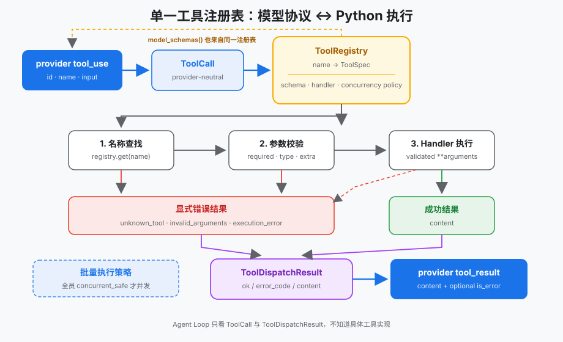
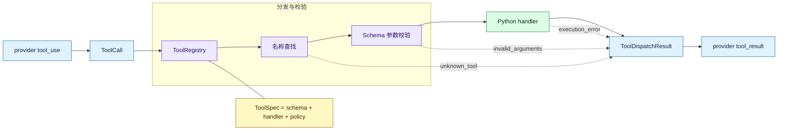
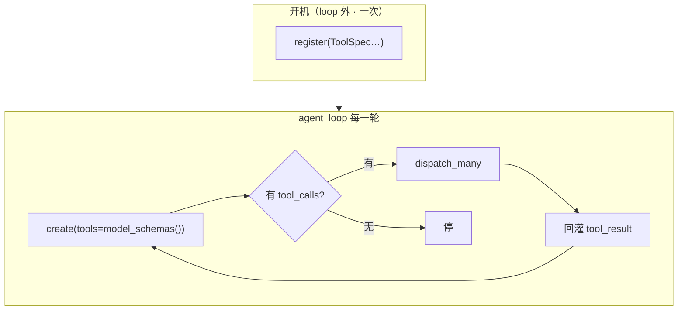

# 工具分发边界：一个 Registry，加工具不必改 Agent Loop

> *模型只提出调用意图，Harness 决定它能否以及如何成为一次本地执行。*
>
> **Harness 层**：工具分发 — 从模型协议跨入真实 Python 代码的边界。

s01 里循环可以直接写 `run_bash(...)`——因为只有一个工具。一旦出现 read / write / edit / glob，把「查名字、校验参数、调函数、编码错误、能不能并发、子进程环境」全塞进 `if/elif`，循环会迅速变成意大利面，而且 schema 列表和 handler 字典一分开就改漏。  
本章要立的是一条 **dispatch 边界**：一个 `ToolRegistry` 管注册、模型 schema、查找、校验和执行；Agent Loop 几乎不用知道每件工具的细节。

> 可跑代码：[`tracks/harness/s02_tool_dispatch`](../../tracks/harness/s02_tool_dispatch/)（`python3 …/code.py --demo`）  
> 配图便于复制到 Notion：SVG 在同目录 `images/s02-tool-dispatch.svg`；Mermaid 可进代码块或先导出成图。

## 你将会得到什么

1. 说清为何不能硬编码 `if name == "bash"`，以及硬编码会同时承担哪七件事  
2. 认识 `ToolSpec` / `ToolRegistry` / `ToolCall` / `ToolDispatchResult`  
3. 能口述 `dispatch`：查找 → 校验 → 执行 → 三种错误码或成功返回  
4. 知道并发只给只读批次、`safe_path` 与过滤子进程环境各防什么  
5. 对照 s01：循环契约不变，只是把执行委托给 Registry  

---

## 读前需要已经知道的

- 一轮模型响应可以归一成带 `tool_calls` 的回合；有工具调用就继续，没有就停。  
- 工具定义有两个方向：向模型描述可用能力，以及在本地执行 Python callable。  
- 模型产生的是**不可信协议输入**；即使 schema 已发给模型，Harness 仍要在执行前再验证。  
- 并发是执行策略，不是同轮所有工具调用的默认属性。  

---

## 零基础名词表

### ToolCall（一次调用意图）

| 层 | 说明 |
|----|------|
| **是什么** | 从供应商 `tool_use` 块抽出的中性结构：`tool_use_id`、`name`、`arguments` |
| **在本文干什么** | 进入 Registry 的门票；后面所有查找/校验/执行都围着它转 |
| **怎么区分** | 还不是执行结果。意图在模型侧；结果是后面的 `ToolDispatchResult`。`arguments` 故意先标成不可信 `object`——「是不是合法参数映射」本身就是 Harness 要验证的条件 |

### ToolSpec（一件工具的完整档案）

| 层 | 说明 |
|----|------|
| **是什么** | 一次注册写全：名字、给模型的说明与参数 schema、本地 `handler`、是否可并发 |
| **在本文干什么** | **单一真相源**：发给模型的目录和真正执行，都从同一份对象来；项目中不再另维护一份 `TOOLS` 列表 + 一份 `TOOL_HANDLERS` 字典 |
| **怎么区分** | `description` + `input_schema` 给模型看；`handler` 才是本地真跑的函数；`concurrent_safe` 只给 Harness 的批量策略看 |

### handler 与 `self`

| 层 | 说明 |
|----|------|
| **是什么** | `handler`：真正干活的 Python 函数。`self`：当前这个 Registry「柜子」自己 |
| **在本文干什么** | `spec.handler(**arguments)` = 按参数执行工具；`self._specs` = 挂在整个柜子上的工具表 |
| **怎么区分** | `self` 几乎不会是 `None`；可能为空的是 **`spec = self.get(name)`** 的查找结果 |

### ToolDispatchResult（跨界之后的结果盒）

| 层 | 说明 |
|----|------|
| **是什么** | 本地执行（或失败）的统一包装：`content` + 可选 `error_code`，再编成 `tool_result` |
| **在本文干什么** | 成功、未知工具、烂参数、handler 抛错——都走同一种返回，不把异常冲出 loop；失败时还可带 `is_error: True` 回灌给模型 |
| **怎么区分** | 三种错误码：`UNKNOWN_TOOL` / `INVALID_ARGUMENTS` / `EXECUTION_ERROR`——对排查意义不同，不能全糊成一句 `Error: ...` |

### ToolRegistry（工具柜）

| 层 | 说明 |
|----|------|
| **是什么** | 注册、派生模型 schema、查找、校验、执行的一站式边界 |
| **在本文干什么** | loop 只调用 `model_schemas` / `dispatch` / `dispatch_many`；加工具 = `register` 新 `ToolSpec` |
| **怎么区分** | 不是 Agent Loop；loop 负责回合，Registry 负责「这一枪怎么打到真实世界」 |

---

## 本章抓住的机制（人话版）

- 用一个 `ToolRegistry` 管理注册、模型 schema、名称查找、参数校验和执行。  
- 用 `ToolCall` 隔离 provider block，用 `ToolDispatchResult` 隔离本地执行结果。  
- 未知工具、错误参数和 handler 异常都转成显式错误结果，不让 Agent Loop 崩溃。  
- 只有整批都标了 `concurrent_safe` 的只读调用才并发；写入和未知调用保守串行。  
- 文件工具用 `safe_path()` 限制工作区边界。  
- bash handler 为子进程**重新构造最小环境**，避免把 provider 凭据随工具调用直接传出 Harness。  

---

## 问题：硬编码分支会承担七件事

s01 单工具时这样写没问题：

```python
output = run_bash(call.arguments["command"])
```

工具扩到 read / write / edit / glob 后，硬编码分支会同时承担：

1. 告诉模型有哪些工具；  
2. 根据名字找到 Python 函数；  
3. 判断参数是否完整；  
4. 把参数传给 handler；  
5. 决定能否并发；  
6. 把成功或失败编码回 provider 协议；  
7. 决定工具子进程可以继承哪些宿主环境变量。  

如果这些信息散落在 schema 列表、dispatch 字典和循环分支中，它们迟早会不一致。真正需要新增的不是更多 `if/elif`，而是一条明确的 **dispatch boundary**。

---

## 架构图与流程图

### 总览图（SVG）



> Notion：把 `notes/learn-workbuddy/images/s02-tool-dispatch.svg` 拖进页面。

### 代码架构图（Mermaid）



读图要点：三条虚线都汇总到同一种 `ToolDispatchResult`，再变成 `tool_result` 喂回模型。

---

## 解决方案：每个工具只注册一次

```python
ToolSpec(
    name="read_file",  # 查找键：模型 tool_use.name 必须对上这个字符串
    description="Read UTF-8 file contents from the workspace.",  # 给模型读的「这工具干什么」
    input_schema=object_schema(
        {
            "path": {"type": "string"},
            "limit": {"type": "integer", "minimum": 1},
        },
        ["path"],
    ),
    handler=run_read,  # 本地真执行的函数；不是给模型看的文本
    concurrent_safe=True,  # True=只读、可与其它只读批并行；写工具保持 False
)
```

| 字段 | 面向谁 | 作用 |
|------|--------|------|
| `name` | 模型协议和 Harness | 稳定查找键 |
| `description` + `input_schema` | 模型 | 描述调用方式 |
| `handler` | 本地执行器 | 实际 Python 实现 |
| `concurrent_safe` | Harness | 批量执行策略 |

`ToolRegistry` 再从这些 `ToolSpec` **派生**模型工具目录，并用同一批对象做运行时查找。

### `register`（带注释）

```python
def register(self, spec: ToolSpec) -> None:
    """把一件工具放进柜子；同名拒绝，禁止静默覆盖。"""

    # self = 当前这个 Registry 柜子（不是某一次 call）
    if not spec.name:
        raise ValueError("tool name must not be empty")
    if spec.name in self._specs:
        # 早点暴露配置错误；覆盖会让人分不清到底注册的是哪一个 handler
        raise ValueError(f"duplicate tool name: {spec.name}")
    if spec.input_schema.get("type") != "object":
        raise ValueError(f"tool {spec.name} must declare an object input schema")

    # 深拷贝 schema：避免外面改字典时污染柜子里的副本
    self._specs[spec.name] = ToolSpec(
        name=spec.name,
        description=spec.description,
        input_schema=copy.deepcopy(dict(spec.input_schema)),
        handler=spec.handler,
        concurrent_safe=spec.concurrent_safe,
    )
```

---

## 注册落在 Agent Loop 的哪一环？

**`register` 不在 for 循环里**——开机备货一次；loop 每轮只用「出示菜单」和「出餐」。



### 三段代码对照（带注释）

```python
# ========== A. 开机：注册（loop 外，模块加载时做一次）==========
TOOL_REGISTRY = ToolRegistry()  # 造一个空柜子

TOOL_REGISTRY.register(
    ToolSpec(
        name="bash",
        description="Run a shell command in the workspace.",
        input_schema=object_schema({"command": {"type": "string"}}, ["command"]),
        handler=run_bash,  # 真执行函数挂在这里
        # concurrent_safe 默认 False：bash 可能改世界，不与其它工具乱并行
    )
)
# 同理再 register read_file / write_file / …
# 加工具 = 再多一次 register；下面的 agent_loop 不用改


# ========== B. loop 每一轮：调模型时只「出示菜单」==========
def agent_loop(messages, registry=TOOL_REGISTRY, max_turns=8):
    for turn_number in range(1, max_turns + 1):
        response = client.messages.create(
            model=MODEL,
            system=SYSTEM,
            messages=messages,
            # 从柜子生成供应商格式的 tools 列表（description + schema）
            # 这里不是 register，也不是执行，只是把说明书递给模型
            tools=registry.model_schemas(),
            max_tokens=8000,
        )
        turn = AgentTurn.from_response(response)
        messages.append({"role": "assistant", "content": turn.content})

        if not turn.tool_calls:
            return AgentLoopResult(...)  # 无工具 → 停

        # ========== C. 有 tool_use：才进入厨房 dispatch ==========
        # turn.tool_calls 里是模型的意图；dispatch 负责查找/校验/执行/装错误
        dispatch_results = registry.dispatch_many(list(turn.tool_calls))

        # 把每个结果编成 tool_result 协议块，挂在 user 轮回灌
        messages.append(
            {
                "role": "user",
                "content": [r.to_protocol_block() for r in dispatch_results],
            }
        )
        # 然后 for 继续 → 再 create → 模型看到工具结果后再推理
```

| 环节 | API | 在 loop 里吗 |
|------|-----|----------------|
| 备货 | `register(ToolSpec)` | **否**（开机一次） |
| 出示菜单 | `model_schemas()` | 是（每轮 create 时） |
| 出餐 | `dispatch` / `dispatch_many` | 是（有 tool_use 时） |

这正是边界设计的价值：新增一个工具时，循环不需要知道它的 schema、函数签名、错误类型或并发策略。

---

## 工作原理（八步）

### 1. 归一化 provider 输入

模型 SDK 的 block 是供应商对象。dispatch 层先只提取需要的字段：

```python
@dataclass(frozen=True)
class ToolCall:
    tool_use_id: str
    name: str
    arguments: object  # 故意不可信：是否 Mapping 要靠校验决定
```

校验通过后，dispatch 才把它收窄为字典并展开给 handler；这里不提前假装输入可信。

### 2. 从注册表生成模型 schema

```python
def model_schemas(self):
    return [spec.model_schema() for spec in self._specs.values()]
```

`model_schema()` 返回**深拷贝**。调用方即使改发送给 SDK 的字典，也不会污染注册表里的执行契约。

### 3. 先查找，再校验，最后执行

```python
def dispatch(self, call: ToolCall) -> ToolDispatchResult:
    """一次 tool_use → 本地执行或显式错误；绝不把异常甩给 agent_loop。"""

    # self = 整个 Registry；可能为 None 的是查找结果 spec，不是 self
    spec = self.get(call.name)
    if spec is None:
        return self._error(
            call,
            ToolErrorCode.UNKNOWN_TOOL,
            f"tool is not registered: {call.name or '<empty>'}",
        )

    # 模型见过 schema 仍可能传错；执行前用同一份 input_schema 再验
    validation_error = _validate_arguments(spec.input_schema, call.arguments)
    if validation_error:
        return self._error(call, ToolErrorCode.INVALID_ARGUMENTS, validation_error)

    arguments = dict(call.arguments)
    try:
        output = spec.handler(**arguments)
    except Exception as exc:
        return self._error(call, ToolErrorCode.EXECUTION_ERROR, str(exc))

    return ToolDispatchResult(call=call, content=str(output))
```

顺序很重要：

| 失败点 | 含义 |
|--------|------|
| 查找失败 | 模型调用了未注册能力 |
| 校验失败 | 协议参数无法安全绑定 |
| 执行失败 | 已经进入 handler，但本地 I/O 或实现报错 |

三者用稳定 `ToolErrorCode` 区分，方便排查。

口述版：

```text
1. spec = self.get(call.name)
2. 没有 → UNKNOWN_TOOL
3. 校验 arguments 对照 input_schema
4. 不合法 → INVALID_ARGUMENTS
5. try: output = spec.handler(**arguments)
6. except → EXECUTION_ERROR（异常变数据，不冲出 loop）
7. 成功 → ToolDispatchResult(content=...)
```

### 4. 参数校验属于 Harness

教学用的 JSON Schema 子集通常覆盖：

- 输入必须是 object；  
- required 字段必须存在；  
- `additionalProperties: false` 拒绝拼错或多余参数；  
- 检查 string / integer / number / boolean / object / array；  
- 支持如 `limit` 上的 `minimum`。  

**关键职责：** schema 不只用于提示模型，也用于执行前验证。生产可用成熟 validator 替换同一边界；Agent Loop 无需改变。

### 5. 错误也是正常协议结果

```python
@dataclass(frozen=True)
class ToolDispatchResult:
    call: ToolCall
    content: str
    error_code: ToolErrorCode | None = None
```

失败时编码成类似：

```python
{
    "type": "tool_result",
    "tool_use_id": "call_123",
    "content": "Error [invalid_arguments]: ...",
    "is_error": True,
}
```

Agent Loop 因此可以把失败反馈给模型，让模型改参数或换工具，而不是因为一个 `KeyError` / `TypeError` 整体退出。

### 6. 并发由工具元数据决定

| 工具 | `concurrent_safe` | 原因 |
|------|-------------------|------|
| `read_file` | 是 | 只读文件 |
| `glob` | 是 | 只读目录匹配 |
| `bash` | 否 | 命令语义未知 |
| `write_file` | 否 | 修改文件 |
| `edit_file` | 否 | 读取后再写入 |

只有整个批次都明确安全时才进线程池；只要包含一个未知、bash 或写工具，就按模型给出的顺序**串行**。并发结果仍按原调用顺序返回，保证 `tool_use_id` 对齐。

`write_file` 后紧跟 `read_file` 若乱并行，可能读到旧内容或文件尚不存在（竞态）。

### 7. 文件边界仍由 handler 保证

```python
def safe_path(path_text: str) -> Path:
    path = (WORKDIR / path_text).resolve()
    if not path.is_relative_to(WORKDIR):
        raise ValueError(f"path escapes workspace: {path_text}")
    return path
```

注册表负责通用协议边界；handler 仍负责自己的领域约束。路径越界异常会被 dispatch 捕获并转换成 `execution_error`。更完整的 allow / ask / deny 是后续权限章；系统沙盒更靠后。

### 8. bash 子进程不继承 provider 凭据

真实模型客户端通常需要从宿主环境读 API key，但执行工具的 shell **不应**自动得到同一批凭据。`run_bash()` 因此显式传入重新构造的环境：

```python
completed = subprocess.run(
    command,
    cwd=WORKDIR,
    env=build_subprocess_env(WORKDIR),
    shell=True,
    # ...
)
```

`build_subprocess_env()` 只保留命令查找、语言区域和临时文件所需变量；`HOME` 与 `PWD` 都指向 `WORKDIR`。未列入允许列表的 `OPENAI_API_KEY`、`ANTHROPIC_API_KEY`、`SSH_AUTH_SOCK` 等不会进入子进程。

这是对「子进程直接继承环境」的默认拒绝，**不是**完整沙盒。bash 仍可能读工作区 `.env`、访问当前用户有权读的其它文件或连网——那些要靠后续权限判断、系统隔离和网络策略一起限制。

**易混：** 只设 `cwd` ≠ 隔离完成；工作目录不会自动摘掉父进程的 API key。

---

## 相对 s01 的变化

| 组件 | s01 | s02 |
|------|-----|-----|
| 工具数量 | 1 个 bash | 多个注册工具（示例里 5 个） |
| 元数据来源 | 单工具常量 + 硬编码执行 | `ToolSpec` 单一真源 |
| 名称查找 | 无 | `ToolRegistry.get()` |
| 参数处理 | 直接取 `command` | schema 执行前校验 |
| 错误处理 | bash 文本错误 | 稳定错误码 + `is_error` |
| 并发 | 串行 | 仅全只读安全批次并发 |
| 路径安全 | bash 自身语义 | 文件 handler 使用 `safe_path()` |
| 子进程环境 | 继承 provider 进程环境 | 允许列表 + 工作区 `HOME` / `PWD` |
| 循环契约 | 显式 turn 与 stop reason | **保持不变**，只委托 dispatch |

---

## 常见误区（新手坑）

| 现象 / 想法 | 原因 | 处理 |
|-------------|------|------|
| 改了工具说明忘了改执行函数 | 分别维护 `TOOLS` 和 `TOOL_HANDLERS` | 只用 `ToolSpec` 注册一次 |
| 「模型看过 schema 就不会传错」 | 模型输出仍可能缺字段、类型错、多余字段 | dispatch 内再校验 |
| 直接 `handler(**block.input)` | 协议错误和 Python 异常穿透到循环层 | 统一变成 `ToolDispatchResult` |
| 同轮工具全并发 | `write` 后 `read` 竞态 | 写工具 / 未知调用串行 |
| 把安全策略塞进 Agent Loop | 循环逐渐知道每种工具细节，加工具必须改循环 | 策略挂在 Spec / Registry |
| 以为设了 `cwd` 就隔离完了 | 工作目录不会移除父进程 API key / SSH agent 等 | `build_subprocess_env` 白名单 |
| 以为 `self is None` 是未知工具 | 把柜子和查找结果搞混 | 判断的是 **`spec`** |

---

## 生产对照（知道即可）

生产里工具可能来自内置、MCP、按需技能：

```text
assemble_tool_pool() = BUILTIN_TOOLS + MCP_TOOLS + SKILL_TOOLS
```

来源可以变，但进 Agent Loop 前仍应归一成统一描述：稳定名称、模型 schema、执行入口、策略元数据。静态注册表是为了把这条**不随来源变化的边界**讲清楚；「先发现、再加载」是下一章。

完整实现还会继续加：成熟 JSON Schema validator、工具命名空间、权限/超时/审计、更细的并发锁、流式参数组装后再进同一 dispatch、默认拒绝的环境过滤覆盖到 sidecar / MCP 等。这些可以扩展 `ToolSpec` 或包裹 `dispatch()`，不必把工具细节塞回 Agent Loop。

---

## 边界

**做了**

- 单一 `ToolRegistry` + `ToolSpec`  
- `dispatch` 成功路径与三错误码  
- 只读并发策略；工作区路径与子进程环境过滤  

**没做**

- 工具 schema 延迟加载（下一章：先发现，再加载）  
- 完整权限 hooks  
- 系统级沙盒 / 网络出口策略  

一句话：

```text
模型提出意图；Registry 决定能否执行、如何执行、失败如何变成可回灌的数据。
加工具 = register(ToolSpec)；agent_loop 仍然只认识 model_schemas + dispatch。
```
