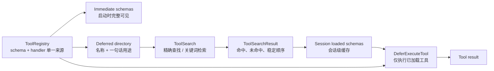
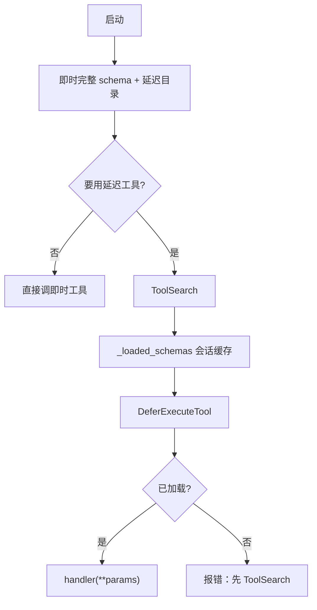

# 延迟加载：先目录，用到再展开说明书

> *工具先列目录，schema 用到再展开。*
>
> **Harness 层**：控制每一轮向模型暴露哪些工具契约。

s02 把工具放进统一 Registry 之后，下一问题立刻出现：工具一多，每轮把全部完整 `input_schema` 塞进 `tools=`，上下文会被说明书挤爆，而本轮真正用到的往往只有一两件。  
本章要立的是 **Deferred Loading**：在**同一份**工具定义之上加可见性策略——启动只给紧凑目录；需要时再用 ToolSearch 把完整契约拉进**本会话**；执行走 DeferExecute，且未加载不可跑。

> 可跑代码：[`tracks/harness/s03_deferred_loading`](../../tracks/harness/s03_deferred_loading/)（`python3 …/code.py --demo`）  
> 配图便于复制到 Notion：SVG 在同目录 `images/s03-deferred-loading.svg`；Mermaid 可进代码块或先导出成图。

## 你将会得到什么

1. 说清「知道有工具」vs「知道怎么调」vs「已经执行」  
2. 对照即时工具与延迟工具：启动时模型分别看见什么  
3. 口述 `ToolSearch → _loaded_schemas → DeferExecute` 链，以及三条主路径  
4. 知道会话缓存不是再复制一份全局注册表；搜索结果为何要稳定排序  
5. 会读 token 估算表：它是教学对比，不是实测省流承诺  

---

## 零基础名词表

### Immediate tool（即时工具）

| 层 | 说明 |
|----|------|
| **是什么** | 注册时 `defer=False`；启动就把完整 schema 放进模型可见的 tools |
| **在本文干什么** | 含 `ToolSearch`、`DeferExecuteTool` 自己——发现与执行入口必须一直在场；高频、短 schema 工具也适合即时 |
| **怎么区分** | 可直接按名字调用；不必先搜索；也不应借 DeferExecute 绕行 |

### Deferred tool（延迟工具）

| 层 | 说明 |
|----|------|
| **是什么** | 注册时 `defer=True`；定义仍在全局 Registry，启动只露出「名字 + 一句话」 |
| **在本文干什么** | 省掉未使用工具的完整参数说明书 token；适合低频、长 schema 工具 |
| **怎么区分** | 要用：先 ToolSearch 加载，再 DeferExecute；目录≠完整契约 |

### ToolSearch（发现并加载）

| 层 | 说明 |
|----|------|
| **是什么** | 即时工具：按精确名称或关键词查询，从延迟目录召回，并把完整 schema 写入会话 |
| **在本文干什么** | **发现 ≠ 执行**——只展开说明书，不跑业务 handler |
| **怎么区分** | 第二次命中同一工具：`cache_hit` / `load_state=cached`，不会往全局表再注册一份 |

### `_loaded_schemas`（会话级缓存）

| 层 | 说明 |
|----|------|
| **是什么** | 本会话已经展开过的完整 schema 字典 |
| **在本文干什么** | 回答「哪些延迟工具的契约已经对模型可见、允许执行」 |
| **怎么区分** | 注册表描述「系统有什么工具」；loaded cache 描述「当前会话已经向模型展示过什么 schema」——二者不能混谈 |

### DeferExecuteTool（按已加载契约执行）

| 层 | 说明 |
|----|------|
| **是什么** | 即时工具：对**已加载**的延迟工具填参并调用其 handler |
| **在本文干什么** | 两步调用的第二步：有说明书才允许动手 |
| **怎么区分** | 未加载 → 明确报错（先 ToolSearch）；即时工具应直接调。加载只表示「schema 已进会话」，不等于下载代码、装插件或绕过权限 |

### ToolSearchResult（可解释的搜索回执）

| 层 | 说明 |
|----|------|
| **是什么** | 一次搜索的结构化结果：`matches`（名、分、schema、加载状态）、`missing`、稳定顺序 |
| **在本文干什么** | 让模型改写查询；让测试与 trace 可复现 |
| **怎么区分** | 未命中是**数据**（写进 missing / 空结果），不是抛异常拆 loop |

---

## 为什么模型不是一开始就看到所有 input_schema

标准 tool calling 通常把每个工具的 `name`、`description`、`input_schema` 一起发给模型。工具少时最简单；目录变大后，全量 schema 会持续占上下文，多数工具本轮根本不会被调用。

因此本章把「知道有这个能力」和「知道怎么调用」拆开：

| 阶段 | 模型看到什么 | 能做什么 |
|------|--------------|----------|
| 启动 | 即时工具完整 schema；延迟工具名称与简述 | 判断需要搜索哪类能力 |
| 发现 | `ToolSearch` 返回的少量完整 schema | 理解命中工具的参数契约 |
| 执行 | `DeferExecuteTool` 通用入口 | 按已加载契约提交参数 |

**目录不是 schema 的替代品。** 它只负责召回候选；真正执行前，模型仍然必须看到完整 `input_schema`。

s02 解决的是「定义和执行不能分家」。s03 **没有再造第二套注册表**，只在同一份定义上增加可见性策略。

---

## 架构图与流程图

### 总览图（SVG）


> Notion：把 `notes/learn-workbuddy/images/s03-deferred-loading.svg` 拖进页面。

### 代码架构图（Mermaid）



### 主链路（人话）



---

## 设计不变量

### 1. 工具定义只有一份

```python
registry.register(
    "image_gen",
    schema=IMAGE_GEN_SCHEMA,
    handler=mock_image_gen,
    defer=True,
)
```

`ToolEntry` 同时持有目录描述、完整 schema、handler 和加载策略。搜索结果与执行入口都从这份定义解析，避免「目录说有、执行映射没有」或「schema 更新了、handler 仍按旧参数跑」。

注册时还会拒绝：空名称、重复名称、注册名与 schema 名不一致、非 object 的 input schema——这些问题在**启动阶段**暴露，比跑到模型调用才失败更好定位。

### 2. 已加载状态属于会话

```python
self._loaded_schemas: dict[str, dict[str, Any]] = {}
```

第一次搜索可记为 `loaded`，同会话再次搜索记为 `cached`，但**不会创建第二份工具定义**。

### 3. 搜索结果必须可解释、可复现

`ToolSearchResult` 同时记录 matches、missing，以及稳定顺序：先按分数降序，再按名称升序打破平分。

若平分结果依赖字典或注册顺序，同一输入可能在不同构建中加载不同工具，回归 trace 也会无意义抖动。

本章关键词评分器故意简短可读：精确名称最高，名称 token 次之，描述 token 再次之。生产可换成 BM25 / 向量 / 混合召回，但仍应保留**相同结果契约 + 稳定排序**。

### 4. 发现是执行前置条件

若延迟工具尚未进入 loaded cache，执行器返回可观察错误并提示先 `ToolSearch`。它也不会接受即时工具：即时工具应走 s02 的直接 dispatch，不能借通用延迟入口绕过原有边界。

---

## 启动时模型看见什么？

```python
def get_immediate_schemas(self) -> list[dict[str, Any]]:
    """Full schemas for all immediate tools (always in context)."""
    return [entry.model_schema() for entry in self._tools.values() if not entry.defer]

def get_deferred_directory(self) -> str:
    """Render the compact startup directory: name plus one-line purpose."""
    return "\n".join(
        f"  - {entry.name}: {entry.description}"
        for entry in self._tools.values()
        if entry.defer
    )
```

| 种类 | 启动可见 | 完整 input_schema？ |
|------|----------|---------------------|
| 即时 | 完整 schema | 有 |
| 延迟 | `名字: 一句话` 目录行 | **没有**（要用再搜） |

---

## 主要代码流程

### 路径 A：按精确名称发现

```text
Model: ToolSearch(tool_names=["image_gen"])
  -> ToolRegistry.load_by_name()
  -> 确认它是 deferred tool
  -> schema 写入 session loaded cache
  -> ToolSearchResult(matches=[...], missing=[])
  -> 完整 input_schema 返回给模型
```

精确列表保留调用者顺序，同时折叠同一次请求中的重复名称，避免重复 schema 进入同一个 tool result。

### 路径 B：按用途搜索

```text
Model: ToolSearch(queries=["image generation"], top_k=3)
  -> 规范化查询词
  -> 只评分 deferred tools
  -> (-score, name) 稳定排序
  -> 只加载 top_k 命中 schema
  -> 返回可解释的 ToolSearchResult
```

未命中不会抛异常，也不会改变 loaded cache；结果会显式告诉模型哪个名称或查询没有对应延迟工具。

### 路径 C：执行已加载工具

```text
Model: DeferExecuteTool(toolName="image_gen", params={...})
  -> 工具是否存在？
  -> 是否为 deferred tool？
  -> schema 是否已在本会话加载？
  -> 从同一 ToolEntry 取得 handler
  -> 执行并把成功/失败写成 tool result
```

```python
def handle_defer_execute(registry, toolName, params=None):
    params = params or {}
    handler = registry.get_handler(toolName)
    if handler is None:
        return f"Error: Unknown tool '{toolName}'"
    if not registry.is_deferred(toolName):
        return f"Error: '{toolName}' is immediate; call it directly."
    if toolName not in registry.get_loaded_names():
        return (
            f"Error: Schema for '{toolName}' not loaded. "
            "Call ToolSearch first."
        )
    try:
        return handler(**params)
    except Exception as exc:
        return f"Error executing {toolName}: {exc}"
```

参数的完整 JSON Schema 校验已在 s02 讲过；本章聚焦可见性与加载状态。

### `_load_match`：加载 vs 缓存

```python
def _load_match(self, entry: ToolEntry, score: int) -> ToolMatch:
    cache_hit = entry.name in self._loaded_schemas
    if not cache_hit:
        self._loaded_schemas[entry.name] = entry.model_schema()
    return ToolMatch(
        name=entry.name,
        score=score,
        schema=copy.deepcopy(self._loaded_schemas[entry.name]),
        cache_hit=cache_hit,
    )
```

| 概念 | 在哪 | 含义 |
|------|------|------|
| `_tools` | 全局 Registry | 工具**定义**始终在这里 |
| `_loaded_schemas` | 会话 | 哪些延迟工具的说明书已对本会话展开 |
| `cache_hit` | 单次 match | 这次是「新加载」还是「命中缓存」 |

---

## 为什么保留 ToolSearch + DeferExecute 两步

生产 harness 常见两种渐进式方案：

1. 搜索后，在下一轮直接把命中工具加入 provider 的 `tools` 列表；  
2. 搜索后，通过一个通用执行入口调用命中工具。  

教学 demo 常选第二种：在离线单文件里就能观察完整状态机，且不依赖特定 provider 是否支持运行中改工具集合。两种方案共享核心原则：

**模型执行前必须获得准确 schema；harness 只暴露当前任务需要的少量 schema。**

串起来：

```text
启动
  tools ≈ 即时完整 schema + 延迟目录（无完整 input_schema）

需要某延迟工具
  ToolSearch(queries / tool_names)
    → 完整 schema 写入本会话 _loaded_schemas

执行
  DeferExecuteTool(toolName, params)
    → 已加载则跑 handler；未加载则报错
```

---

## Token 估算怎么读

教学代码常用 `len(json) // 4` 做粗估，运行时会对比：

- 全量加载全部 schema 的估算成本；  
- 启动时即时 schema + 延迟目录的估算成本；  
- 本会话经 `ToolSearch` 实际加载的增量；  
- 相对全量加载的估算差值。  

这些数字只用于**比较本 demo 的两种装载策略**，不是 tokenizer 实测，也不应外推成任何真实产品的固定节省比例。真实收益取决于序列化方式、工具数量、schema 长度、缓存策略和单会话实际命中数。

---

## 失败路径

| 场景 | Harness 行为 | 设计原因 |
|------|--------------|----------|
| 精确名称不存在 | 写入 `missing`，不激活任何工具 | 让模型可以改写查询 |
| 关键词无命中 | 返回明确空结果 | 空结果是数据，不是异常 |
| 重复注册名称 | 启动时抛 `ValueError` | 防止目录和执行歧义 |
| 平分结果 | 按名称稳定排序 | 保持测试与 trace 可复现 |
| 未搜索直接执行 | 拒绝并提示先搜索 | 保证模型先看参数契约 |
| 延迟入口调用即时工具 | 拒绝并提示直接调用 | 保留 s02 dispatch 边界 |
| handler 抛异常 | 转成工具错误文本 | 保住 agent loop |

---

## 边界

**做了**

- 紧凑延迟目录 + 可确定的 ToolSearch  
- 会话级 schema 加载（loaded / cached）  
- DeferExecute 门禁：未加载不可执行  

**没做**

- 完整权限 hooks（下一章方向）  
- 生产级检索索引 / BM25 / 向量召回（可替换评分器，契约不变）  
- 运行中改 provider `tools` 列表的那条产品路径（原则相同，接口不同）  

一句话：

```text
Deferred Loading = 用紧凑目录省上下文；用会话级加载展开契约；
用 DeferExecute 保证「没说明书就不执行」。
全局注册表管「有哪些工具」；_loaded_schemas 管「本会话打开了哪些说明书」。
```
