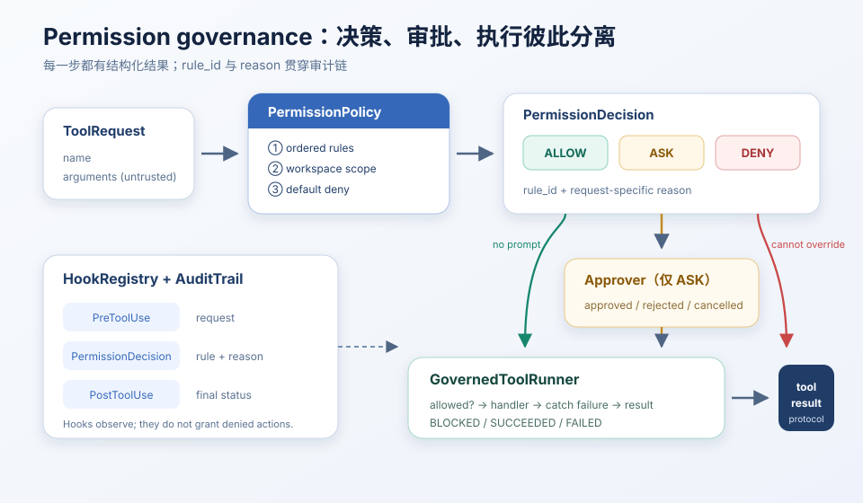
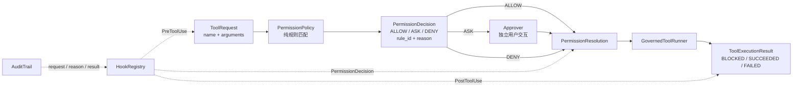

# 权限与 Hooks：先决策，再审批，再执行

> *先划边界，再给自由。*
>
> **Harness 层**：把模型提出的动作变成可解释、可审批、可审计的执行结果。

s03 管「工具说明书能不能看见」；s04 管「选中工具后，Harness 是否允许跨入本地执行」。  
核心不是危险词越列越多，而是把治理拆成三个可测试阶段，且每条决定都带稳定的 `rule_id` 与面向人的 `reason`——审计要能回答「哪条规则、为什么、用户是否批准、工具最终怎样结束」，而不是一句模糊的 `permission denied`。

> 可跑代码：[`tracks/harness/s04_permission_hooks`](../../tracks/harness/s04_permission_hooks/)（`python3 …/code.py --demo`）  
> 配图：同目录 `images/s04-permission-hooks.svg`（源自章节教案）。
## 你将会得到什么

1. 脑子里有「安检三岗 + 旁路摄像头」总图，能自己串一遍  
2. 掌握核心数据契约：`ToolRequest` / `Decision` / `Resolution` / `ToolExecutionResult`  
3. 会看有序规则、默认拒绝、工作区作用域、bash 克制分类  
4. 明白 DENY 不可被审批覆盖、Hook 不提权、BLOCKED ≠ FAILED、权限失败如何回到 agent loop  

---

## 先装进脑子的总图

```text
模型想调工具
    │
    ▼
① 规则岗 Policy     decide(...)
    │                 按规则表从上到下贴牌
    │                 → ALLOW / ASK / DENY（rule_id + reason）
    ▼
② 窗口岗 Approval   resolve_permission(...)
    │                 只有 ASK 才问人
    │                 ALLOW / DENY 都不触发交互
    │                 → permission：allowed + approval_status
    ▼
③ 执行岗 Execution  GovernedToolRunner
    │                 allowed 为假 → BLOCKED（不调 handler）
    │                 为真 → handler → SUCCEEDED / FAILED
    ▼
旁路摄像头 Hook      录像与审计；不能把 DENY 改成放行
```

可复述短段：

> 先 **`decide`** 得到 decision → 再 **`resolve`** 得到带 **`allowed`** 的 permission。只有 **ASK** 才问人；**DENY** 不问且 `allowed=False`。为假则 **BLOCKED**；为真才调用工具。**Hook** 只记账；改权限改规则表。

教案里的三句定义：

1. `PermissionPolicy.decide()` 只做规则匹配，输出 `ALLOW / ASK / DENY`；  
2. `resolve_permission()` 只为 `ASK` 请求用户意见，`ALLOW / DENY` 不触发交互；  
3. `GovernedToolRunner.run()` 根据解析结果决定是否调用 handler，并统一返回执行结果。  

---

## 零基础名词表

### ToolRequest

| 层 | 说明 |
|----|------|
| **是什么** | 进入治理层前，把 provider 的 tool-use 归一化成的中性结构 |
| **在本文干什么** | Policy / Runner / Hook 都认这一份，不直接啃 SDK 对象 |
| **怎么区分** | `arguments` 先标成不可信 `object`——校验前不能假设一定是字典 |

### Policy / `decide`（规则岗）

| 层 | 说明 |
|----|------|
| **是什么** | 纯规则匹配引擎 |
| **在本文干什么** | 产出 `PermissionDecision` |
| **怎么区分** | **不问人、不跑工具**；CLI / 桌面 / 测试共用同一 Policy，只换 `Approver` |

### Approval / `resolve`（窗口岗）

| 层 | 说明 |
|----|------|
| **是什么** | `resolve_permission(decision, approver)` |
| **在本文干什么** | 产出 `PermissionResolution` |
| **怎么区分** | 只在 ASK 调回调；Policy **不认识**任何一种 UI |

### Execution / Runner（执行岗）

| 层 | 说明 |
|----|------|
| **是什么** | `GovernedToolRunner.run()` |
| **在本文干什么** | BLOCKED / 调 handler / 捕获异常；`to_protocol_block()` 回灌 loop |
| **怎么区分** | 不偷偷改权限结论 |

### `decision` vs `permission`（易混）

| 盒子 | 谁造的 | 内容 |
|------|--------|------|
| **decision** | `decide` | `action` / `rule_id` / **`reason`（已在这里）** |
| **permission** | `resolve` | 包住 decision + **`allowed`** + **`approval_status`** |

### Hook / AuditTrail

| 层 | 说明 |
|----|------|
| **是什么** | 生命周期扩展点 + 审计记录 |
| **在本文干什么** | 观察、指标、告警、事后处理 |
| **怎么区分** | **不能**把拒绝改成允许；内存审计便于教学，持久防篡改是更后章 |

---

## 为什么必须拆开三个阶段

旧写法把规则判断、`input()` 和 handler 塞进同一个 pre-tool hook，会有三个问题：

- 单元测试规则时被迫模拟交互；  
- `deny`、用户拒绝和 handler 失败都变成相似字符串；  
- 审计只能看到最终结果，无法复原决策依据。  

| 阶段 | 输入 | 输出 | 明确不做 |
|------|------|------|----------|
| Policy | `ToolRequest` | `PermissionDecision` | 不询问用户，不执行工具 |
| Approval | `PermissionDecision` | `PermissionResolution` | 不重新匹配规则，不调用 handler |
| Execution | `PermissionResolution` | `ToolExecutionResult` | 不偷偷改变权限决定 |

这样 CLI、桌面弹窗和自动化测试都能复用同一个 policy：它们只需要注入不同 `Approver` 回调。

---

## 架构图



教案架构（含 AuditTrail）：



---

## 核心数据契约

### ToolRequest

```python
@dataclass(frozen=True)
class ToolRequest:
    tool_use_id: str
    name: str
    arguments: object  # 校验前不可信
```

Provider 的 tool-use block 进入治理层时先归一化。`arguments` 故意保留为 `object`。

### PermissionDecision

```python
@dataclass(frozen=True)
class PermissionDecision:
    request: ToolRequest
    action: PermissionAction
    rule_id: str
    reason: str
```

| Action | 含义 | 下一步 |
|--------|------|--------|
| `ALLOW` | 已命中显式安全规则 | 不询问，允许执行 |
| `ASK` | 无法证明无副作用，或需要知情同意 | 进入独立审批层 |
| `DENY` | 明确禁止、越界、输入不适合安全判断，或无规则覆盖 | **不可**由审批回调覆盖 |

`rule_id` 稳定，适合指标聚合与回归断言；`reason` 带当次请求解释，适合 UI 和审计。两者缺一不可。

为何不是一个 `is_allowed: bool`？因为「不需要审批地允许 / 需要用户同意 / 系统不可覆盖地拒绝」是三种治理语义；布尔值也无法表达用户拒绝与系统拒绝的差别。

### PermissionResolution

保留原始 decision，并增加：

- `allowed`：最终是否允许进入 handler；  
- `approval_status`：`not_required` / `approved` / `rejected` / `cancelled`。  

因此「规则直接拒绝」和「规则要求审批但用户拒绝」不会被压成同一个布尔值。

### ToolExecutionResult

| Status | 是否调用 handler | 典型原因 |
|--------|----------------:|----------|
| `BLOCKED` | 否 | policy deny、用户拒绝或取消 |
| `SUCCEEDED` | 是 | handler 正常返回 |
| `FAILED` | 可能 | handler 缺失或抛出异常 |

`to_protocol_block()` 会把 `BLOCKED` / `FAILED` 编码成 provider 可识别的 **error tool result**。权限失败成为 agent loop 的**数据**，而不是拆掉循环的异常控制流。

---

## 代码主开关与 Agent loop

Agent loop 侧极简：

```python
request = ToolRequest.from_block(block)
result = RUNNER.run(request)
protocol_results.append(result.to_protocol_block())
```

Loop **不再**自己拼权限字符串，也**不直接**读审批输入；只接收结构化结果并继续 provider 协议。

`GovernedToolRunner` 内部顺序固定：

```text
emit PreToolUse
→ policy.decide
→ resolve_permission
→ emit PermissionDecision
→ blocked：不调用 handler
→ allowed：执行 handler，捕获异常
→ emit PostToolUse
→ 返回 ToolExecutionResult
```

```python
decision = self.policy.decide(request)                 # ① 规则岗
permission = resolve_permission(decision, self.approver)  # ② 窗口岗
if not permission.allowed:
    return ... status=BLOCKED ...                      # 手不动
# ③ 才 handler；异常 → FAILED
```

口诀：**先 `decision`，再 `permission`，再看 `allowed`。**

---

## 有序规则与默认拒绝

`first-match-wins`；**顺序本身就是安全语义**。硬拒绝必须先于普通 bash 审批；路径越界必须先于工作区内读写规则。

```text
1. bash.hard_deny                 → DENY
2. path.outside_workspace        → DENY
3. path.read_allow               → ALLOW
4. path.write_requires_approval  → ASK
5. bash.requires_approval        → ASK
6. default.deny                  → DENY（没有规则命中）
```

| 想做什么 | 命中 | 结果 |
|----------|------|------|
| `sudo id` | hard_deny | deny（不问） |
| `ls` | bash.requires_approval | ask |
| 读区内文件 | path.read_allow | allow |
| 写区内文件 | path.write_requires_approval | ask |
| 未登记 `weather` | default.deny | deny |

若把 bash ASK 挪到 hard_deny 前：`sudo` / 递归强删可能被降级成「询问后可执行」。

### 为什么默认拒绝

```python
return PermissionDecision(
    request,
    PermissionAction.DENY,
    "default.deny",
    f"no permission rule matched tool {request.name!r}",
)
```

新增 handler 却忘记补权限规则时，默认放行会悄悄扩大 agent 权限；默认拒绝会在测试或首次调用中明确暴露缺口。  
**Fail-closed** 不是「所有动作都拒绝」，而是「每一种可执行动作都必须有显式治理路径」。

---

## 工作区路径作用域

文件工具在规则匹配前先经过 `WorkspaceScope`：

```text
用户参数
→ 相对路径拼接 workspace root
→ resolve(strict=False)
→ 是否仍位于 workspace root 下？
→ inside: 继续匹配读/写规则
→ outside / resolution error: DENY
```

覆盖三类常见越界：

- `../outside/secret.txt` 路径穿越；  
- `/etc/hosts` 绝对外部路径；  
- `workspace/link/...` 中符号链接实际指向工作区外。  

`strict=False` 允许检查**尚未创建**的目标文件，同时会解析已存在的父级符号链接。`glob` 检查第一个 wildcard **之前**的静态路径前缀（例如 `../outside/*.txt` 在展开前就被拒）。

这仍然只是 **preflight**。检查完成到 handler 使用路径之间可能变化；生产还需容器、系统沙盒、受限 FD 等关闭 **TOCTOU** 与间接执行风险。

写工作区为何也要 ASK？路径在允许范围内只说明没有越界，不说明用户同意内容被修改——**Scope 与 consent 是两个维度**。

---

## Bash 的 allow / ask / deny

命令字符串不是可靠的沙盒语言，本章只做克制分类：

- `sudo`、递归强制删除、格式化、关机重启、典型 `dd` 设备写入 → **DENY**；  
- 其他所有 shell 请求 → **ASK**；  
- 真正需要自动读取时，用受 `WorkspaceScope` 保护的 `read_file` / `glob` → **ALLOW**。  

原因：首 token 不能证明路径和副作用——`cat /etc/passwd` 会越过文件工具的 workspace scope；`git diff --no-index` 可读任意路径；看似只读的命令还可通过重定向、管道、别名或脚本产生副作用。  
与其维护容易被误解的「安全 shell 列表」，本章把自动读取能力放在结构化文件工具中。

> 字符串与正则规则是**安全带，不是沙盒**。它不能完整理解 shell AST、脚本间接调用、解释器代码、竞态和系统调用。

---

## 用户审批为何不能覆盖 DENY

```python
def resolve_permission(decision, approver):
    if decision.action is ALLOW:
        return allowed_without_prompt
    if decision.action is DENY:
        return blocked_without_prompt   # 不调用 approver
    return approved_or_rejected(approver(decision))
```

`Approver` 只在 `ASK` 分支被调用。硬拒绝、路径越界、非法输入与默认拒绝都不会弹出「是否继续」——弹窗本身会暗示用户有权覆盖系统边界。

CLI 用 `console_approver()`；桌面可换成模态框；测试用 `lambda`。**Policy 不认识任何一种 UI。**

教学实验：`sudo` + approver 永远返回 True → 仍 `allowed=False`，`approval_status=not_required`，approver **调用次数 = 0**。

---

## Hook 生命周期与审计

权限是显式流水线；Hook 是生命周期扩展点：

| Hook | Payload | 用途 |
|------|---------|------|
| `PreToolUse` | `ToolRequest` | 记录原始请求、指标 |
| `PermissionDecision` | `PermissionResolution` | 记录规则、理由与审批结果 |
| `PostToolUse` | `ToolExecutionResult` | 记录 blocked/succeeded/failed、输出告警 |
| `UserPromptSubmit` | 用户文本 | 输入侧观测或过滤扩展 |
| `Stop` | 无 | 会话统计与清理 |

本章 Hook **不负责**把拒绝变成允许。授权路径保持显式；扩展负责观察、审计和后处理，避免第三方扩展成为隐蔽的权限提升入口。

`AuditTrail` 每次工具调用三类记录（教学用内存；持久化与防篡改审计链是后续章）：

```text
request     tool=write_file
permission  tool=write_file rule=path.write_requires_approval
            reason="write_file mutates workspace content..." outcome=approved
result      tool=write_file rule=... outcome=succeeded
```

---

## 失败路径

| 场景 | Decision / Result | 审计价值 |
|------|-------------------|----------|
| 未知工具 | `DENY / BLOCKED`，`default.deny` | 暴露漏配 policy |
| 参数不是 object | `DENY / BLOCKED`，`request.invalid_arguments` | 无法安全判断时 fail closed |
| 路径逃逸 | `DENY / BLOCKED`，`path.outside_workspace` | 记录目标与作用域 |
| 写入工作区且批准 | `ASK → approved → SUCCEEDED` | 区分策略与用户意图 |
| 写入工作区但拒绝 | `ASK → rejected → BLOCKED` | 证明 handler 未执行 |
| handler 抛异常 | `ALLOW/approved → FAILED` | 与权限拒绝分开统计 |
| 审批时 EOF / Ctrl-C | `ASK → cancelled → BLOCKED` | 默认安全退出 |

---

## 自己怎么跑、测什么（概念）

离线教学入口通常是章节脚本的 `--demo`；连真模型则走正常入口（需配置）。可观察：

1. 读工作区文件 → `path.read_allow`；  
2. 写工作区文件 → 独立审批；  
3. 读 `../outside.txt` → 路径作用域拒绝；  
4. 执行 `ls` → bash 默认进入审批；  
5. 递归强制删除 → 不可覆盖的 hard deny。  

专项测试固定的治理契约包括：hard deny 带理由；未匹配默认拒绝；穿越/绝对路径/符号链接逃逸被拒；policy 纯决策不偷偷提示；shell 不凭首 token 自动放行；deny 不可被 approval 覆盖；审计同时保存 rule/reason/审批 outcome/执行 status；blocked 与 handler failed 都编码成 tool result；OS 异常不拆教学脚本。

---

## 面试级自问（教案原题）

**为什么不是一个 `is_allowed: bool`？**  
三种治理语义不同；布尔分不清用户拒绝与系统拒绝。

**为什么 `rule_id` 和 `reason` 都要？**  
前者稳定便于统计和测试；后者带本次上下文，便于 UI 与事故复盘。

**为什么写工作区也要 ASK？**  
Scope ≠ consent。

**为什么 Hook 不直接控制权限？**  
观测与扩展生命周期可以；若扩展能把 deny 改成 allow，授权事实源不可追踪。显式 policy pipeline 更好审计。

**这套实现还不是生产沙盒的原因？**  
没有 shell AST、进程/网络/系统调用隔离、完整参数 schema 验证、持久审批授权、TOCTOU 防护和防篡改审计。它提供的是 **Harness 治理契约**，不宣称替代 OS 安全边界。

---

## 边界与小结

**做了：** 三阶段契约、数据模型、有序规则与默认拒绝、工作区作用域、bash 克制分类、DENY 不可覆盖、Hook/审计、失败路径与 loop 回灌。  

**没做：** 生产级沙盒与防篡改审计链。

```text
decide 盖章 → resolve 问人（仅 ASK）→ allowed 才动手。
DENY 不问；Hook 只录像；改权限改规则表。
BLOCKED = 没进门；FAILED = 进门后摔了。
安全带 ≠ 沙盒。
```
