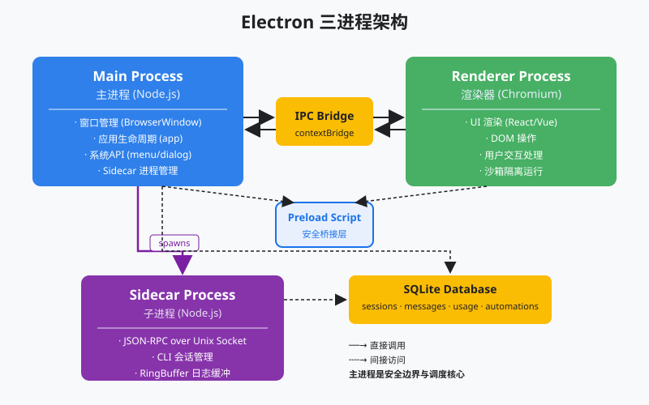
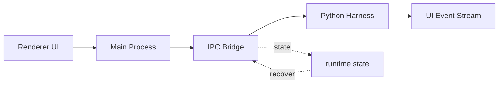
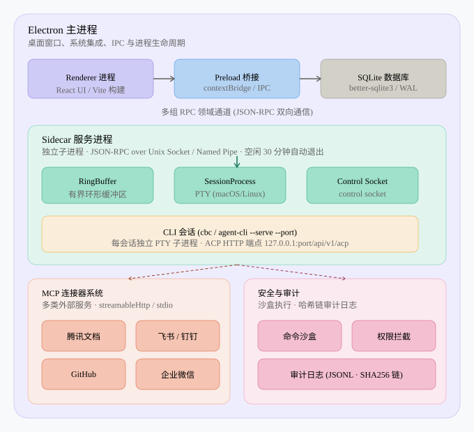

# Electron Shell：一个进程不够，要三个

> *一个进程不够，要三个* — Main / Renderer / Preload，IPC 桥接。
>
> **Harness 层**：进程架构 — 桌面应用的基础骨架。

s01–s04 的 agent 可以挤在单个 Python 进程里（CLI 够用）。桌面 AI 助手不行：UI 要流畅、网页不能直接摸磁盘、关窗不能连坐杀死 agent。  
本章用 Electron 的三进程模型讲清**壳怎么分层**；教学版用 Python `multiprocessing` + 队列模拟 IPC。

> 配图：`images/s05-electron-arch.svg` · `images/s05-process-architecture.svg`

## 你将会得到什么

1. 脑子里有「三层楼」：前台 / 对讲 / 管家，以及双向对讲怎么走  
2. 分清 IPC、窄接口、进程 vs 线程  
3. 能对照教学代码说出 Queue 如何模拟 IPC  
4. 知道 Main 是 lifecycle/router，真大脑在 Sidecar（下章）  

---

## 零基础名词表

### IPC（Inter-Process Communication）

| 层 | 说明 |
|----|------|
| **是什么** | 进程间通信：独立进程内存分开，只能「递纸条」不能直接调对方函数 |
| **在本文干什么** | Renderer ↔ Main 传消息；教学里纸条 = `multiprocessing.Queue` |
| **怎么区分** | 同进程函数调用 ≠ IPC；跨进程必须走通道 |

### Main / Renderer / Preload

| 词 | 人话（三层楼） | 能力 |
|----|----------------|------|
| **Renderer** | 3 楼前台：画 UI | 像浏览器，不该直接 FS / shell |
| **Preload** | 2 楼对讲机：只通固定口令 | 白名单 API（窄接口） |
| **Main** | 1 楼管家：开窗、路由、管子进程 | 完整系统侧能力 |

### 窄接口 / 白名单

| 层 | 说明 |
|----|------|
| **是什么** | 只暴露少量意图清楚的方法（如 `sendMessage`），没有 `fs` / 任意 `runShell` |
| **在本文干什么** | 即使 UI 被 XSS，也只能走已开的门；敏感操作仍到 Main（还可再过 s04 权限） |
| **怎么区分** | API 太宽 = 变相远程执行，进程隔离形同虚设 |

### Process vs Thread

| 层 | 说明 |
|----|------|
| **进程** | 各自内存；崩一个可以不拖死另一个；UI 与长任务可分开 |
| **线程** | 同进程共享内存；一个忙/崩，常拖垮整屋 |

### Sidecar（边车）

| 层 | 说明 |
|----|------|
| **是什么** | Main 拉起的子进程，跑 agent「大脑」 |
| **在本文干什么** | 真架构里长任务在这；本章教学为省事暂把 loop 写在 Main（代码有注释） |
| **怎么区分** | Main = 壳/路由；Sidecar = 大脑（s06 展开） |

---

## 先装进脑子的总图（三层楼）

```text
┌─────────────────────────┐
│  3楼  Renderer = 前台    │  只能接待、按对讲
│       （画界面）          │  不能自己开保险柜（FS/shell）
├─────────────────────────┤
│  2楼  Preload  = 对讲机  │  只通白名单口令（窄接口）
│       （IPC 桥）          │
├─────────────────────────┤
│  1楼  Main     = 管家    │  接对讲、管窗、派人
│                           │  真大脑以后在旁屋 Sidecar
└─────────────────────────┘

请示：前台 → 对讲 → 管家
回话：管家 → 对讲 → 前台
两边都不能直接调用另一层的函数名。
```

单进程三痛点（六个字：**不卡、隔离、别连坐**）：

1. **UI 不能卡** — agent 跑 30 秒时窗口还要能动  
2. **安全隔离** — 渲染器（网页）不能直接访问文件系统  
3. **生命周期** — 关窗 ≠ 杀 agent；agent 崩 ≠ 杀 UI  

同进程双线程 → UI 更容易被拖死；**分进程** → UI 才不容易卡。

---

## 架构图





更完整的桌面拓扑（Main → Sidecar / CLI / MCP / 审计，后续章拆）：



```text
┌──────────────────────────────────────────────────┐
│                  Electron App                     │
│  Main ◄──IPC/Preload──► Renderer                 │
│    │ spawn                                        │
│    ▼                                              │
│  Sidecar (s06)                                    │
└──────────────────────────────────────────────────┘
```

---

## 学习前置与本章机制

**前置：**

- Electron 至少有 main、renderer、preload 三类边界  
- Renderer 负责 UI，不应直接拿文件系统和进程权限  
- IPC 的价值是把能力暴露成窄接口  

**本章抓住的机制：**

- 用 Python 多进程模拟桌面 shell 的隔离边界  
- 展示 UI 不被 agent 长任务阻塞的原因  
- 把主进程定位成 lifecycle/router，而不是 agent loop 本体  

**常见误区：**

- 把所有能力塞进 renderer = 把安全边界交给前端页面  
- 把桌面进程和 agent 进程绑死 → 崩溃恢复困难  
- IPC API 太宽 → 变相远程执行接口  

---

## 解决方案：三个角色

| 进程 | 职责 | 能力 |
|------|------|------|
| **Main** | 窗口管理、系统 API、Sidecar 管理 | 完整 Node.js + 原生 API |
| **Renderer** | UI 渲染（HTML/CSS/JS） | 受限的浏览器环境 |
| **Preload** | 桥接 Main 和 Renderer | 受控的 Node.js API 暴露 |

---

## 工作原理

### IPC + Preload 窄接口

真 Electron：

```javascript
const { contextBridge, ipcRenderer } = require('electron')

contextBridge.exposeInMainWorld('workbuddy', {
    sendMessage: (text) => ipcRenderer.invoke('agent/send', text),
    onResponse: (callback) => ipcRenderer.on('agent/response', callback),
    listSessions: () => ipcRenderer.invoke('session/list'),
    // 没有 fs、child_process、require…
})
```

Renderer 只调 `window.workbuddy.sendMessage(...)`；IPC 到 Main，再路由到 Sidecar / CLI。  
若 preload 再开 `runShell(cmd)` 透传任意命令 → **不算窄接口**，隔离被拆掉。

### 教学版模拟（对着 `code.py`）

| Electron | 本章模拟 |
|----------|----------|
| IPC | `mp.Queue` |
| Main | `mp.Process(target=main_process)` |
| Renderer | `renderer_process`（当前进程当终端 UI） |
| Preload | `PreloadBridge`（只暴露白名单方法） |

**Renderer 要 Main 干活：只往队列塞消息，不直接调用 `main_process`。**

#### 1）Preload = 对讲机（窄接口）

```python
class PreloadBridge:
    """模拟 contextBridge：Renderer 只能调用这里列出的方法。"""

    def __init__(self, send_queue: mp.Queue, recv_queue: mp.Queue):
        self._send = send_queue   # 前台 → 管家
        self._recv = recv_queue   # 管家 → 前台

    def send_message(self, text: str) -> str:
        """IPC：递纸条给 Main，再阻塞等回条。"""
        self._send.put({"type": "agent/message", "data": text})
        result = self._recv.get()  # 等 Main 处理完
        return result.get("data", "")

    def list_sessions(self) -> list:
        self._send.put({"type": "session/list"})
        return self._recv.get().get("data", [])

    def ping(self) -> str:
        self._send.put({"type": "ping"})
        return self._recv.get(timeout=5).get("data", "")
    # 没有 run_shell / 没有直接 open 文件 —— 这才叫窄
```

#### 2）Main = 管家（收纸条、办事、回纸条）

```python
def main_process(recv_queue, send_queue, renderer_queue):
    # … 准备 client / tools（教学版）…
    while True:
        msg = recv_queue.get()          # 阻塞等前台对讲
        if msg is None:
            break
        msg_type = msg.get("type")

        if msg_type == "ping":
            send_queue.put({"type": "pong", "data": "main alive"})

        elif msg_type == "session/list":
            send_queue.put({"type": "result", "data": list(sessions.keys())})

        elif msg_type == "agent/message":
            # 真 WorkBuddy：这里应转调 Sidecar
            # 教学版：为省事直接在 Main 里跑 agent loop
            text = msg["data"]
            # … messages.create / tool_use / bash …
            send_queue.put({"type": "result", "data": final_text})
```

#### 3）Renderer = 前台（只用桥，不碰系统）

```python
def renderer_process(send_queue, recv_queue):
    """
    等价 Electron Renderer。
    这里不能直接：访问文件系统 / 执行 shell / 当 Node 用。
    只能：PreloadBridge 上的白名单 API。
    """
    bridge = PreloadBridge(send_queue, recv_queue)
    print(bridge.ping())  # 先确认管家还活着

    while True:
        query = input("s05 >> ")
        if query.strip().lower() in ("q", "exit", ""):
            break
        # 关键：不调用 main_process(...)，只走桥
        result = bridge.send_message(query)
        print(result)

    send_queue.put(None)  # 通知 Main 收工
```

#### 4）入口：两根对讲线 + 拉起子进程

```python
if __name__ == "__main__":
    renderer_to_main = mp.Queue()   # 前台 → 管家
    main_to_renderer = mp.Queue()   # 管家 → 前台

    main_proc = mp.Process(
        target=main_process,
        args=(renderer_to_main, main_to_renderer, None),
        name="MainProcess",
    )
    main_proc.start()               # 管家住进独立进程

    try:
        renderer_process(renderer_to_main, main_to_renderer)  # 本进程当 UI
    finally:
        renderer_to_main.put(None)
        main_proc.join(timeout=5)
        if main_proc.is_alive():
            main_proc.terminate()
```

数据流（用户打字时）：

```text
input → bridge.send_message
     → renderer_to_main.put({type: agent/message})
     → main_process 里 get →（教学）跑 loop → put 结果
     → bridge._recv.get → print
```

### 为什么不用线程

线程共享内存——一个线程崩溃常带掉整个进程。进程隔离意味着：

- Renderer 崩溃 → Main 可重建窗口  
- Agent 长时间运行 → UI 不被阻塞  
- 渲染器被攻击 → 无直接文件系统 API  

**进程边界就是安全边界。**

### Main Process 的职责（真桌面壳）

1. 窗口管理 — 创建、销毁、恢复  
2. Sidecar 生命周期 — 启动、监控、重启  
3. 系统集成 — 托盘、全局快捷键、文件关联  
4. RPC 路由 — 多组领域化 JSON-RPC  
5. MCP 连接器管理  
6. 自动化调度  

---

## 相对 s04 的变更

| 组件 | s04 | s05 |
|------|-----|-----|
| 进程模型 | 单进程 | 三进程 (main/renderer/preload) |
| 通信方式 | 函数调用 | IPC（消息队列） |
| UI 阻塞 | agent 跑时 UI 易卡 | UI 独立进程 |
| 安全隔离 | 无进程级 UI 隔离 | Renderer 不能直接 FS |
| 崩溃恢复 | 整体崩溃 | 进程级隔离 |

s04 讲「允不允许执行」；s05 讲「执行发生在哪一层壳里」。权限规则再严，也替代不了进程边界。

---

## 试一下（概念）

```bash
# 私人沙盒或公开切片目录下
python3 s05_electron_shell/code.py --demo   # 离线看本章在链路中的位置
# 配好 Key 后可交互：
python3 s05_electron_shell/code.py
```

观察：Main 与 Renderer 是否独立进程；长任务时 UI 是否仍可操作；一侧崩溃另一侧是否还能活。

---

## Clean-room 视野（不要求手撕）

**Preload 安全模型：** 只挂白名单；XSS 也不能直接 FS——敏感操作必须 IPC → Main（+ 权限）。  

**多窗口 vs 多会话：** 窗口是 UI 容器；会话是 agent 运行实例（独立 messages / cwd / 工具池）。每个 Session 对应 CLI 子进程（s07）。  

**多组 RPC 领域：** session / tool / memory / mcp / skill / automation… 分模块 `ipcMain.handle`，渲染器 `invoke`。  

生产 Main 入口还会注册协议处理器、全局快捷键、MCP 池等——本章只要求建立三进程 + IPC 心智。

---

## 边界与下一课

**做了：** 三进程边界、IPC 窄接口、进程 vs 线程、Python 模拟、Main = 壳不是大脑。  

**没做：** 真 Electron 打包；Sidecar JSON-RPC / RingBuffer（s06）；多会话 CLI（s07）。

```text
前台 → 对讲(IPC) → 管家；回话反过来。
窄接口；分进程才不卡。
真大脑在 Sidecar；本章 loop 暂放 Main 仅为教学。
```

下一课：**s06 Sidecar Server** — JSON-RPC、RingBuffer、多会话生命周期。
