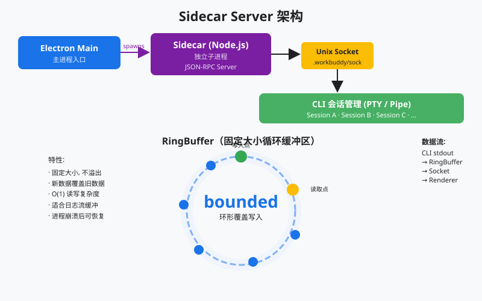
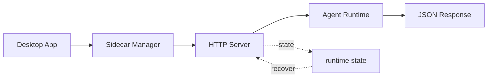

# Sidecar Server：主进程不跑 agent，Sidecar 来跑

> *主进程不跑 agent, Sidecar 来跑* — JSON-RPC over Unix Socket，有界 RingBuffer。
>
> **Harness 层**：进程架构 — agent 的宿主进程。

s05 解决了 UI 不卡（三层楼）。还没回答：**agent 跑在哪？**  
若塞进 Main：崩窗、抢资源、难热更新。WorkBuddy 把大脑拆到独立 **Sidecar**；Main 只管窗口与系统集成；两者用本机 socket 上的 **JSON-RPC** 说话；近期日志进 **RingBuffer**（不是审计库）。

> 配图：`images/s06-sidecar-arch.svg`

## 你将会得到什么

1. 能讲清为何 agent 不能长住 Main（崩溃连带 / 资源争抢 / 更新困难）  
2. 分清控制面（Sidecar）与执行面（Session，细节在 s07）  
3. 能指着代码说 JSON-RPC 一来一回（`method` / `id`）与 RingBuffer 覆盖旧数据  
4. 知道教学版用 `socketpair` + 线程模拟真 Unix socket 子进程  

---

## 零基础名词表

### Sidecar（边车 / 宿主）

| 层 | 说明 |
|----|------|
| **是什么** | Main 旁的独立进程，做 agent 控制面 |
| **在本文干什么** | 听 RPC、管会话生命周期、抓日志、路由到工具/记忆等 |
| **怎么区分** | Main = 壳/窗口；Sidecar = 宿主；Session CLI = 单会话执行（s07） |

### JSON-RPC

| 层 | 说明 |
|----|------|
| **是什么** | 用 JSON 描述「调哪个方法、带什么参数、用 id 对响应」的远程调用约定 |
| **在本文干什么** | Main ↔ Sidecar 的纸条格式；换行分隔一条消息 |
| **怎么区分** | 与 s05 IPC 同属「隔墙说话」；IPC 管 UI↔Main，JSON-RPC 管 Main↔Sidecar |

### Unix Domain Socket

| 层 | 说明 |
|----|------|
| **是什么** | 本机进程间通道（常表现为一个 sock 文件），不走网卡 |
| **在本文干什么** | 生产里 Main 连 `/tmp/...sock`；教学用 `socketpair()` 一对已连好的本机 socket |
| **怎么区分** | 比 TCP 轻（不经网络栈）；比单纯 pipe 更适合多连接、双向 RPC |

### RingBuffer（环形缓冲区）

| 层 | 说明 |
|----|------|
| **是什么** | 固定大小的循环写缓冲；满了覆盖最旧数据 |
| **在本文干什么** | 抓近期 stdout/stderr，方便重连/排障回看 |
| **怎么区分** | ≠ 数据库、≠ 永久审计日志；长期留存另存 |

### 控制面 vs 执行面

| 词 | 人话 |
|----|------|
| **控制面（Sidecar）** | 谁在、启停、路由、抓日志 |
| **执行面（Session）** | 某一个会话里真正跑 agent loop（多在独立 CLI） |

---

## 先装进脑子的总图

```text
┌─────────────────────────────────────────────────┐
│                 Electron App                     │
│  Renderer ──IPC──► Main（窗口 / 系统 / 连 Sidecar）│
│                      │                           │
│                      │  Unix Socket + JSON-RPC   │
│                      ▼                           │
│                 Sidecar（控制面）                  │
│                 · RPC 路由  · RingBuffer          │
│                 · session/sidecar/tool/…         │
│                      │ spawn                     │
│                      ▼                           │
│                 Session CLI（执行面 · s07）        │
└─────────────────────────────────────────────────┘
```

口诀：**壳（s05）→ Sidecar 宿主（s06）→ Session（s07）**。

完整链路：

```text
用户 → Renderer → IPC → Main → JSON-RPC → Sidecar → spawn → Session
用户 ← Renderer ← IPC ← Main ← JSON-RPC ← Sidecar ← ACP HTTP ← Session
```

---

## 架构图





```text
┌─────────────────────────────────────────────────────────┐
│                    Electron App                          │
│  ┌──────────────┐    Unix Socket    ┌───────────────┐  │
│  │ Main Process  │◄────JSON-RPC─────►│ Sidecar       │  │
│  │ • Window Mgmt │    /tmp/wb.sock   │ • RPC Server  │  │
│  │ • System API  │                   │ • RingBuffer  │  │
│  │ • Tray/Menu   │                   │ • Session Mgr │  │
│  └──────────────┘                   └───────┬───────┘  │
│                                              │ spawn     │
│                                              ▼          │
│                                      ┌───────────────┐  │
│                                      │ Session Proc  │  │
│                                      │ (CLI, s07)    │  │
│                                      └───────────────┘  │
└─────────────────────────────────────────────────────────┘
```

| 组件 | 职责 | 通信方式 |
|------|------|---------|
| **Main Process** | 窗口、系统集成、Sidecar 生命周期 | Unix Socket → Sidecar |
| **Sidecar** | agent 宿主、RPC 路由、日志捕获 | Unix Socket → Main; spawn → Session |
| **RingBuffer** | 有界环形缓冲，捕获 stdout/stderr | Sidecar 内部 |
| **Session Process** | 单个会话的 agent loop | ACP HTTP（s07） |

---

## 学习前置与本章机制

**前置：**

- Sidecar 是控制面，Session Runtime 是执行面  
- Unix socket / named pipe 适合本机 IPC  
- RingBuffer 解决重连与近期输出捕获，不是永久日志  

**本章抓住的机制：**

- JSON-RPC over 本机 socket 模拟 Main ↔ Sidecar  
- RingBuffer 保存最近输出（reconnect / capture）  
- spawn / shutdown / status 放统一控制面  

**常见误区：**

- 让 Electron Main 直接跑 agent → UI 生命周期与任务纠缠  
- 只用 stdout 管会话 → 难做 resize / kill / capture / reconnect  
- 把 RingBuffer 当数据库 → 丢掉长期审计能力  

---

## 问题：agent 放哪？

s05 解决了 UI 阻塞。若 agent 仍长住 Main：

1. **崩溃连带** — 工具抛异常 → Main 挂 → 窗口全没  
2. **资源争抢** — 大任务吃满 CPU/内存 → 窗口管理卡顿  
3. **更新困难** — 改 agent 要重启整个应用 → 用户窗口全关  

解法：独立 Sidecar；Main 与 Sidecar 用本机 JSON-RPC 通信。

---

## 工作原理

### Unix Domain Socket

生产：Sidecar `listen` 一个 sock 文件；Main `connect` 后发 JSON 行。

```javascript
const net = require('net');
const server = net.createServer((socket) => {
    handleConnection(socket);
});
server.listen(socketPath);
```

Unix Socket 比 TCP 快（不走网络栈）；比 pipe 灵活（多连接、双向）。

### JSON-RPC 消息格式

每条消息一行 JSON：

```text
{"jsonrpc":"2.0","method":"session/create","params":{"cwd":"/proj"},"id":1}
{"jsonrpc":"2.0","method":"tool/execute","params":{"name":"bash","input":{...}},"id":2}
```

响应带同一 `id`：

```text
{"jsonrpc":"2.0","result":{"sessionId":"abc123"},"id":1}
{"jsonrpc":"2.0","result":{"output":"..."},"id":2}
```

| 字段 | 作用 |
|------|------|
| `method` | 告诉 Sidecar 调哪个 handler（不是直接「对 AI 下指令」） |
| `params` | 参数 |
| `id` | 把响应和某次请求对上号 |
| `result` / `error` | 成功或失败载荷 |

### RPC 领域

| 领域 | 示例方法 | 用途 |
|------|---------|------|
| `session/*` | create, destroy, list, send | 会话生命周期 |
| `sidecar/*` | ping, status, shutdown | Sidecar 自身管理 |
| `tool/*` | execute, list, permission | 工具调用 |
| `memory/*` | getProfile, saveSettings | 记忆系统 |
| `mcp/*` | connect, disconnect, list | MCP 连接器 |
| `skill/*` | load, list, execute | Skills |
| `automation/*` | create, update, list | 定时任务 |

`method` 是查表键；只有像 `agent/send` 这类方法才会真正跑模型。

### RingBuffer — 有界环形缓冲

```text
RingBuffer (固定大小)
┌──────────────────────────────────┐
│ [old] ████████████░░░░░░ [new]  │  ← 写头追着读头跑
└──────────────────────────────────┘
     ↑ 被覆盖          ↑ 正在写
```

满了覆盖最旧数据 → 内存有界；只保证「最近一段还在」。

### PTY vs Pipe（预告 s07）

| 后端 | 用途 | 特点 |
|------|------|------|
| **PTY** | 交互式命令 | 颜色、光标、终端特性 |
| **Pipe** | 非交互式 | 更轻；适合 agent 内部工具 |

---

## 对着 `code.py` 看（教学版）

| 生产 | 本章模拟 |
|------|----------|
| Unix Domain Socket 文件 | `socket.socketpair()` |
| spawn 真子进程 Sidecar | `threading` 跑 `handle_connection` |
| newline-delimited JSON-RPC | `RPCConnection` + `json.dumps` + `\n` |
| 有界 RingBuffer | `RingBuffer` + `% size` 绕回 |

### 1）RingBuffer：写满覆盖旧数据

```python
def write(self, data: bytes | str):
    """Write data into the ring buffer, overwriting old data if full."""
    if isinstance(data, str):
        data = data.encode('utf-8')
    with self._lock:
        for byte in data:
            self.buffer[self.write_pos] = byte
            self.write_pos = (self.write_pos + 1) % self.size
            self.total_written += 1
```

### 2）RPCConnection：一行一个 JSON

```python
class RPCConnection:
    """
    - Each message is a JSON object followed by \\n
    - Requests have {jsonrpc, method, params, id}
    - Responses have {jsonrpc, result, id} or {jsonrpc, error, id}
    """

    def send_message(self, msg: dict):
        data = (json.dumps(msg) + "\n").encode('utf-8')
        self.sock.sendall(data)

    def recv_message(self) -> dict | None:
        while b"\n" not in self._recv_buffer:
            chunk = self.sock.recv(65536)
            if not chunk:
                return None
            self._recv_buffer += chunk
        line, self._recv_buffer = self._recv_buffer.split(b"\n", 1)
        return json.loads(line.decode('utf-8'))
```

### 3）Sidecar：按 method 查表，用同一 id 回信

```python
def handle_connection(self, conn: RPCConnection):
    while True:
        req = conn.recv_message()
        if req is None:
            break
        method = req.get("method", "")
        params = req.get("params", {})
        req_id = req.get("id")
        handler = self.rpc_handlers.get(method)
        if handler:
            result = handler(params)
            conn.send_message({"jsonrpc": "2.0", "result": result, "id": req_id})
        else:
            conn.send_message({
                "jsonrpc": "2.0",
                "error": {"code": -32601, "message": f"Method not found: {method}"},
                "id": req_id,
            })
```

注册示例（教学裁剪版）：

```python
def _register_channels(self):
    self.rpc_handlers["sidecar/ping"] = self._handle_ping
    self.rpc_handlers["sidecar/status"] = self._handle_status
    self.rpc_handlers["sidecar/shutdown"] = self._handle_shutdown
    self.rpc_handlers["session/create"] = self._handle_session_create
    self.rpc_handlers["session/list"] = self._handle_session_list
    self.rpc_handlers["session/destroy"] = self._handle_session_destroy
    self.rpc_handlers["agent/send"] = self._handle_agent_send
    self.rpc_handlers["tool/list"] = self._handle_tool_list
    self.rpc_handlers["memory/getProfile"] = self._handle_memory_get
```

### 4）Main：只连 Sidecar、发 RPC，自己不当大脑

```python
class MainProcessClient:
    def connect(self, sidecar: SidecarServer):
        server_sock, client_sock = socket.socketpair()
        server_conn = RPCConnection(server_sock)
        threading.Thread(
            target=sidecar.handle_connection,
            args=(server_conn,),
            daemon=True,
        ).start()
        self.conn = RPCConnection(client_sock)

    def call(self, method: str, params: dict = None) -> dict:
        self._rpc_id += 1
        req = {"jsonrpc": "2.0", "method": method,
               "params": params or {}, "id": self._rpc_id}
        self.conn.send_message(req)
        return self.conn.recv_message()
```

生产意图写在 agent loop 注释里——真机是 Sidecar **spawn CLI**，本章为简单可 inline：

```python
def _run_agent_loop(self, session: dict, user_text: str) -> str:
    """
    The actual agent loop. In WorkBuddy, this runs in a separate
    CLI session process (s07). Here we run it inline for simplicity.
    Production harness: Sidecar spawns a CLI process per session,
    communicates via ACP HTTP endpoints.
    """
```

### 5）入口观察点

`main()`：起 Sidecar → Main `connect` → `sidecar/ping` → `session/create` → 交互里还可 `/status` `/sessions` `/logs`（读 RingBuffer）。

---

## WorkBuddy 对照（生产草图）

```javascript
class SidecarServer {
    constructor() {
        this.ringBuffer = new RingBuffer(fixedLimit);
        this.sessions = new Map();
        this.rpcHandlers = new Map();
        this.registerChannels();
    }
    start(socketPath) {
        this.server = net.createServer((socket) => this.handleConnection(socket));
        this.server.listen(socketPath);
    }
}
```

Main spawn Sidecar：

```javascript
const socketPath = `/tmp/workbuddy-sidecar-${process.pid}.sock`;
const sidecarProc = spawn(process.execPath, [sidecarEntry, '--socket', socketPath], {
    stdio: ['pipe', 'pipe', 'pipe']
});
const client = net.createConnection(socketPath);
```

---

## 相对 s05 的变更

| 组件 | s05 | s06 |
|------|-----|-----|
| 焦点 | 三进程 UI 壳 + IPC | agent 宿主 + JSON-RPC + RingBuffer |
| Main 角色 | 管家 / 路由（教学仍可能 inline loop） | 明确不跑大脑；连 Sidecar |
| 通信 | Renderer↔Main：IPC/Queue | Main↔Sidecar：JSON-RPC |
| 日志 | 未强调有界缓冲 | RingBuffer 近期捕获 |
| 下一层 | 指向 Sidecar | 指向 Session CLI（s07） |

---

## 试一下

```bash
# 私人沙盒或公开切片目录下
python3 s06_sidecar_server/code.py --demo   # 离线：继承/新增/保留
# 配好 Key 后可交互（ping / session / agent/send /logs）：
python3 s06_sidecar_server/code.py --provider deepseek
```

观察：

- 「本章新增」是否含 sidecar control plane / JSON-RPC routing / ring buffer logs  
- 交互时请求 `id` 是否与响应配对  
- `/logs` 是否来自 RingBuffer；满了是否覆盖旧数据  

---

## Clean-room 视野（不要求手撕）

练习方向（理解即可）：

1. RingBuffer `read(since_timestamp)` — 只回指定时间之后  
2. `sidecar/status` 暴露会话数、RingBuffer 使用率（教学版已有雏形）  
3. Sidecar 崩溃后 Main 重连：重启进程、恢复会话元数据  

PTY/管道与会话状态机留给 s07。

---

## 边界与下一课

**做了：** 为何离开 Main；Sidecar 控制面；JSON-RPC；RingBuffer；教学 socketpair/线程模拟。  

**没做：** 完整 Session/CLI 生命周期、PTY/管道细节、生产 MCP 池、永久审计存储。

```text
Main 管窗；Sidecar 管宿主。
method 查表，id 对单；RingBuffer 有界覆盖，不当库。
壳 → Sidecar → Session。
```

下一课：**s07 Session Management** — PTY/管道、ACP HTTP、会话状态机。
