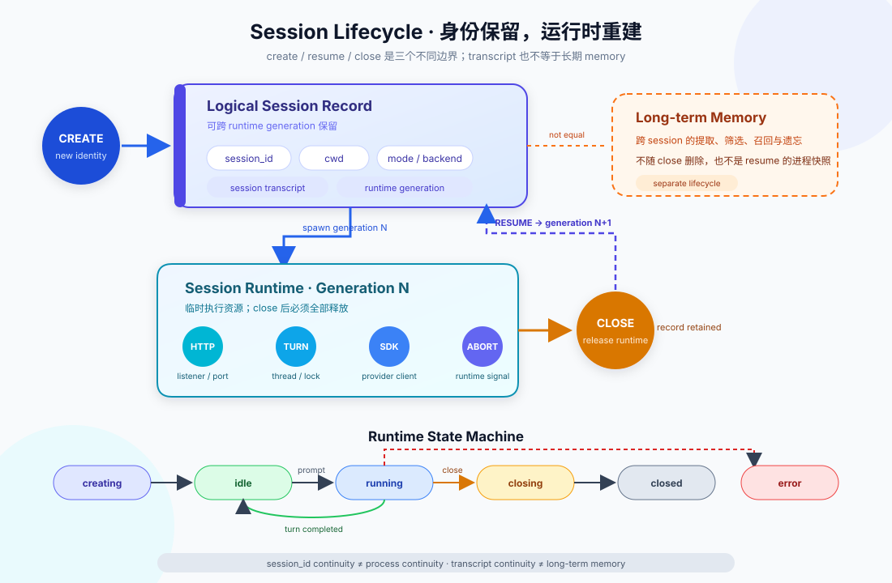
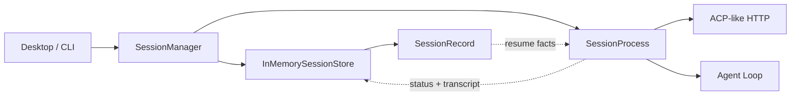

# Session Management：逻辑会话可恢复，运行时必须重建

> `session_id` 标识一段可继续的工作历史；进程、线程、端口和 provider client 只是这一时刻的运行时资源。
>
> **Harness 层**：会话生命周期、运行时隔离与恢复边界。

s06 解决了「谁来托管 Agent」（Sidecar）。本章继续向下拆：**Sidecar 如何管理多个独立工作会话**。  
核心不是「进程表里有一行」，而是分清两类对象——**可留下的档案** vs **这一代才有的车**。

> 配图：`images/s07-session-lifecycle.svg`

## 你将会得到什么

1. 能分清 `SessionRecord` 与 `SessionProcess`  
2. 能讲清 create / close / resume / forget 各改什么  
3. 知道 resume = 旧 id + 新 generation；端口会变；禁止双 live  
4. 明白 `running` ≠ 进程存活证明；transcript ≠ 长期 memory；abort ≠ close  

---

## 零基础名词表

### SessionRecord（逻辑会话记录）

| 层 | 说明 |
|----|------|
| **是什么** | 可跨 runtime 存活的「档案」：id、cwd、mode、backend、transcript、generation… |
| **在本文干什么** | close 后仍可留；resume 靠它开新一代 |
| **怎么区分** | 里面**没有**端口、线程、HTTP server、锁、provider client |

### SessionProcess（会话运行时）

| 层 | 说明 |
|----|------|
| **是什么** | 某一代 ephemeral 执行资源：HTTP、线程、端口、锁、abort、client |
| **在本文干什么** | 真正收消息、跑 turn、暴露 ACP-like HTTP |
| **怎么区分** | 只属一个 `runtime_generation`；关掉就没了，不能反序列化复活 |

### runtime_generation（运行时代数）

| 层 | 说明 |
|----|------|
| **是什么** | 同一 session id 下第几次配齐运行时（1、2、3…） |
| **在本文干什么** | 每次 resume **+1**，标志「新车」 |
| **怎么区分** | id 不变；代数变 = 换了一代 Process |

### transcript（会话抄本）

| 层 | 说明 |
|----|------|
| **是什么** | 本 session 按 turn 追加的消息与工具结果 |
| **在本文干什么** | 支持「接着这段聊」；close 可留，forget 才删 |
| **怎么区分** | ≠ 跨会话长期 Memory（无检索/遗忘策略） |

### live runtime

| 层 | 说明 |
|----|------|
| **是什么** | Manager 当前仍握着的 `SessionProcess` |
| **在本文干什么** | 判断「还活着」的权威依据 |
| **怎么区分** | store 里写着 `running` 只是上次观测，崩溃后可能撒谎 |

---

## 先装进脑子的总图

```text
SessionRecord（档案）          SessionProcess（第 N 代车）
  id / cwd / mode / backend      HTTP / 线程 / 端口
  transcript / generation        锁 / abort / provider client
        │                              │
        │  create：建档案 + 第 1 代车   │
        │  close：收车，档案留         │
        │  resume：同 id，generation+1，新车
        │  forget：先 close，再撕档案  │
        └──────────────────────────────┘
```

口诀：**档案可留；车必须重建。resume 不是冻醒旧进程。**

相对 s06：

```text
壳(s05) → Sidecar 宿主(s06) → 多会话身份与恢复(s07) → 模型路由(s08)
```

---

## 架构图





| 对象 | 生命周期 | 包含 | 不应包含 |
|------|----------|------|----------|
| `SessionRecord` | 可跨 runtime | id、cwd、mode、backend、transcript、generation | 线程、端口、HTTP、锁、client |
| `SessionProcess` | 只属一代 | listener、线程、abort、turn lock、执行入口 | 跨会话永久身份、长期 memory |

---

## 学习前置与本章机制

**相对 s06 新增：** 逻辑会话与运行时分离；create/resume/close 生命周期；ACP-like HTTP 边界。

**常见误区：**

- 把窗口/tab 当 session identity  
- 把端口当身份（resume 后端口可变）  
- close = delete  
- 从数据库 `running` 推断进程还活着  
- 把 transcript 当跨会话 memory  
- 序列化整个 runtime「冻醒」  
- 同一 id 挂两个 live runtime  

---

## 四个生命周期操作

| 操作 | 保留 id | 保留 transcript | 保留 runtime | 可 resume |
|------|:-------:|:---------------:|:------------:|:---------:|
| **create** | 新建 | 空 | 第 1 代 | — |
| **close** | 是 | 是 | **否** | 是 |
| **resume** | 是 | 是 | **新建一代** | 已恢复 |
| **forget** | **否** | **否** | 须已无 | 否 |

### Create

验证 cwd/mode/backend → 分配 id → 写入 Record → 启动第一代 Process。启动失败时记录留 `error`，不静默消失。

### Close

回收当前 generation：转 `closing` → 协作 abort → 停 HTTP → 清线程/端口 → `closed`。**幂等**；不删历史。

### Resume

加载 Record → generation **+1** → 新 HTTP/线程/端口/client。  
若已有 live runtime → 拒绝（避免双写 transcript）。

```text
Record(sess_0001, gen=1, closed)
            │ resume
            ▼
Process(sess_0001, gen=2, new port…)
```

### Forget

显式删档案；**要求先 close**。避免关窗/重启误删历史。

---

## 状态机

| 状态 | 含义 | 主要后继 |
|------|------|----------|
| `creating` | 分配 runtime | `idle` / `error` / `closing` |
| `idle` | 就绪等输入 | `running` / `closing` / `error` |
| `running` | 正在执行 turn | `idle` / `closing` / `error` |
| `closing` | 释放资源中 | `closed` / `error` |
| `closed` | 无 live runtime，档案可在 | resume → 新一代 `creating` |
| `error` | 本代失败 | `closing`，随后可 resume |

`CLOSED` 的专业含义：**运行时资源已清空**；**不是**档案/transcript 已删。

应用崩溃后记录可能仍显示 `running`——必须以 Manager 是否握有 **live runtime** 为准，再决定 reconcile / 新 generation。

---

## Transcript 不是长期 Memory

| 维度 | Session transcript | Long-term memory |
|------|--------------------|------------------|
| 作用域 | 一个 session id | 用户/项目/组织等跨会话 |
| 用途 | 继续当前对话 | 新任务召回有价值信息 |
| 读写 | 顺序追加 / 截窗口 | 提取、筛选、检索、遗忘 |
| 生命周期 | close 可留；forget 删 | 不随任一 close 自动删 |

本章恢复的是**会话连续性**；跨会话记忆与 RAG 在后续章。

---

## ACP-like HTTP 与 PTY/Pipe

每个 live Process 可听本机端口（bind `0` 由 OS 原子分配）：

```text
POST /agent/send      发用户消息
GET  /agent/status    查状态摘要
POST /agent/abort     协作式中断当前 turn
GET  /agent/messages  transcript 视图
```

Handler 只做传输解析；状态机仍在 `SessionProcess`。

| | PTY | Pipe |
|--|-----|------|
| 语义 | 更像真终端 | 普通 stdin/stdout |
| 适合 | 交互 CLI | 非交互工具 |
| 恢复 | **新建** PTY/worker | **新建** pipes/worker |

`backend` 存在 Record，只为 resume 时重新选择；fd 不能持久化复活。教学版用 `subprocess` 示意，不声称完整 PTY。

---

## abort ≠ close

| | abort | close |
|--|-------|-------|
| 目标 | 停**当前 turn** | 结束**整代 runtime** |
| 档案 | 不动 | 保留（可 resume） |
| 比喻 | 踩刹车 | 收车钥匙 |

教学里 abort 是协作式 `Event`，挡不住正在阻塞的同步 SDK 调用；生产还要 cancellation / 信号 / 超时强杀。

---

## 对着 `code.py` 看

### 1）Record：故意不放临时资源

```python
@dataclass
class SessionRecord:
    """可跨运行时重启存活的可序列化事实。

    端口、线程、HTTP server、锁、provider client、abort 标志
    故意不在这里——它们属于 SessionProcess，必须重建而非反序列化。

    messages 是本会话 transcript，用来继续这段对话；
    不是长期记忆（不跨会话检索，无相关性/留存策略）。
    """
    id: str
    cwd: str
    mode: str = MODE_CRAFT
    backend: str = "pipe"
    ...
    runtime_generation: int = 1
    messages: list[dict] = field(default_factory=list)
```

### 2）Process：握住这一代的车

```python
class SessionProcess:
    """拥有一代 ephemeral 执行资源。"""

    def __init__(self, record: SessionRecord, record_sink: RecordSink) -> None:
        self.record = copy.deepcopy(record)
        self._http_server = None
        self._http_thread = None
        self._turn_lock = threading.Lock()
        self._abort_requested = threading.Event()
        self.port: int | None = None
```

### 3）Manager：四操作

```python
def create_session(...):
    """创建新的逻辑身份及其第一代运行时。"""
    ...
    self.store.create(record)
    self._start_runtime(record)

def resume_session(self, session_id: str) -> str:
    """从已保留的逻辑会话记录启动全新运行时。
    绝不复活旧线程/进程/端口/client；
    只重载可恢复事实，generation+1，让 OS 分配新资源。
    """
    if session_id in self._runtimes:
        raise SessionAlreadyRunningError(session_id)
    record = self.store.load(session_id)
    record.runtime_generation += 1
    self._start_runtime(record)

def close_session(self, session_id: str) -> bool:
    """关闭 live runtime，保留 record 与 transcript 以便 resume。"""
    ...

def forget_session(self, session_id: str) -> bool:
    """仅在 runtime 已关闭后删除逻辑历史。"""
    if session_id in self._runtimes:
        raise SessionLifecycleError(...)
    return self.store.delete(session_id)
```

### 4）InMemorySessionStore

固定存储端口；可把同一 store 注入两个 Manager，证明「关 runtime 后换 Manager 仍能 resume」。**不冒充**磁盘持久化。

---

## 相对 s06 的变更

| | s06 | s07 |
|--|-----|-----|
| 焦点 | Sidecar 宿主 + JSON-RPC + RingBuffer | 多会话身份 / 恢复边界 |
| 会话 | 控制面入口 | Record vs Process 拆开 |
| 恢复 | 未细讲 | create/resume/close/forget + generation |
| 传输 | Main↔Sidecar RPC | 每会话 ACP-like HTTP（可选） |

---

## 试一下

```bash
# 用章目录 .venv（需 anthropic 等依赖）
source .venv/bin/activate   # 在 learn-workbuddy-main 或 tracks/harness
python s07_session_management/code.py --demo   # 只看章序，不够当学会
python s07_session_management/code.py            # 交互生命周期（无需 Key）
```

建议顺序：`/sessions` → `/close` → `/resume` → 再 `/resume`（应拒绝双 live）→ `/close` → `/forget`。

**一次真实观察示例（你的终端）：**

| 步骤 | Gen | Port | 含义 |
|------|-----|------|------|
| 初始 live | 1 | 51677 | 第 1 代车 |
| `/close` | 1 | `-` | 车收了，档案还在 |
| `/resume` | **2** | **62002** | 同 id，新一代，新端口 |
| live 再 resume | 仍 2 | 仍 62002 | 拒绝双 live（异常参数可能只打印 id） |
| `/forget` 后 | — | — | `/sessions` 空表 |

---

## Clean-room 视野（不要求手撕）

- SQLite adapter 换 store，Manager 不动  
- 启动 reconcile：把崩溃遗留的 `running` 标成可恢复  
- transcript 容量上限仍 ≠ long-term memory  
- close：协作 abort → 超时 → 强制终止  

---

## 边界与下一课

**做了：** Record/Process；四操作；状态机与存活证明；transcript≠memory；abort≠close；HTTP 边界。  

**没做：** 磁盘持久化、完整 PTY、跨会话 Memory、模型路由（s08）。

```text
档案可留；车必须重建。
close 收车；forget 撕档。
id 不变，端口可变；running 不可信，看 live runtime。
abort 停这一脚；close 收整趟车。
```

下一课：**s08** — 在 session runtime 上做模型路由（成本/能力），路由结果仍属当前 runtime 配置。
