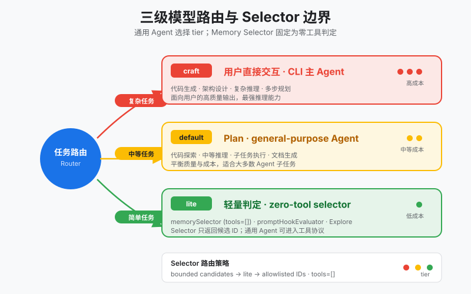
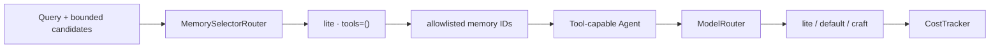

# Model Routing：用 AI 管理 AI — 便宜粗筛，贵的推理

> *用 AI 管理 AI — 便宜的做粗筛, 贵的做推理* — 模型分级路由。
>
> **Harness 层**：成本优化 — 模型是 agent 的 CPU。

s07 解决了会话身份与运行时重建。本章继续问：**同一趟会话里，每个子任务该用哪档模型？**  
不全用最贵——会烧钱，还会把贵模型上下文塞满低价值分类活。

> 配图：`images/s08-model-routing.svg`

## 你将会得到什么

1. 三级槽位 **lite / default / craft** 与 Agent 映射直觉  
2. 「用 AI 管理 AI」两步：lite 粗筛 → craft 精推  
3. **Memory Selector** = zero-tool，只返回候选内 ID  
4. **CostTracker**：路由可观测；能对照一次真跑账本  
5. 旁路旋钮：`auto`（按任务选档）、`effort`（同档拧油门）、不可用时**只降不升**

---

## 零基础名词表

### ModelTier（模型档位）

| 层 | 说明 |
|----|------|
| **是什么** | 成本/能力标签：lite、default、craft |
| **在本文干什么** | Agent 查表落档，再取对应 ModelInfo |
| **怎么区分** | `lite` 不是某一个厂商型号，而是「用最便宜档」的槽位 |

### Memory Selector

| 层 | 说明 |
|----|------|
| **是什么** | 内部判定器：从已检索候选里选相关记忆 ID |
| **在本文干什么** | 固定 lite + `tools=()`；输出 allowlisted IDs |
| **怎么区分** | ≠ 通用 Tool Agent（后者可发现并执行工具） |

### CostTracker

| 层 | 说明 |
|----|------|
| **是什么** | 按档累计 calls / tokens / cost |
| **在本文干什么** | 证明「省了多少、谁在烧钱」 |
| **怎么区分** | 没有记账 = 省钱可能变成随机降智 |

### effort / auto / 降级（边界）

| 词 | 是什么 | 在本文干什么 | 怎么区分 |
|----|--------|--------------|----------|
| **auto** | 按**任务类型**查表选档 | `TASK_TIER_MAP`；如 `code_search→lite` | 看任务，不是看 Agent 名 |
| **agent 模式** | 按**角色名**查表 | `AGENT_MODEL_MAP`；如 `CLI→craft` | 生产更常显式绑档 |
| **effort** | 同档再分 low/medium/high | 拧推理深度 → 计费跟着变 | 选「哪台车」是档位；effort 是油门 |
| **动态降级** | 某档限流/宕机时换档 | `craft→default→lite` | **只降不升**；lite 也挂则硬失败 |

---

## 先装进脑子的总图

```text
任务进来 → ModelRouter
              ├─ mode=agent → AGENT_MODEL_MAP（按角色）
              └─ mode=auto  → TASK_TIER_MAP（按任务）
                    ↓
              preferred 若在 unavailable → 只往更便宜降
                    ↓
         lite / default / craft  (+ 可选 effort)
                │
                ├─ memorySelector(lite, tools=0) → 选出 mem_id…
                └─ CLI(craft) 只看精选结果 → 回答用户

旁路：CostTracker 每枪记账
```

口诀：**便宜的做粗筛，贵的做推理；Selector 不带工具；挂了只降不升。**

相对前章：

```text
壳(s05) → Sidecar(s06) → Session(s07) → 模型路由/成本(s08) → JSONL(s09)
```

---

## 架构图





```text
┌──────────────────────────────────────────────────────────────┐
│                     ModelRouter                               │
│   lite (~$0.25/M)   default (~$3/M)   craft (~$15/M)          │
│   粗筛/分类          规划/执行          用户交互/深推理         │
│   memorySelector    Plan / GP          CLI                    │
│   Explore / hook…   compact…                                  │
└──────────────────────────────────────────────────────────────┘
```

---

## 学习前置与本章机制

**前置：** 路由是成本、延迟、质量的权衡；粗筛适合轻模型；路由要可观测；Selector 不是带工具循环的通用 Agent。

**抓住的机制：** lite/default/craft 槽位；辅助与主推理分预算；记录路由/成本；Selector zero-tool。

**常见误区：** 全最强；全最便宜；只靠关键词乱路由。

---

## 问题：全都用最贵？

后台常有 memorySelector、hook 评估、Explore… 若全 craft：

1. **成本失控**  
2. **上下文质量下降** — 贵模型被低价值任务淹没  

---

## 三级与映射

| 层级 | 角色 | 教学单价 | 典型 |
|------|------|----------|------|
| lite | 粗筛/分类 | ~$0.25/M | Explore、memorySelector、promptHookEvaluator |
| default | 规划/执行/压缩 | ~$3/M | Plan、general-purpose、compact |
| craft | 推理/对用户 | ~$15/M | CLI |

规律：**后台内部多用 lite；中间执行 default；面对用户 craft。**

---

## 用 AI 管理 AI

**传统**：50 条记忆全塞 craft → 贵且脏。  
**分级**：lite 先选 3 个 ID → craft 只看 3 条 → 更省且更干净。

同模式也出现在 hook 评估、代码探索、压缩等场景。

---

## Memory Selector 边界

| | Memory Selector | 通用 Tool Agent |
|--|-----------------|-----------------|
| 输入 | query + bounded candidates | 目标 + 工具目录 |
| 输出 | 候选内 ID | 文本 / tool call |
| 工具 | `tools=()`，塞 schema 即拒 | 可执行工具 |
| 副作用 | 无 | 可能改外部状态 |

候选生成与相关性打分属后续 Recall；本章只钉路由与 zero-tool 契约。

---

## 成本与真跑账本

教案对比（典型对话）：全 craft 约 **$0.75**；分级约 **$0.35**（约省 53%）。

**一次真实观察（本仓库 mock 跑通）：**

| 场景 | 总成本 | 备注 |
|------|--------|------|
| 全 craft | **$0.750000** | Scenario A |
| 正常分级 | **$0.348750** | Scenario B；Explore→lite |
| L5：Explore 误绑 craft | **$0.466750** | Explore 8K 变贵；仍低于全 craft |
| 「用 AI 管理 AI」小 demo | lite+craft **$0.076250** vs 全塞 craft **$0.300000** | 省约 75% |
| README 练习 #3 总延迟 | 全 craft **10000ms** vs 分级 **3400ms**（差 **6600ms**） | 累加各档 `latency_ms` |

Step1 现场：`工具: 0`；输出 `mem_01 / mem_05 / mem_09`。

---

## 对着 `code.py`

### 档位与映射

```python
AGENT_MODEL_MAP = {
    "CLI": ModelTier.CRAFT,
    "Plan": ModelTier.DEFAULT,
    "Explore": ModelTier.LITE,
    "memorySelector": ModelTier.LITE,
    "promptHookEvaluator": ModelTier.LITE,
    ...
}
```

### Selector：zero-tool

```python
class MemorySelectorRouter:
    """在不做带工具通用 Agent 的前提下，完成记忆相关性判定路由。
    传入 tool schema 是协议错误。"""

    def route(self, *, tool_schemas=()):
        if tool_schemas:
            raise ValueError("memory selector is zero-tool; tool schemas are not allowed")
        model = self.router.route_request("memorySelector")
        ...
```

### CostTracker

```python
class CostTracker:
    """按模型档位跟踪 token 与费用。"""
    def track(self, tier, token_count):
        self.tokens[tier] += token_count
        self.calls[tier] += 1
```

### auto / effort / 降级（练习落地）

```python
# auto：看任务类型
TASK_TIER_MAP = {
    "code_search": ModelTier.LITE,
    "plan": ModelTier.DEFAULT,
    "user_chat": ModelTier.CRAFT,
}

# effort：同档再拧（教学倍数，非厂商原价）
EFFORT_COST_MULT = {"low": 0.7, "medium": 1.0, "high": 1.5}
# 同 craft、5000 tokens → low $0.0525 / medium $0.075 / high $0.1125

# 降级：只往更便宜走
TIER_DOWNGRADE = {
    ModelTier.CRAFT: ModelTier.DEFAULT,
    ModelTier.DEFAULT: ModelTier.LITE,
    ModelTier.LITE: None,  # 无处可降 → RuntimeError
}
```

| 旋钮 | 一句人话 | 真跑核对 |
|------|----------|----------|
| auto | 任务选档 | `code_search` → lite |
| effort | 同车油门 | high 比 medium 贵（约 ×1.5） |
| 降级 | 挂了往下 | CLI 在 craft 挂时 → default；三档全挂硬失败 |

---

## 相对 s07

| | s07 | s08 |
|--|-----|-----|
| 焦点 | Record vs Process；四操作 | 模型档位与成本 |
| 资源 | 端口/线程/HTTP | lite/default/craft 预算 |
| 下一层 | 模型路由 | JSONL 持久化（s09） |

---

## 试一下

```bash
source .venv/bin/activate
python s08_model_routing/code.py --demo   # 章序，不够当学会
python s08_model_routing/code.py          # mock 全演示，无需 Key
```

观察：路由表；Selector `tools=0`；Scenario A/B 成本差；把 Explore 临时改 craft 再改回，看 TOTAL 抬高。

可选：`--interactive` 用 `route` / `auto` / `effort` / `down` / `up` / `cost` 探路由。

---

## 边界与下一课

**做了：** 三级路由、用 AI 管理 AI、Selector zero-tool、CostTracker、mock 真跑账本；`auto` / `effort` / 延迟对比 / 动态降级。  

**没做：** 真多厂商热切换；S12 相关性算法；对话落盘（s09）。

```text
不全用最贵；lite 筛，craft 推。
Selector 工具=0，只吐候选内 ID。
记账才知道谁在烧钱；乱绑贵模型会抬账。
auto 看任务，agent 看角色；effort 拧同档油门；挂了只降不升。
```

下一课：**s09 JSONL Transcript** — 追加日志、事件回放、崩溃恢复。
