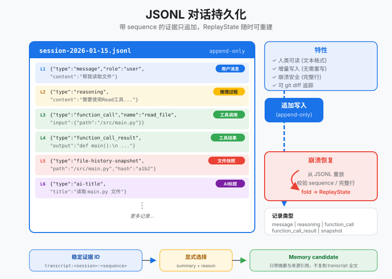
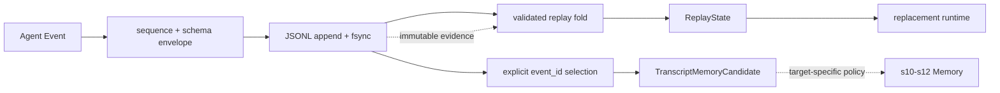

# JSONL Transcript：证据只追加，运行时状态可重建

> *日志是证据，replay state 是派生结果* — append-only JSONL 会话持久化。
>
> **Harness 层**：持久化 — 对话的源真相。

s08 解决了「用哪个模型」。本章继续问：**对话内容存哪？崩溃后怎么重建？**  
答案不是「整张表 CRUD」，而是：**事件流只追加；运行时状态随时可 fold 出来。**

> 配图：`images/s09-jsonl-transcript.svg`

## 你将会得到什么

1. 为何对话是**流** → append-only **JSONL** 当源真相  
2. 信封字段：`sequence` / `event_id` / `fsync`（正文含完整 `append`）  
3. 六种事件；哪些进 `messages[]`（正文含 `_event_to_message`）  
4. **证据 vs 派生**：`ReplayState` 可丢可重建（正文含 `replay` / `recover`）  
5. 损坏边界：partial tail vs 完整坏行（正文含判定代码）  
6. Transcript ≠ Memory；显式 `summary` + `reason`  
7. JSONL vs SQLite 分工；超长会话分片（正文含轮转 + SQLite 登记）  

---

## 零基础名词表

### JSONL（JSON Lines）

| 层 | 说明 |
|----|------|
| **是什么** | 文本文件：一行一个 JSON 对象，用 `\n` 分隔，没有外层数组 |
| **在本文干什么** | 每个会话一个 `.jsonl`；每次事件只追加一行 |
| **怎么区分** | 不是「一个大 JSON 数组」；也不是 SQLite 表行 |

### transcript（会话笔录 / 证据）

| 层 | 说明 |
|----|------|
| **是什么** | 本会话发生过什么的忠实记录（消息、工具、推理、快照…） |
| **在本文干什么** | `JSONLTranscript.append` 写入；崩溃后仍在磁盘 |
| **怎么区分** | ≠ 长期 Memory（后者跨会话、要精选） |

### ReplayState（派生运行时状态）

| 层 | 说明 |
|----|------|
| **是什么** | 对 JSONL 做 fold 得到的临时视图：`messages[]`、title、快照计数等 |
| **在本文干什么** | `replay` / `recover` 重建；进程挂了可以扔掉再折 |
| **怎么区分** | 不是证据本身；也不是 Memory |

### event_id

| 层 | 说明 |
|----|------|
| **是什么** | `transcript:<session_id>:<sequence>`，一条事件的稳定身份证 |
| **在本文干什么** | Memory 晋升时精确指回证据，不复制大正文 |
| **怎么区分** | 随机 UUID 也能唯一，但不自描述「哪次会话第几条」 |

### partial tail（残缺末行）

| 层 | 说明 |
|----|------|
| **是什么** | 文件最后一行没有 `\n`，且 JSON 不完整（常见于写到一半崩溃） |
| **在本文干什么** | 只读 recover 可忽略并标 `ignored_partial_tail`；禁止再 append |
| **怎么区分** | 有换行的完整坏行 / 中间坏行 / sequence 跳号 → 硬失败，不假装成功 |

---

## 先装进脑子的总图

```text
Agent 事件
    │  append（只追加 + fsync）
    ▼
session.jsonl  ←── 不可变证据（源真相）
    │  validated replay fold
    ▼
ReplayState（messages / title / …）← 可丢、可重建
    │  显式 select_memory_candidate(event_id, summary, reason)
    ▼
TranscriptMemoryCandidate →（交给 s10–s12 策略，本章不写入 Memory）
```

口诀：**日志是证据；replay state 是派生；Memory 要手选，不会自动升。**

相对前章：

```text
壳(s05) → Sidecar(s06) → Session(s07) → 模型路由(s08) → JSONL 证据(s09) → Workspace Memory(s10)
```

---

## 架构图





---

## 问题：为什么不全塞进数据库？

直觉是 SQLite：`INSERT` 每条消息。但对话更像**流**：

1. **崩溃恢复** — 事务可能半截；JSONL 文件本身就是日志  
2. **流式追加** — 边吐边存，不必读-改-写一行  
3. **移植** — `cp session.jsonl` 即可；库还要导出  
4. **并发** — 一会话一文件，少锁竞争  
5. **Schema** — 新字段新行解析；少 `ALTER TABLE`  

核心矛盾：**对话是流，不是表。** 流适合只追加；CRUD 表在这里常常过度设计。

---

## 解决方案：每会话一个 JSONL

```text
~/.workbuddy/projects/<workspace>/<session>.jsonl
```

每行一个事件；文件只长不缩。样例：

```jsonl
{"schema_version":1,"sequence":1,"session_id":"session_abc123","event_id":"transcript:session_abc123:1","recorded_at":"2026-11-18T06:25:10+00:00","type":"message","role":"user","content":"帮我修复 main.py 里的登录 bug"}
{"schema_version":1,"sequence":2,"session_id":"session_abc123","event_id":"transcript:session_abc123:2","recorded_at":"...","type":"reasoning","content":"先读 main.py…"}
{"schema_version":1,"sequence":3,"session_id":"session_abc123","event_id":"transcript:session_abc123:3","recorded_at":"...","type":"function_call","name":"read_file","arguments":{"path":"main.py"},"callId":"call_001"}
```

### 六种事件类型

| JSONL `type` | 用途 | 进 LLM `messages[]`？ |
|--------------|------|----------------------|
| `message` | 用户/助手消息 | ✅ |
| `function_call` | 工具调用 | ✅ → tool_use |
| `function_call_result` | 工具结果 | ✅ → tool_result |
| `reasoning` | 思考过程 | ❌ 元数据 |
| `file-history-snapshot` | 文件快照 | ❌ |
| `ai-title` | 自动标题 | ❌ |

真跑对照（教学 demo）：**10 个事件 → 6 条 messages**（少掉 2×reasoning + snapshot + ai-title）。

映射逻辑（教学完整版）：

```python
TYPE_MESSAGE = "message"
TYPE_REASONING = "reasoning"
TYPE_FUNCTION_CALL = "function_call"
TYPE_FUNCTION_CALL_RESULT = "function_call_result"
TYPE_FILE_SNAPSHOT = "file-history-snapshot"
TYPE_AI_TITLE = "ai-title"

def _event_to_message(event: dict) -> dict | None:
    """事件 → LLM message；元数据返回 None（仍留在 JSONL 里）。"""
    etype = event.get("type")
    if etype == TYPE_MESSAGE:
        return {"role": event["role"], "content": event["content"]}
    if etype == TYPE_FUNCTION_CALL:
        return {
            "role": "assistant",
            "content": [{
                "type": "tool_use",
                "id": event["callId"],
                "name": event["name"],
                "input": event["arguments"],
            }],
        }
    if etype == TYPE_FUNCTION_CALL_RESULT:
        return {
            "role": "user",
            "content": [{
                "type": "tool_result",
                "tool_use_id": event["callId"],
                "content": event["output"],
            }],
        }
    # reasoning / file-history-snapshot / ai-title
    return None
```

### 追加与信封

写入只做一件事：追加一行。教学实现：

```python
import os
import json
from copy import deepcopy
from datetime import datetime, timezone
from pathlib import Path

TRANSCRIPT_SOURCE_TYPE = "transcript"
RESERVED_ENVELOPE_FIELDS = frozenset(
    {"schema_version", "sequence", "recorded_at", "session_id", "event_id"}
)

class TranscriptCorruptionError(RuntimeError):
    """证据损坏：完整坏行、跳号、坏尾后再写等。"""

class TranscriptValidationError(ValueError):
    """调用方塞了非法字段。"""

class JSONLTranscript:
    def __init__(self, filepath: str | Path):
        self.path = Path(filepath)
        self.session_id = self.path.stem  # 分片时会去掉 _2 后缀，见后文
        self.path.parent.mkdir(parents=True, exist_ok=True)
        self._ignored_partial_tail = False
        self._missing_final_newline = False

    def _event_id(self, sequence: int) -> str:
        return f"{TRANSCRIPT_SOURCE_TYPE}:{self.session_id}:{sequence}"

    def append(self, event: dict) -> None:
        """追加一行；永不改写旧行。"""
        reserved = sorted(RESERVED_ENVELOPE_FIELDS.intersection(event))
        if reserved:
            raise TranscriptValidationError(
                "event payload contains reserved envelope fields: "
                + ", ".join(reserved)
            )
        existing = self._read_all_events()  # 同时刷新坏尾标志
        if self._ignored_partial_tail:
            raise TranscriptCorruptionError(
                f"{self.path.name}: cannot append after partial tail; "
                "preserve this log and use a new transcript file"
            )
        if self._missing_final_newline:
            raise TranscriptCorruptionError(
                f"{self.path.name}: cannot append after unterminated last line; "
                "preserve this log and use a new transcript file"
            )
        sequence = existing[-1]["sequence"] + 1 if existing else 1
        envelope = {
            **deepcopy(event),
            "schema_version": 1,
            "sequence": sequence,
            "recorded_at": datetime.now(timezone.utc).isoformat(),
            "session_id": self.session_id,
            "event_id": self._event_id(sequence),
        }
        encoded = (
            json.dumps(envelope, ensure_ascii=False, sort_keys=True) + "\n"
        ).encode()
        fd = os.open(self.path, os.O_APPEND | os.O_CREAT | os.O_WRONLY, 0o600)
        try:
            written = os.write(fd, encoded)
            if written != len(encoded):
                raise OSError(f"short transcript write: {written}/{len(encoded)}")
            os.fsync(fd)
        finally:
            os.close(fd)
```

| 字段 | 作用 |
|------|------|
| `sequence` | 本会话第几条；跳号 = 证据断了 |
| `event_id` | `transcript:<session>:<sequence>` |
| `session_id` / `recorded_at` / `schema_version` | 归属、时间、版本 |
| 末尾 `\n` + `fsync` | 行界清楚；尽量落盘 |

### 回放与崩溃恢复

```python
from dataclasses import dataclass, field

SESSION_MAX_ITEMS = 1000

@dataclass
class ReplayState:
    """从证据 fold 出来的可丢弃运行时状态。"""
    messages: list[dict] = field(default_factory=list)
    title: str | None = None
    file_snapshots: list[dict] = field(default_factory=list)
    total_events: int = 0
    reasoning_count: int = 0
    next_sequence: int = 1
    ignored_partial_tail: bool = False


def replay(
    self,
    max_items: int = SESSION_MAX_ITEMS,
    *,
    last_user_turn: bool = False,
) -> list[dict]:
    """折成 messages[]。last_user_turn=True：只保留最后一轮 user 起的上下文。"""
    events = self._read_all_events()
    if last_user_turn:
        start = 0
        for i in range(len(events) - 1, -1, -1):
            ev = events[i]
            if ev.get("type") == TYPE_MESSAGE and ev.get("role") == "user":
                start = i
                break
        else:
            return []
        recent = events[start:]
    else:
        recent = events[-max_items:] if max_items > 0 else []

    messages = []
    for event in recent:
        msg = self._event_to_message(event)
        if msg:
            messages.append(msg)
    return messages


def recover(self) -> dict:
    """崩溃恢复：打开 JSONL → fold → 得到可接着用的状态字典。"""
    state = self.replay_state()
    return {
        "messages": state.messages,
        "title": state.title,
        "file_snapshots": state.file_snapshots,
        "total_events": state.total_events,
        "message_count": len(state.messages),
        "reasoning_count": state.reasoning_count,
        "ignored_partial_tail": state.ignored_partial_tail,
    }
```

三幕 demo 现象：Part 1 写入 10 行；Part 2 内存清空但磁盘仍在；Part 3 `recover` 得到 **10 events / 6 messages**。

### 损坏边界

读文件时（教学核心分支）：

```python
def _split_jsonl(raw: bytes) -> list[str]:
    # 按 "\n" 切；保留是否以 \n 结尾的信息供 partial 判定
    text = raw.decode("utf-8")
    if not text:
        return []
    parts = text.split("\n")
    if text.endswith("\n"):
        return [p + "\n" for p in parts[:-1]]
    # 最后一段没有换行 → 可能是 partial tail
    lines = [p + "\n" for p in parts[:-1]]
    lines.append(parts[-1])  # 无尾部 \n
    return lines


# 在逐行 json.loads 时：
try:
    event = json.loads(line)
except json.JSONDecodeError as exc:
    partial_tail = (line_number == len(lines)) and (not line.endswith("\n"))
    if partial_tail:
        self._ignored_partial_tail = True
        break  # 忽略残缺末行，前面的完整行照常保留
    raise TranscriptCorruptionError(
        f"{path.name}:{line_number}: invalid complete JSON record"
    ) from exc
```

| 情况 | 行为 |
|------|------|
| partial tail（无 `\n` + JSON 残缺） | recover 可忽略并标标志；**禁止 append**（见上文 `append` 开头两处 `raise`） |
| 完整坏行 / 中间坏 / sequence 跳号 | `TranscriptCorruptionError`，不假装成功 |

新手坑：只读恢复成功 ≠ 可以继续往同一文件写。坏尾后再 `append` 会把残缺内容「粘」成完整坏行。

### transcript ≠ Memory

```python
MEMORY_ELIGIBLE_EVENT_TYPES = frozenset({TYPE_MESSAGE, TYPE_FILE_SNAPSHOT})

@dataclass(frozen=True)
class TranscriptMemoryCandidate:
    source_id: str
    session_id: str
    sequence: int
    event_type: str
    captured_at: str
    summary: str
    selection_reason: str
    source_type: str = TRANSCRIPT_SOURCE_TYPE

def select_memory_candidate(
    self,
    event_id: str,
    *,
    summary: str,
    reason: str,
) -> TranscriptMemoryCandidate:
    """显式选择一条已落盘证据；不写入 Memory，不复制事件正文。"""
    summary = " ".join(summary.split())
    reason = " ".join(reason.split())
    if not summary or not reason:
        raise ValueError("summary and reason are required")
    events = self._read_all_events()
    selected = next((e for e in events if e.get("event_id") == event_id), None)
    if selected is None:
        raise ValueError(f"unknown transcript event: {event_id}")
    event_type = str(selected.get("type", ""))
    if event_type not in MEMORY_ELIGIBLE_EVENT_TYPES:
        raise ValueError(f"event type {event_type!r} is not eligible")
    return TranscriptMemoryCandidate(
        source_id=str(selected["event_id"]),
        session_id=str(selected["session_id"]),
        sequence=int(selected["sequence"]),
        event_type=event_type,
        captured_at=str(selected["recorded_at"]),
        summary=summary,
        selection_reason=reason,
    )


# 调用示例
candidate = transcript.select_memory_candidate(
    "transcript:session_abc123:1",
    summary="项目确定使用 SQLite WAL。",
    reason="用户明确确认的持久化架构决策。",
)
```

| | Transcript | Memory |
|--|------------|--------|
| 目标 | 本会话忠实证据 | 跨会话精选事实 |
| 进入方式 | 事件自动 append | 显式选择 |
| 内容 | 全文事件 | 摘要 + `event_id` 指针 |

### JSONL vs SQLite

| | JSONL | SQLite |
|--|-------|--------|
| 用途 | 对话源真相 | 元数据与索引 |
| 写法 | Append-only | CRUD |
| 例子 | 事件流 | 会话列表、用量、**手改标题**、**分片登记** |

原则：**能从 JSONL 重建的，不往库里再存一份。**

### 会话分片

单文件超过上限（默认 10000 行；测试可改小）→ 开 `session_abc123_2.jsonl`…  
`sequence` / `event_id` 仍按**逻辑会话**连续。

```python
import re
import sqlite3

SESSION_SHARD_MAX_LINES = 10_000

def __init__(self, filepath, *, max_lines_per_shard=SESSION_SHARD_MAX_LINES):
    self.path = Path(filepath)
    self.session_id = re.sub(r"_\d+$", "", self.path.stem)  # 逻辑 id
    self.max_lines_per_shard = max(1, max_lines_per_shard)
    self._shard_db = self.path.parent / f"{self.session_id}.shards.sqlite"
    # CREATE TABLE transcript_shards(session_id, shard_index, path, PRIMARY KEY(...))
    ...

def _shard_path(self, index: int) -> Path:
    if index <= 1:
        return self.path.parent / f"{self.session_id}.jsonl"
    return self.path.parent / f"{self.session_id}_{index}.jsonl"

def _rotate_shard_if_needed(self) -> None:
    if self.count_lines() < self.max_lines_per_shard:
        return
    nxt = self._latest_shard_index() + 1
    self.path = self._shard_path(nxt)
    self._register_shard(nxt, self.path)  # INSERT OR REPLACE into SQLite

def _register_shard(self, index: int, path: Path) -> None:
    with sqlite3.connect(self._shard_db) as conn:
        conn.execute(
            """
            INSERT OR REPLACE INTO transcript_shards(session_id, shard_index, path)
            VALUES (?, ?, ?)
            """,
            (self.session_id, index, str(path)),
        )
```

分片索引是**元数据**（方便按会话查出有哪些文件）；对话证据仍在各 JSONL 里。

---

## 试一下

公开可跑切片（无需翻私人沙盒）：

```bash
cd tracks/harness
python3 -m venv .venv && source .venv/bin/activate
pip install -r requirements.txt
python s09_jsonl_transcript/code.py --demo
python s09_jsonl_transcript/code.py
```

观察：`jsonl line` 1→10；崩溃后文件仍在；恢复 messages=6；raw 每行一 JSON。

可选交互：

```bash
python s09_jsonl_transcript/code.py --interactive
# user / assistant / reason / tool / result / title / replay / recover / raw / q
```

---

## 边界与下一课

**做了：** append-only 证据、六事件映射、replay/recover、损坏边界、Memory 选择门槛、JSONL/SQLite 分工、截断回放、分片索引。  

**没做：** s10–s12 真正写入 Memory；生产级多写者锁；完整 WorkBuddy 事件全字段。

```text
对话是流；证据只追加。
派生可扔；崩溃再 fold。
坏尾只读可晾；完整坏硬失败。
Memory 要摘要+理由；不会自动升。
```

下一课：**s10 Workspace Memory** — 工作日志追加、主题蒸馏、保留策略。
