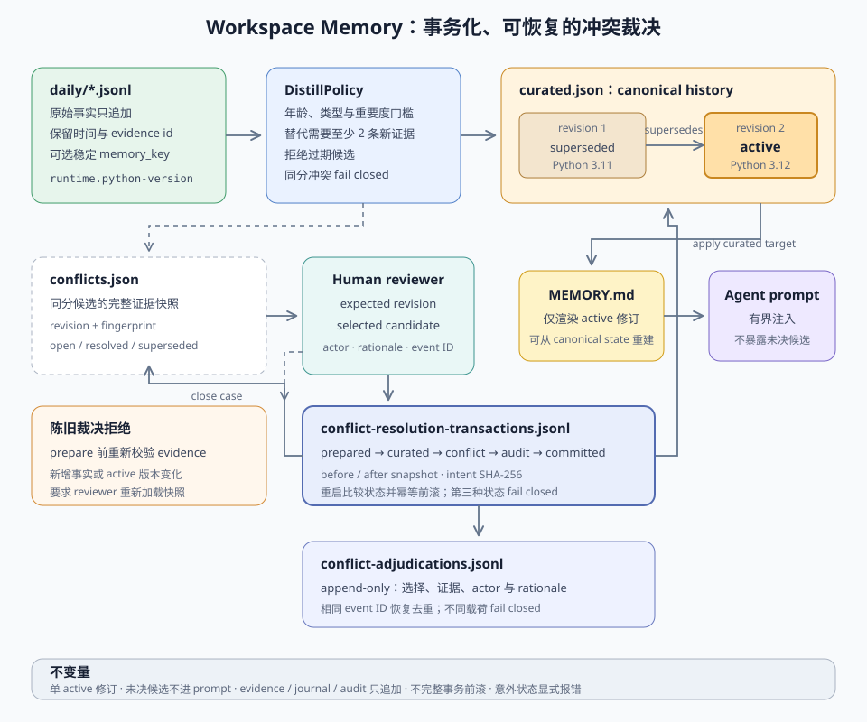
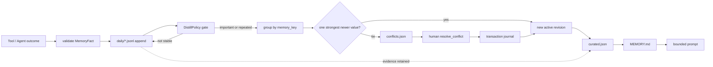
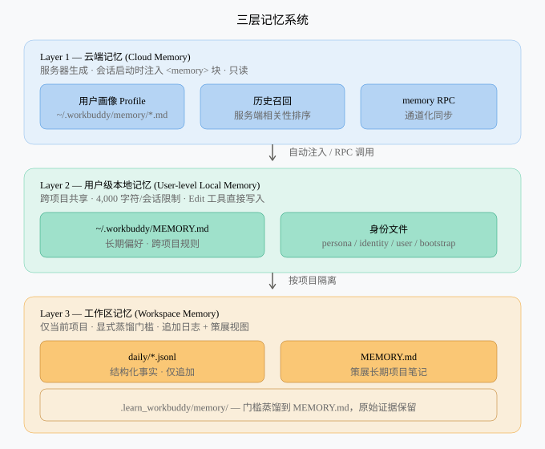

# Workspace Memory：工作日志蒸馏成可恢复的项目记忆

> *Transcript 保存一次会话发生了什么；Workspace Memory 选择下次仍值得知道什么。*
>
> **Harness 层**：项目作用域、记忆写入策略、蒸馏策略与 prompt 注入。

s09 把对话做成了 append-only 证据流。本章继续问：**跨会话、同项目，哪些事实还该记得？**  
答案不是「再存一份聊天记录」，而是：**原始事实只追加；稳定且够旧、重要或重复的才进长期视图。**

> 配图：`images/s10-workspace-memory.svg`

## 你将会得到什么

1. Transcript vs Workspace Memory：忠实记录 vs 有损选择  
2. 存储所有权：`daily/*.jsonl` / `curated.json` / `MEMORY.md`（正文含追加与重建关系）  
3. `FactKind` + `DistillPolicy`：谁能晋升、outcome 默认不晋升  
4. `memory_key` 冲突域；同强度进 review；只有人类 `/resolve`  
5. transaction journal：崩了按 before/after 前滚或 fail closed  
6. 确认凭据在进程内存，不看日志 `source` 字段（正文含 `/confirm-demo` 逻辑）  
7. 倒序读最近事实：不一次加载全部日志（正文含 `read_recent_facts`）  
8. 三层记忆位置：本章只做 workspace；user / remote 留给后章  

---

## 零基础名词表

### Workspace Memory（工作区记忆）

| 层 | 说明 |
|----|------|
| **是什么** | 绑定**某一个项目目录**的长期记忆：同项目跨会话共享，不同项目用 `workspace_id` 隔离 |
| **在本文干什么** | 从每日事实日志里蒸馏出策展状态，再投影成 `MEMORY.md` 注入 prompt |
| **怎么区分** | ≠ s09 transcript（本会话证据）；≠ s11 用户偏好（跨项目） |

### daily JSONL（每日事实日志）

| 层 | 说明 |
|----|------|
| **是什么** | `daily/YYYY-MM-DD.jsonl`：一天一个文件，一行一条 `MemoryFact`，只追加 |
| **在本文干什么** | 一切证据的源真相；蒸馏读它，但不删它 |
| **怎么区分** | ≠ `MEMORY.md`（可重建视图）；≠ 进程里的确认集合 |

### curated.json（策展真相）

| 层 | 说明 |
|----|------|
| **是什么** | 机器可读的长期条目：active / superseded 修订、`evidence_ids`、revision 链 |
| **在本文干什么** | distill / resolve 成功后的 canonical state；原子替换写入 |
| **怎么区分** | 比 `MEMORY.md` 更完整；`MEMORY.md` 只渲染 active |

### MEMORY.md

| 层 | 说明 |
|----|------|
| **是什么** | 给人看、给 prompt 看的派生文本 |
| **在本文干什么** | 从 `curated.json` 重建；丢了还能再生 |
| **怎么区分** | 不是证据；改它不等于改真相 |

### DistillPolicy（蒸馏门槛）

| 层 | 说明 |
|----|------|
| **是什么** | 显式规则：够旧 + 稳定类型 +（够重要或够重复）才晋升 |
| **在本文干什么** | 禁止模型随口决定「永远记住什么」 |
| **怎么区分** | ≠ LLM 自由总结；≠ 删除旧日志 |

### memory_key（冲突域）

| 层 | 说明 |
|----|------|
| **是什么** | 稳定问题名，如 `storage.sqlite.journal-mode`；答案可变，问题不变 |
| **在本文干什么** | 同 key 下新值可替代旧修订；同分则排队给人判 |
| **怎么区分** | ≠ 答案正文；≠ 随机 `fact_id` |

### FactKind

| 层 | 说明 |
|----|------|
| **是什么** | 四种事实类型：`decision` / `convention` / `pitfall` / `outcome` |
| **在本文干什么** | 前三类默认可进长期；`outcome` 默认只留近期日志 |
| **怎么区分** | 「今天测试过了」多半是 outcome，不是 convention |

### `_session_confirmed`（会话确认凭据）

| 层 | 说明 |
|----|------|
| **是什么** | harness **进程内存**里的 `fact_id → MemoryFact` 字典 |
| **在本文干什么** | 首次晋升时可给 importance +1；必须整条事实比对相等 |
| **怎么区分** | ≠ 日志字段 `source=user_confirmed`（可被 bash 伪造） |

### transaction journal（裁决事务日志）

| 层 | 说明 |
|----|------|
| **是什么** | `conflict-resolution-transactions.jsonl`：多文件裁决的阶段账本 |
| **在本文干什么** | 崩溃后按 before/after 幂等前滚；乱账 fail closed |
| **怎么区分** | ≠ 审计文件 `conflict-adjudications.jsonl`（记谁选了什么） |

---

## 先装进脑子的总图

```text
工具 / Agent 结果
    │  validate MemoryFact
    ▼
daily/*.jsonl  ←── 只追加的证据（不删）
    │  DistillPolicy（年龄 + 类型 + 重要/重复）
    ▼
按 memory_key 分组
    │
    ├─ 唯一更强更新 → curated.json 新 active 修订
    ├─ 同分 → conflicts.json（等人 /resolve）
    └─ 不够格 → 继续只留在 daily
              │
              ▼
         MEMORY.md（可重建）→ 有限条数注入 prompt
```

口诀：**证据只追加；长期靠蒸馏；冲突人来判；确认在内存。**

相对前章：

```text
壳(s05) → Sidecar(s06) → Session(s07) → 路由(s08) → JSONL(s09) → Workspace Memory(s10)
```

---

## 架构图





---

## 存储布局与所有权

```text
project/
└── .learn_workbuddy/
    └── memory/
        ├── daily/
        │   ├── 2026-08-07.jsonl
        │   └── 2026-08-08.jsonl
        ├── curated.json
        ├── conflicts.json
        ├── conflict-adjudications.jsonl
        ├── conflict-resolution-transactions.jsonl
        └── MEMORY.md
```

| 文件 | 身份 | 写入 | 能否当证据 |
|------|------|------|------------|
| `daily/*.jsonl` | 原始事实 | `O_APPEND` 单行追加 | 是 |
| `curated.json` | 策展机器真相 | 临时文件 + `os.replace` | 可追溯到 evidence id |
| `conflicts.json` | 待审快照 | 原子替换 | 是 |
| `conflict-adjudications.jsonl` | 人工裁决审计 | 追加 | 是 |
| `conflict-resolution-transactions.jsonl` | 多文件恢复账本 | 追加阶段事件 | 是 |
| `MEMORY.md` | 人/prompt 视图 | 从策展重建 | 否 |

`WorkspaceMemory` 先 `resolve` 项目绝对路径，再算 16 位 `workspace_id`；读日志时校验 id，防止串项目。

---

## 机制 1：结构化事实 + 只追加

`kind` 只有四类：

```python
from enum import Enum

class FactKind(str, Enum):
    DECISION = "decision"      # 例如选择 SQLite WAL
    CONVENTION = "convention"  # 例如路径必须相对 workspace
    PITFALL = "pitfall"        # 例如不可把 token 写入记忆
    OUTCOME = "outcome"        # 例如本次测试通过 — 默认不晋升长期
```

一条事实的核心字段（教学精简）：

```python
@dataclass(frozen=True)
class MemoryFact:
    fact_id: str
    workspace_id: str
    recorded_at: str          # UTC ISO
    kind: str                 # FactKind 之一
    content: str
    source: str = "agent"
    importance: int = 3       # 1..5
    evidence: dict = field(default_factory=dict)
    memory_key: str | None = None  # 可选冲突域
```

写入每日日志（一次 `os.write` + `fsync`，成功才返回）：

```python
def append_daily_log(self, content: str, *, kind, importance=3,
                     source="agent", memory_key=None, recorded_at=None) -> MemoryFact:
    text = re.sub(r"\s+", " ", content).strip()
    if not text or not (1 <= importance <= 5):
        raise ValueError("invalid fact")
    kind_value = kind.value if isinstance(kind, FactKind) else str(kind)
    timestamp = _as_utc(recorded_at)
    fact = MemoryFact(
        fact_id=uuid.uuid4().hex,
        workspace_id=self.workspace_id,
        recorded_at=timestamp.isoformat().replace("+00:00", "Z"),
        kind=kind_value,
        content=text,
        memory_key=None if memory_key is None else _clean_memory_key(memory_key),
        source=source,
        importance=importance,
    )
    encoded = (json.dumps(asdict(fact), ensure_ascii=False, sort_keys=True) + "\n").encode()
    path = self.daily_log_path(timestamp.date())  # daily/YYYY-MM-DD.jsonl
    fd = os.open(path, os.O_APPEND | os.O_CREAT | os.O_WRONLY, 0o600)
    try:
        if os.write(fd, encoded) != len(encoded):
            raise OSError("short memory write")
        os.fsync(fd)
    finally:
        os.close(fd)
    return fact
```

调用示例：

```python
memory.append_daily_log(
    "SQLite must run in WAL mode.",
    kind=FactKind.DECISION,
    importance=5,
    memory_key="storage.sqlite.journal-mode",
    evidence={"file": "storage.py"},
)
```

**新手坑**：连续写两条会得到两行，不是覆盖。蒸馏也不会删旧行——删证据等于拆掉审计链。

---

## 机制 2：蒸馏门槛（显式策略，不靠模型随口定）

默认逻辑：

```text
年龄 ≥ 30 天
AND kind ∈ {decision, convention, pitfall}
AND (importance ≥ 4  OR  规范化后重复 ≥ 2)
```

```python
@dataclass(frozen=True)
class DistillPolicy:
    minimum_age_days: int = 30
    minimum_importance: int = 4
    repeat_threshold: int = 2
    supersession_repeat_threshold: int = 2
    # 只给本进程 confirm_fact 过的事实；日志 source 字段不参与
    confirmed_importance_bonus: int = 1
    stable_kinds: frozenset[str] = frozenset(
        {"decision", "convention", "pitfall"}
    )

def qualifies(facts: list[MemoryFact], first: bool = False) -> bool:
    def effective_importance(fact: MemoryFact) -> int:
        if first and self.is_session_confirmed(fact):
            return min(5, fact.importance + policy.confirmed_importance_bonus)
        return fact.importance
    return (
        max(effective_importance(f) for f in facts) >= policy.minimum_importance
        or len(facts) >= policy.repeat_threshold
    )
```

`distill()` 骨架（读全部事实 → 过滤年龄与类型 → 分组晋升；**不删除** daily）：

```python
def distill(self, *, policy=None, as_of=None) -> DistillReport:
    """Promote eligible facts without deleting their source evidence."""
    active_policy = policy or DistillPolicy()
    observed_at = _as_utc(as_of)
    cutoff = observed_at - timedelta(days=active_policy.minimum_age_days)
    all_facts = self.read_all_facts()
    aged = [f for f in all_facts if _parse_timestamp(f.recorded_at) < cutoff]
    candidates = [
        f for f in aged
        if f.kind in active_policy.stable_kinds and f.fact_id not in already_processed
    ]
    # … legacy 按 kind+内容分组；有 memory_key 的按冲突域处理 …
    # 同分 → 建 MemoryConflictCase；唯一更强 → 新 active 修订
    # 最后原子写 curated.json，再重建 MEMORY.md
```

有 `memory_key` 时额外规则（摘要）：

1. 内容相同 → 合并 `evidence_ids`，不新开修订  
2. 内容不同 → 还要达到 `supersession_repeat_threshold`（默认 2）且时间更新  
3. 多个候选同分 → **fail closed**，进 `conflicts.json`，不靠文件顺序赌运气  

---

## 机制 3：冲突只许人类裁决 + journal 前滚

模型工具列表**没有** `resolve_conflict`。人工入口示例：

```python
case = memory.list_conflicts()[0]
choice = next(c for c in case.candidates if c.content == "Use Postgres.")

event = memory.resolve_conflict(
    case.conflict_id,
    choice.candidate_id,
    expected_revision=case.revision,  # 必须仍是刚看到的版本
    actor="reviewer@example.com",
    rationale="Production needs PostgreSQL extensions.",
    event_id="review:storage-database:42",
)
```

执行前会复查：case 仍 open、revision 未变、observed fact 指纹一致、候选仍属于本案。任何新证据都会 `StaleConflictResolutionError`，逼 reviewer 重看。

一次裁决要动多个文件，所以**先写 journal intent**，再推进阶段：

```text
prepared → curated_applied → conflict_closed → audit_appended → committed
```

```python
class ResolutionPhase(str, Enum):
    PREPARED = "prepared"
    CURATED_APPLIED = "curated_applied"
    CONFLICT_CLOSED = "conflict_closed"
    AUDIT_APPENDED = "audit_appended"
    COMMITTED = "committed"

def _recover_resolution_transactions(self) -> None:
    for transaction, phases in self._read_resolution_transactions():
        if phases[-1] == ResolutionPhase.COMMITTED.value:
            continue
        self._complete_resolution_transaction(transaction, phases)
        # 磁盘仍等于 before → 重做；已等于 after → 继续下一阶段
        # 既不是 before 也不是 after → fail closed（不瞎修）
```

新建 `WorkspaceMemory(project_dir)` 就会跑恢复；不依赖旧进程里的对象。

---

## 机制 4：确认凭据在进程内存

问题：Agent 有 `bash`，能往 daily 塞一行 `source=user_confirmed`。若晋升只看字段，一条 shell 就伪造「用户确认」。

解法：`confirm_fact` 照常落盘，同时把整条事实放进 `_session_confirmed`；加成只认内存比对。

```python
def confirm_fact(self, content: str, *, kind, importance: int) -> MemoryFact:
    fact = self.append_daily_log(
        content, kind=kind, importance=importance,
        source="user_confirmed", evidence={"actor": "local-cli-user"},
    )
    self._session_confirmed[fact.fact_id] = fact  # 只在本进程
    return fact

def is_session_confirmed(self, fact: MemoryFact) -> bool:
    # 整条比对：伪造新 id 或复用 id 改内容都不算
    return self._session_confirmed.get(fact.fact_id) == fact
```

离线演示 `/confirm-demo`（临时目录，不写当前项目）：

```python
def run_confirm_demo() -> list[str]:
    with tempfile.TemporaryDirectory() as tmp:
        memory = WorkspaceMemory(Path(tmp) / "proj")
        memory.append_daily_log("Use plain JSON files", kind="decision",
                                importance=3, source="model_inferred")
        memory.confirm_fact("Use SQLite WAL for persistence",
                            kind="decision", importance=3)
        memory.append_daily_log("Use Redis as the primary store", kind="decision",
                                importance=3, source="user_confirmed")  # 伪造字段
        report = memory.distill(as_of=datetime.now(timezone.utc) + timedelta(days=40))
        curated = memory.read_memory_md()
        # 只有 session-confirmed 那条会进 MEMORY.md
        restarted = WorkspaceMemory(Path(tmp) / "proj")
        # 重启后 is_session_confirmed(...) 全是 False
```

期望输出形态：

```text
session-confirmed: 'Use SQLite WAL for persistence' -> promoted
model_inferred: 'Use plain JSON files' -> not promoted
forged source=user_confirmed: 'Use Redis as the primary store' -> not promoted
after restart: is_session_confirmed session-confirmed=False forged=False
```

| 来源 | 日志 `source` | 能否 +1 加成 |
|------|---------------|--------------|
| CLI `/confirm` | `user_confirmed` | 本进程内可以 |
| bash 伪造同字段 | `user_confirmed` | 否 |
| 重启后的旧确认 | `user_confirmed` | 否（内存已空） |

若要跨重启且防同用户 shell 伪造，需要**独立进程持有密钥签名**等 OS 边界（练习方向，不是本章默认实现）。

---

## 机制 5：按日期倒序读最近事实

`read_all_facts()` 会打开**所有**按天日志再排序；日志一多年份多就浪费。

```python
def list_logs(self) -> list[Path]:
    return sorted(self.daily_dir.glob("????-??-??.jsonl"))  # 升序：旧 → 新

def read_recent_facts(self, limit: int = 20) -> list[MemoryFact]:
    """从新到旧取最近事实；读够 limit 就停。"""
    if limit <= 0:
        return []
    collected: list[MemoryFact] = []
    for path in reversed(self.list_logs()):          # 先最新那天
        for fact in reversed(self._read_log(path)):  # 当天内：下新上旧 → 倒着取
            collected.append(fact)
            if len(collected) >= limit:
                return collected
    return collected
```

交互命令：`/recent` 或 `/recent 5`。

---

## Prompt 注入边界

`get_context_for_agent()` 只注入：策展里的 active 修订 + 最近有限条 workspace facts（例如最多 6 条）。  
不会把整份 daily、冲突候选或 session transcript 整包塞回上下文。  
Keyed 原始事实在蒸馏完成前，也不能当成 recent facts 绕过冲突策略。

---

## 三层记忆中的位置



| 层 | Owner | 本章 |
|----|-------|------|
| Workspace | 当前项目 | ✅ s10 |
| User | 跨项目的人 | ❌ s11 |
| Remote / profile | 远端召回 | ❌ s12 |

区分不只看「文件放哪」，还看 **谁拥有、谁能写、留多久、何时召回**。

---

## 试一下

公开可跑切片（无需翻私人沙盒）：

```bash
cd tracks/harness
python3 -m venv .venv && source .venv/bin/activate
pip install -r requirements.txt
python s10_workspace_memory/code.py --demo
python s10_workspace_memory/code.py
```

交互（无 Key 也可）：

```text
/confirm decision 3 Prefer append-only daily logs
/confirm decision 3 Never overwrite old fact rows
/today
/logs
/recent 5
/confirm-demo
/memory /distill /conflicts
q
```

观察：`/logs` 显示当天 `N facts` 且旧行仍在；`/confirm-demo` 只有会话确认晋升；重启模拟后确认凭据消失。

---

## 练习方向（读完可自测）

1. **跨重启确认**：独立进程持密钥签名事实哈希；说明依赖哪条 OS 边界。  
2. **workspace-scoped lease**：两进程同时 prepare 裁决时，后到者拒绝或等待。  
3. **倒序读**：即上文 `read_recent_facts`。  
4. **为何确认放内存**：bash 可伪造日志字段与单独文件；内存集合比对整条事实。

---

## 边界与下一课

**做了：** 项目级追加证据、蒸馏门槛、冲突人工裁决、journal 恢复、确认加成、倒序读最近事实、三层定位。  

**没做：** 跨项目用户偏好（s11）；远端 profile/recall（s12）；生产级多写者完整锁实现（lease 为练习方向）。

```text
证据在 daily；长期靠蒸馏。
冲突人来判；journal 防烂账。
确认在内存；字段不可信。
本章只管项目；人的习惯等 s11。
```

下一课：**s11 User Memory** — owner 从 workspace 提到 user，跨项目复用且避免项目规则污染全局画像。
