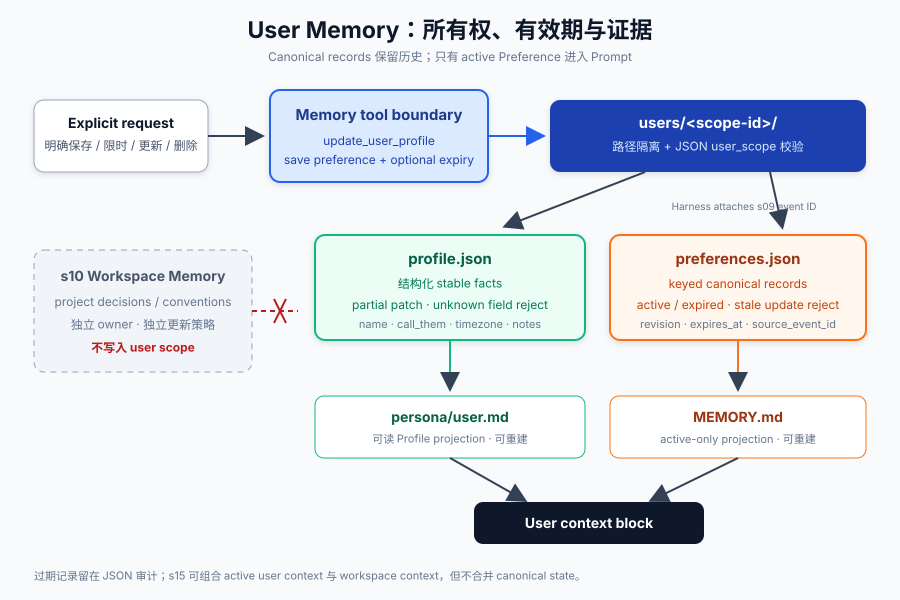
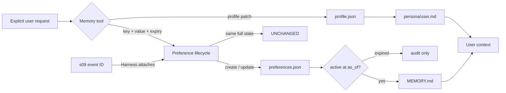

# User Memory：Profile 与 Preference 的用户级边界

> *工作区记忆回答「这个项目长期有效的事实」；用户记忆回答「这个人跨项目仍然有效的稳定信息与明确偏好」。*
>
> **Harness 层**：Memory ownership、显式状态变更、有效期、证据来源与 Prompt context。

s10 把项目决策蒸馏进 workspace。本章继续问：**不属于任何项目的信息存在哪？**  
答案拆成两份契约：**Profile**（你是谁）与 **Preference**（跨项目默认怎么做）——都归用户，但不能混成任意 Markdown。

> 配图：`images/s11-user-memory.svg`

## 你将会得到什么

1. s10 vs s11：项目 Owner vs 用户 Owner  
2. Profile vs Preference：字段 patch vs 稳定 key 生命周期  
3. JSON 是真相；`MEMORY.md` / `persona/user.md` 可重建  
4. CREATED / UPDATED / UNCHANGED；过期留审计、不进投影  
5. `source_event_id` 归 Harness；模型工具不能伪造  
6. 删除墓碑防旧证据复活  
7. 多用户：`scope-id` + JSON 内 `user_scope`  
8. 为何不能自动记住每句话；与 s12 边界  

---

## 零基础名词表

### User Memory（用户记忆）

| 层 | 说明 |
|----|------|
| **是什么** | 绑定**某个人**（`user_scope`）的跨项目记忆 |
| **在本文干什么** | 存 Profile / Preference，组装进用户上下文 |
| **怎么区分** | ≠ s10 项目记忆；≠ s12 远端按 query 召回 |

### Profile（资料）

| 层 | 说明 |
|----|------|
| **是什么** | 「这个用户是谁」的固定字段：`name`、`call_them`、`timezone`… |
| **在本文干什么** | `update_profile` 局部 patch；写 `profile.json`，投影 `persona/user.md` |
| **怎么区分** | ≠ Preference（不是按任意 key 的做事规则） |

### Preference（偏好）

| 层 | 说明 |
|----|------|
| **是什么** | 「跨项目默认怎样做」：稳定 `key` → 当前 `value` |
| **在本文干什么** | `set_preference` / `delete_preference`；写 `preferences.json` |
| **怎么区分** | 同 key 新旧版本互替，不是两条并存的长期事实 |

### WriteStatus（写入三态）

| 层 | 说明 |
|----|------|
| **是什么** | `created` / `updated` / `unchanged`（另有删除相关状态） |
| **在本文干什么** | 告诉调用方这次有没有真的改盘、revision 有没有涨 |
| **怎么区分** | 不能只看 key；要看 value+source+expiry+证据是否全同 |

### expires_at（过期时间）

| 层 | 说明 |
|----|------|
| **是什么** | 临时偏好的截止时刻（带时区，存 UTC） |
| **在本文干什么** | 到期后仍留在 JSON 审计；不进 `MEMORY.md` / Prompt |
| **怎么区分** | ≠ 遗忘删除（遗忘用墓碑，且不保留原文） |

### source_event_id（出处）

| 层 | 说明 |
|----|------|
| **是什么** | 指向 s09 transcript 某事件的稳定 ID |
| **在本文干什么** | Harness 附着；模型 `save_user_preference` **没有**该参数 |
| **怎么区分** | ≠ 模型自述「我记得」 |

### 墓碑（DeletedPreference / tombstone）

| 层 | 说明 |
|----|------|
| **是什么** | 删除后留下的「这个 key 删过、何时删」记录，**不含**被删 value |
| **在本文干什么** | 阻止同时间戳旧证据把偏好复活 |
| **怎么区分** | ≠ 过期记录（过期仍保留原值作审计） |

### scope-id / user_scope

| 层 | 说明 |
|----|------|
| **是什么** | 用户标识的稳定摘要（路径）+ JSON 内印章（内容归属） |
| **在本文干什么** | 同 root 多用户隔离；错拷文件时拒绝读取 |
| **怎么区分** | 路径闸 vs 内容闸，两道都要 |

---

## 先装进脑子的总图

```text
用户明确意图
    │
    ├─ update_profile ──► profile.json ──► persona/user.md（可重建）
    │
    └─ set_preference ──► preferences.json
              │                │
              │                ├─ active ──► MEMORY.md（可重建）──► Prompt
              │                └─ expired ──► 仅审计，不进投影
              │
         delete ──► deleted[] 墓碑（防复活）
```

口诀：**人的习惯进 s11；JSON 说了算；过期不投影；出处归 Harness；删除留墓碑。**

```text
Workspace(s10) → User(s11) → Remote recall(s12)
```

---

## 架构图





重要边界：`UserMemory` **不接收 workspace path**，也不读 s10 日志。两边可在 s15 组装 Prompt 时合并，但存储与所有权分开。

---

## 存储结构

教学默认根：`~/.learn_workbuddy/user-memory/`（可用 `WORKBUDDY_HOME` 改到临时目录）：

```text
user-memory/
└── users/
    └── <scope-id>/
        ├── profile.json
        ├── preferences.json
        ├── MEMORY.md
        └── persona/
            ├── core.md
            ├── identity.md
            ├── user.md
            └── bootstrap.md
```

| 文件 | 角色 | 是否真相 |
|------|------|----------|
| `profile.json` | 结构化资料 | 是 |
| `preferences.json` | 偏好全集（含过期）+ 删除墓碑 | 是 |
| `persona/user.md` | Profile 可读投影 | 否，可重建 |
| `MEMORY.md` | Preference active 投影 | 否，可重建 |

---

## 机制 1：Profile 局部更新

```python
result = memory.update_profile({
    "name": "老王",
    "call_them": "王哥",
    "timezone": "UTC+8",
})
```

规则摘要：

- 只改请求里出现的字段；`None` = 明确删除该字段  
- 不在 schema 的字段直接报错  
- 相同值记 `unchanged`，不无故重写 JSON；投影过期仍会修  

真跑现象：`call_them=王哥` 出现在 `profile.json` / `user.md`；**不会**因此出现在 Preference 的 `MEMORY.md`。

---

## 机制 2：Preference 按 key 去重

```python
class WriteStatus(str, Enum):
    CREATED = "created"
    UPDATED = "updated"
    UNCHANGED = "unchanged"
    DELETED = "deleted"

@dataclass(frozen=True)
class Preference:
    key: str
    value: str
    source: str
    updated_at: str
    revision: int = 1
    expires_at: str | None = None
    source_event_id: str | None = None
```

```python
created = memory.set_preference("response.language", "Chinese")
# → CREATED revision=1

unchanged = memory.set_preference("response.language", "Chinese")
# → UNCHANGED revision=1（全态相同，不涨版本）

updated = memory.set_preference("response.language", "English")
# → UPDATED revision=2
```

幂等身份还包含 `source`、`expires_at`、`source_event_id`。  
旧时间戳不能回滚较新的 canonical `updated_at`。

---

## 机制 3：过期与投影

```python
def status(self, *, as_of=None) -> PreferenceStatus:
    if self.expires_at is None:
        return PreferenceStatus.ACTIVE
    return (
        PreferenceStatus.ACTIVE
        if _as_utc(as_of) < _parse_timestamp(self.expires_at)
        else PreferenceStatus.EXPIRED
    )
```

```python
def read_memory(self, *, as_of=None) -> str:
    """只投影 active；过期记录仍留在 preferences.json。"""
    expected = self._render_preferences(self.list_active_preferences(as_of=as_of))
    if as_of is None and self._read_text(self.memory_path) != expected:
        self._atomic_write_text(self.memory_path, expected)  # 投影可修复
    return expected
```

口诀：**过期 ≠ 删除；审计在，Prompt 里不在。**

---

## 机制 4：出处只归 Harness

模型工具 schema（注意：**没有** `source_event_id`）：

```python
{
    "name": "save_user_preference",
    "input_schema": {
        "type": "object",
        "properties": {
            "key": {"type": "string"},
            "value": {"type": "string"},
            "expires_at": {"type": "string", "format": "date-time"},
        },
        "required": ["key", "value"],
    },
}
```

派发时 Harness 固定 `source="model_tool"`，不接受模型伪造事件 ID：

```python
if name == "save_user_preference":
    result = self.memory.set_preference(
        str(arguments.get("key", "")),
        str(arguments.get("value", "")),
        source="model_tool",
        expires_at=(None if arguments.get("expires_at") in (None, "")
                    else str(arguments["expires_at"])),
    )
```

---

## 机制 5：遗忘墓碑

```python
@dataclass(frozen=True)
class DeletedPreference:
    """只记录删过哪个 key，不保存被删的 value。"""
    key: str
    deleted_at: str
    revision: int
    source: str
```

```text
CREATED  set_preference(..., source_event_id="session-1:e1")
DELETED  delete_preference("response.language")  → deleted[] 墓碑
STALE    同一条旧证据重放 → 拒绝，偏好不复活
```

`forget_user_preference` 工具只能传 `key`；删除时间与来源由 Harness 决定。

---

## 机制 6：多用户双闸

```python
def __init__(self, base_dir=None, *, user_id="local-user"):
    self.scope_id = _scope_id(user_id)
    self.base_dir = self.root_dir / "users" / self.scope_id
    ...

def _read_scoped_json(self, path, *, default_key):
    ...
    if payload.get("user_scope") != self.scope_id:
        raise UserScopeError(f"{path.name} belongs to another user scope")
```

真跑：同 root 下 alice=`tabs`、bob=`spaces`，`scope_id` 不同。

---

## 为什么不能自动记住每句话

长期记忆进未来 Prompt。自动提升聊天内容会：

1. **误归因**（转述 ≠ 本人偏好）  
2. **时效不明**（「今天详细点」≠ 永远详细）  
3. **不可解释**（难追溯、难撤销）  

保守策略：只有用户明确长期意图才走显式工具。

---

## 与 s10、s12 的边界

| 层 | Owner | 内容 |
|----|-------|------|
| s10 Workspace | 项目 | 决策、约定、踩坑 |
| s11 User | 人 | Profile、跨项目偏好 |
| s12 Remote | 远端账号/服务 | 按 query 召回的候选视图 |

---

## 试一下

```bash
cd tracks/harness
python3 -m venv .venv && source .venv/bin/activate
pip install -r requirements.txt
python s11_user_memory/code.py --demo
```

离线偏好烟测（临时目录，无需 Key）：

```python
from pathlib import Path
import tempfile
from s11_user_memory.code import UserMemory

root = Path(tempfile.mkdtemp()) / "user-memory"
mem = UserMemory(root, user_id="alice")
print(mem.set_preference("response.language", "Chinese").status)  # created
print(mem.set_preference("response.language", "Chinese").status)  # unchanged
print(mem.read_memory())
```

交互（可设临时 HOME）：

```bash
WORKBUDDY_HOME=/tmp/learn-workbuddy-s11 WORKBUDDY_USER_ID=alice \
  python s11_user_memory/code.py
# /profile /memory /identity /reset-id q
```

---

## 练习方向（读完可自测）

1. 把单个 `source_event_id` 扩成有界 `source_event_ids`；全态一致才 UNCHANGED。  
2. 即将过期偏好：自动续期 vs 用户确认——进 Prompt 的续期应显式确认。  
3. User Default 由可信 adapter 投影；模型不能自封 `current_turn` / `workspace_override`。

---

## 边界与下一课

**做了：** 用户作用域 Profile/Preference、幂等写入、过期投影、出处边界、墓碑、多用户隔离。  

**没做：** s12 远端检索打分；s15 完整 Prompt 优先级实现；生产级 ASK 审批 UI。

```text
项目归 s10；人归 s11。
JSON 是真相；Markdown 可修。
同态不涨版；过期不进 Prompt。
出处归 Harness；删除留墓碑。
```

下一课：**s12 Cloud / Remote Memory** — stored memory vs recalled context；按当前 query 返回带 source 与 score 的候选。
