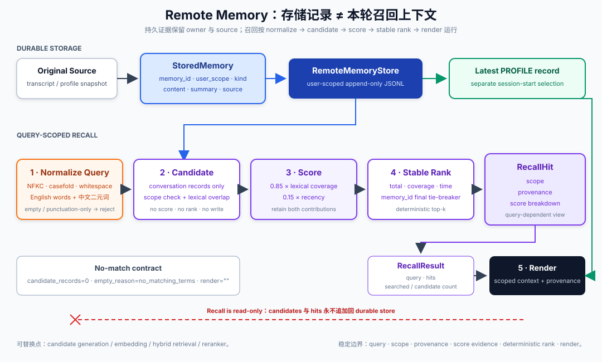
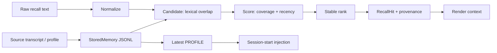

# Remote Memory：Stored Record 与 Recalled Context

> *Memory 是带 owner 和 source 的持久记录；Recall 是针对当前 query 生成的候选视图。两者生命周期、可信度和使用方式不同。*
>
> **Harness 层**：Remote memory boundary、retrieval contract 与 context provenance。

s10 / s11 回答「把什么状态存哪里」。本章继续问：**当前任务需要过去哪一段信息？**  
常见错误是把「库里存过的一切」和「本轮该进 Prompt 的上下文」都叫 memory。

> 配图：`images/s12-cloud-memory.svg`

## 你将会得到什么

1. Stored vs Recall：仓库 ≠ 本轮购物车  
2. 五阶段：`normalize → candidate → score → stable rank → render`  
3. `StoredMemory` / `MemorySource`：`stored_at` ≠ `captured_at`  
4. 透明打分 + 稳定并列键；命中带 breakdown / provenance  
5. 召回只读；Profile 启动注入 ≠ conversation hits  
6. 撤回：追加 retraction；`read_all` 有原文；有效视图没有  
7. `retract_memory` vs s11 forget；purge 设计边界  
8. 工程边界：写入锁、中文二元切词、`RecallResult` 诊断字段、miss 不塞空 XML、hit≠事实、import 不建 store、先稳契约再换 ranker

---

## 零基础名词表

### StoredMemory（持久记录）

| 层 | 说明 |
|----|------|
| **是什么** | 远端/本地 JSONL 里长期保存的一条记忆，带稳定 ID 与用户作用域 |
| **在本文干什么** | 作为召回语料与审计证据 |
| **怎么区分** | ≠ 本轮 RecallHit（命中是临时视图） |

### Recall / RecallHit（召回命中）

| 层 | 说明 |
|----|------|
| **是什么** | 针对**这一次提问**筛出来、排好序的少量候选 |
| **在本文干什么** | 经五阶段流水线进入 Prompt 渲染 |
| **怎么区分** | 换 query 结果可变；读命中 ≠ 再写一条新记忆 |

### normalize（规范化）

| 层 | 说明 |
|----|------|
| **是什么** | 清洗问题：空白折叠、NFKC、大小写、切出可搜 terms |
| **在本文干什么** | 后续所有阶段只认稳定 terms；空/纯标点直接拒绝 |
| **怎么区分** | ≠ 打分；此时还没有候选列表 |

### candidate（候选）

| 层 | 说明 |
|----|------|
| **是什么** | 与问题有词项重叠的记录集合（未打分） |
| **在本文干什么** | 粗筛；不写回仓库 |
| **怎么区分** | ≠ 最终 hits（还要 score/rank） |

### score breakdown（分数拆解）

| 层 | 说明 |
|----|------|
| **是什么** | 总分 = 词覆盖贡献 + 新旧贡献；各项可检查 |
| **在本文干什么** | 解释「为什么排前面」，方便离线测试 |
| **怎么区分** | ≠ 生产 embedding/reranker（本章刻意用透明基线） |

### retract / retraction（撤回）

| 层 | 说明 |
|----|------|
| **是什么** | 追加一条指向目标的撤回事件；不改写旧行 |
| **在本文干什么** | 有效视图拿掉；审计流仍留原文 + 撤回事件 |
| **怎么区分** | ≠ s11 墓碑（s11 不保留原 value） |

### Profile snapshot（远端画像快照）

| 层 | 说明 |
|----|------|
| **是什么** | 某时刻服务端 profile 记录 |
| **在本文干什么** | 会话启动取最新一条注入；不进 conversation hits |
| **怎么区分** | ≠ s11 用户显式 Preference |

### provenance（出处 / 来源证明）

| 层 | 说明 |
|----|------|
| **是什么** | 这条记忆从哪来、何时留下的证据标签（`source_id` / `source_type` / `captured_at`） |
| **在本文干什么** | 跟 hit、Profile 一起进 Prompt，方便审计「为什么捞上来」 |
| **怎么区分** | ≠ 正文 content；≠「事实已确认」的盖章 |

### RecallResult（一次召回的完整观测结果）

| 层 | 说明 |
|----|------|
| **是什么** | 结构化返回：query、hits、扫了多少条、进候选多少条、空原因 |
| **在本文干什么** | 工具/审计看诊断；renderer 再决定是否塞 Prompt |
| **怎么区分** | `searched>0` 且 `candidates=0` = 库有货但对不上词，不是「库空」 |

---

## 先装进脑子的总图

```text
StoredMemory JSONL（带 owner + source）
        │
        ├─ latest PROFILE ──► 会话启动注入（带 memory_id / source）
        │
        └─ CONVERSATION ──► 仅当 recall_history
                              │
                              ▼
              normalize → candidate → score → stable rank → render
                              │
                              ▼
                         RecallHit（本轮视图，不写回）
```

撤回：

```text
retract(target) → 追加 retraction 事件
read_all()        ：原文 + 撤回事件都在
active_records()  ：目标消失 → recall 也看不到
```

口诀：**仓库长期在；召回按问题捞；看不等于写；忘掉留账本。**

```text
s09 transcript → 可成 s12 source
s10 workspace / s11 user → 存哪
s12 remote → 当前问题需要哪段历史
```

---

## 架构图





---

## 机制 1：写入带来源的记录

```python
@dataclass(frozen=True)
class MemorySource:
    source_id: str
    source_type: str
    title: str
    captured_at: str  # 原始事件发生时间

@dataclass(frozen=True)
class StoredMemory:
    memory_id: str
    user_scope: str
    kind: MemoryKind
    content: str
    summary: str
    source: MemorySource
    stored_at: str      # 写入仓库的时间
```

```python
store.append(
    kind=MemoryKind.CONVERSATION,
    memory_id="memory-42",
    content="Selected SQLite WAL for local persistence.",
    summary="Selected SQLite WAL.",
    source=MemorySource(
        source_id="transcript-42",
        source_type="conversation_transcript",
        title="Persistence decision",
        captured_at="2026-08-01T12:00:00Z",
    ),
)
```

`captured_at` ≠ `stored_at`：周一聊的、周三入库，两者可以不同。

---

## 机制 2：五阶段召回

```text
normalize → candidate → score → stable rank → render
```

```python
def normalize_recall_query(text, *, user_scope, limit, query_id, issued_at) -> RecallQuery:
    readable_text = _clean_text(text, ...)
    normalized_text = _normalize_search_text(readable_text)
    terms = _tokenize(normalized_text)
    if not terms:
        raise RemoteMemoryValidationError("recall query has no searchable terms")
    ...
```

教学打分（透明基线）：

```text
总分 = 0.85 × 词覆盖率  +  0.15 × 新旧程度（看 captured_at）
```

```python
def score_recall_candidate(query, candidate, *, as_of) -> RecallScoreBreakdown:
    coverage = len(candidate.matched_terms) / len(query.terms)
    age_days = max((_utc(as_of) - candidate.captured_at).total_seconds() / 86_400, 0.0)
    recency = 1.0 / (1.0 + age_days / RECENCY_WINDOW_DAYS)
    lexical_contribution = LEXICAL_WEIGHT * coverage
    recency_contribution = RECENCY_WEIGHT * recency
    return RecallScoreBreakdown(..., total=round(lexical_contribution + recency_contribution, 6))
```

稳定并列键：

```text
总分 DESC → 词覆盖 DESC → captured_at DESC → memory_id ASC
```

```python
scored.sort(
    key=lambda item: (
        -item.score_breakdown.total,
        -item.score_breakdown.lexical_coverage,
        -item.candidate.captured_at.timestamp(),
        item.candidate.record.memory_id,
    )
)
```

召回**只读**：多次 `recall` 不追加 durable store。

---

## 机制 3：Profile 分路

| | Profile 快照 | Conversation 召回 |
|--|--------------|-------------------|
| 时机 | 会话启动取最新 | 显式 `recall_history` |
| 进 hits？ | 否 | 是 |
| 策略 | 最新 snapshot | 按 query 五阶段 |

注入带 provenance，例如：

```xml
<remote_profile memory_id="profile-001"
                source_id="profile-snapshot-001"
                captured_at="...">
  ...
</remote_profile>
```

---

## 机制 4：撤回两视图

```python
store.retract("conv-1", reason="用户要求忘掉", source=source)
assert "conv-1" in {r.memory_id for r in store.read_all()}
assert "conv-1" not in {r.memory_id for r in store.active_records()}
```

| 视图 | 方法 | 撤回内容 |
|------|------|----------|
| 审计流 | `read_all()` | 在 |
| 有效视图 | `active_records()` | 不在 |

离线 `/retract-demo` 典型输出：

```text
[before] recall '...': conversation-003, conversation-005
[before] read_all=7 active=7
[harness] retract conversation-003 -> retraction-...
[after] recall '...': conversation-005
[after] read_all=8 active=6; conversation-003 still in read_all: True
[restart] recall '...': conversation-005
[reject] unknown id: rejected
[reject] retraction event: rejected
```

### 与 s11 forget 对照

| | s11 forget | s12 retract |
|--|------------|-------------|
| 标识 | preference key | memory_id |
| 原文 | 墓碑不留 value | `read_all` 仍有原文 |
| 工具 | `forget_user_preference` | `retract_memory`（source 由 Harness 填） |

---

## 与 s09–s11 边界

| 模块 | Owner | 回答 |
|------|-------|------|
| s09 Transcript | session | 这一轮真实发生了什么 |
| s10 Workspace | workspace | 项目长期有效什么 |
| s11 User | user | 跨项目默认怎样 |
| s12 Remote | remote user/service | 当前问题需要哪段长期历史 |

s09 transcript 可以成为 s12 的 source，但「有 transcript」≠「必须召回」。

---

## 机制 5：工程边界（教案补洞）

### 5.1 写入锁：查重与追加同一临界区

并发两次相同 `memory_id` 若「先查重、再各自写」，会竞态成重复行。教学实现用 `flock`，把查重和 append 放进同一把排他锁：

```python
@contextmanager
def _exclusive_store_lock(path: Path) -> Iterator[None]:
    lock_path = path.with_name(f"{path.name}.lock")
    descriptor = os.open(lock_path, os.O_CREAT | os.O_RDWR, 0o600)
    locked = False
    try:
        fcntl.flock(descriptor, fcntl.LOCK_EX)
        locked = True
        yield
    finally:
        if locked:
            fcntl.flock(descriptor, fcntl.LOCK_UN)
        os.close(descriptor)

def _append_record(self, record: StoredMemory) -> StoredMemory:
    encoded = (json.dumps(record.to_dict(), ...) + "\n").encode("utf-8")
    with _exclusive_store_lock(self.path):
        existing = {item.memory_id: item for item in self.read_all()}
        if record.memory_id in existing:
            raise RemoteMemoryDuplicateError(...)
        # 同锁内 O_APPEND 写入
        ...
```

生产远端服务可用唯一索引 / 条件写达到同一边界；本地用 advisory lock 只是教学模拟。

### 5.2 中文按相邻两字搭桥

英文用词 token；中文连续汉字切 **字二元（bigram）**：`分层记忆` → `分层` / `层记` / `记忆`。纯标点归一化后无 terms → 拒绝，不退化成全量召回。

```python
def _tokenize(text: str) -> tuple[str, ...]:
    normalized = _normalize_search_text(text)
    terms = set(re.findall(r"[a-z0-9_]+", normalized))
    for segment in re.findall(r"[\u4e00-\u9fff]+", normalized):
        if len(segment) == 1:
            terms.add(segment)
        else:
            terms.update(
                segment[index : index + 2] for index in range(len(segment) - 1)
            )
    return tuple(sorted(terms))
```

### 5.3 RecallResult：三个数 + 空原因

```python
@dataclass(frozen=True)
class RecallResult:
    query: RecallQuery
    hits: tuple[RecallHit, ...]
    searched_records: int      # 扫了多少条 conversation
    candidate_records: int     # 有词重叠、进了打分
    empty_reason: str | None = None  # 无 hit 时如 "no_matching_terms"
```

真跑对照：

```text
HIT  searched=1 candidates=1 hits=1 empty=None
MISS searched=1 candidates=0 hits=0 empty=no_matching_terms
```

口诀：`searched>0` 且 `candidates=0` → **有货但对不上词**，不是库空。

### 5.4 Render：miss 返回空串

有 hits → 吐带 query / score / provenance / snippet 的 XML；无 hits → `""`，避免空 `<recalled_context/>` 白占 Prompt。

```python
def render_recall_context(result: RecallResult) -> str:
    if not result.hits:
        return ""
    lines = [
        f'<recalled_context query_id="..." searched_records="..." ...>',
        ...
    ]
    ...
```

### 5.5 命中 ≠ 事实正确 ≠ 必进 Prompt

| 层次 | 含义 |
|------|------|
| 命中 | 和本轮 query 词对上了、排进候选 |
| 事实正确 | 内容是否靠谱——召回**不验真** |
| 必进 Prompt | 还要看 budget / 策略；hit 不是自动盖章 |

模型看到的是「本轮召回候选」，不是无来源的事实段落。

### 5.6 无 Key / import 不建 store

存储与召回是纯本地契约。副作用拆成两个懒入口：

```text
default_runtime()  → 首次 CLI / recall_history 才建教学 store
runtime_client()   → 真正 online 对话才要模型 Key
```

`import RemoteMemoryStore, RecallEngine` **不会**写默认目录、**不会**要 API Key。

### 5.7 为何不做复杂 reranker

先稳住管道契约：

```text
normalize → candidate → score 拆解 → 稳定排序 → 带来源 hits → render
```

立刻上 embedding / hybrid / LLM reranker，出问题难分清坏在哪一段。  
以后换更强排序：**只要仍返回同一个 `RecallResult`**，上层 tool 与 Prompt 装配不用重写。

---

## 试一下

```bash
cd tracks/harness
python3 -m venv .venv && source .venv/bin/activate
pip install -r requirements.txt
python s12_cloud_memory/code.py --demo
python s12_cloud_memory/code.py
# /retract-demo
```

可用 `WORKBUDDY_HOME` / `WORKBUDDY_USER_ID` 隔离教学目录。

---

## 练习方向

1. `RecallResult.retracted_records` 纯计数：不含原文，但可能暴露「有匹配已撤回」的存在感。  
2. 物理 purge：保留撤回事件、抹 content；崩溃恢复宜 **先 journal 意图 → 再抹 → 再标完成**。  
3. 对照 s11/s12 忘掉语义（见上表）。

---

## 边界与下一课

**做了：** Stored/Recall 契约、五阶段透明召回、Profile 分路、撤回两视图、工具入口；写入锁、中文二元、`RecallResult` 诊断、miss 空串、hit≠事实、懒加载、换 ranker 保契约。  

**没做：** 生产 embedding/hybrid/reranker 实现细节；物理 purge 完整实现；s13 大输出外部化。

```text
库里有的 ≠ 本轮该用的。
五步流水线；看不等于写。
Profile 启动注；历史按问题捞。
撤回退视图；账本仍留痕。
命中只是候选；miss 不塞空壳。
换打分不换 RecallResult。
```

下一课：**s13 Output Externalization** — 大工具结果外置，Prompt 里留指针。
