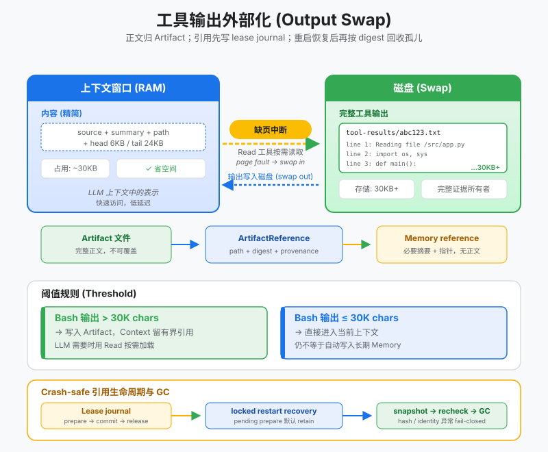
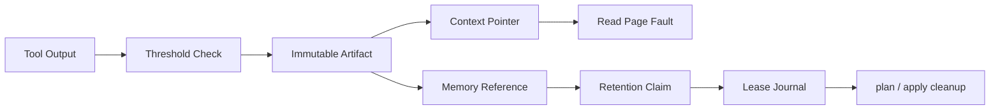

# Tool Output Externalization：内存不够，换到磁盘

> *上下文是内存，磁盘是外存 — 大工具输出全文落盘，Prompt 只留指针。*
>
> **Harness 层**：上下文管理 — 虚拟内存换页机制。

s12 把大量远端记录压成少量 hits。本章继续问：**单条工具结果本身就太大时怎么办？**  
一条 `grep` 可能几百 KB～几十 MB；上下文窗口装不下，截断又可能丢掉关键行。

> 配图：`images/s13-output-externalization.svg`

## 你将会得到什么

1. 为何外部化：完整不丢，Prompt 只涨有界体积  
2. 三表示：Artifact / Context pointer / Memory 瘦引用  
3. 阈值 + 独占写盘（不覆盖旧证据）  
4. Pointer：Bash head+tail；非 Bash 短预览；缺页 Read  
5. Memory 无正文；无路径 RetentionClaim  
6. Journal：PREPARED → 发布 → COMMITTED；释放先删引用  
7. 对账 fence + plan/apply 清理 fail-closed；入口防线优先于智能记忆  

---

## 零基础名词表

### Artifact（工件 / 磁盘证据）

| 层 | 说明 |
|----|------|
| **是什么** | `tool-results/tool_result_NNN.txt` 里的完整工具输出 |
| **在本文干什么** | 唯一正文所有者；审计与按需读回 |
| **怎么区分** | ≠ 塞进 Prompt 的那段文字 |

### Context pointer（上下文指针）

| 层 | 说明 |
|----|------|
| **是什么** | 本轮 messages 里的有界表示：摘要 + 出处 + 预览 + 路径 |
| **在本文干什么** | 让模型知道「有大事发生过、全文在哪」，又不撑爆窗口 |
| **怎么区分** | ≠ 全文；中间段落可能不在预览里 |

### Memory reference（记忆瘦引用）

| 层 | 说明 |
|----|------|
| **是什么** | 交给后续 Memory 策略的元数据（summary / path / digest / source） |
| **在本文干什么** | 跨会话检索「怎么指回去」 |
| **怎么区分** | **没有** `content`，也不复制 head/tail |

### 缺页 / page fault

| 层 | 说明 |
|----|------|
| **是什么** | 需要中间某段时，再用 Read 从磁盘取回行窗口 |
| **在本文干什么** | 按需加载，避免整文件灌回 Prompt |
| **怎么区分** | ≠ 第一次外部化时的 pointer 预览 |

### RetentionClaim / lease journal

| 层 | 说明 |
|----|------|
| **是什么** | 「这份 Artifact 还有人要」的租约；journal 用 append-only 日志扛崩溃 |
| **在本文干什么** | 决定 GC 能不能删文件 |
| **怎么区分** | claim **无物理路径**；路径由可信 session 根推导 |

### fail-closed（失败则关闭）

| 层 | 说明 |
|----|------|
| **是什么** | 清理时身份/摘要对不上 → **不删**，而不是硬删 |
| **在本文干什么** | 防止误删被替换或损坏的证据 |
| **怎么区分** | ≠「尽量多删腾空间」 |

---

## 先装进脑子的总图

```text
工具输出很大？
    │
    ├─ 否 → 原文进上下文
    └─ 是 → 写 Artifact（全文）
              │
              ├─ Context pointer → 本轮 Prompt（有界）
              ├─ Memory reference → 可选长期策略（无正文）
              └─ RetentionClaim + journal → 保护 / 对账 / 清理
```

口诀：**磁盘管全文；Prompt 管这一轮预览；Memory 管怎么指回去；不确定就护着。**

```text
s12：库太大 → 召回少量 hits
s13：一条结果太大 → 外置 + 指针
s14：对话太长 → 压缩（下一课）
```

---

## 架构图





---

## 机制 1：三表示不能揉成一段字符串

| 表示 | 含什么 | 有全文？ |
|------|--------|----------|
| Artifact 文件 | 完整输出 | ✅ |
| Context pointer | 摘要 + provenance + 预览 + 路径 | ❌ |
| Memory reference | summary / path / digest / source | ❌ 无 `content` |

```python
@dataclass(frozen=True)
class ArtifactMemoryReference:
    summary: str
    artifact_path: str
    content_sha256: str
    source_tool: str
    source: ArtifactSource
    # 故意没有 content，也不复制 pointer 预览

@dataclass(frozen=True)
class ArtifactReference:
    path: Path
    summary: str
    source_tool: str
    source: ArtifactSource
    byte_size: int
    character_count: int
    content_sha256: str

    def for_memory(self) -> ArtifactMemoryReference:
        return ArtifactMemoryReference(
            summary=self.summary,
            artifact_path=str(self.path),
            content_sha256=self.content_sha256,
            source_tool=self.source_tool,
            source=self.source,
        )
```

---

## 机制 2：阈值 + 独占写盘

```python
BASH_MAX_OUTPUT_LENGTH = 30000        # Bash：字符数
TOOL_RESULT_THRESHOLD_KB = 50         # 其他：字节

def should_externalize(self, output: str, tool_name: str) -> bool:
    if tool_name == "bash":
        return len(output) > BASH_MAX_OUTPUT_LENGTH
    return len(output.encode("utf-8")) > TOOL_RESULT_THRESHOLD_KB * 1024

def _next_artifact_path(self) -> Path:
    while True:
        self._counter += 1
        candidate = self.tool_results_dir / f"tool_result_{self._counter:03d}.txt"
        try:
            candidate.touch(mode=0o600, exist_ok=False)  # 已存在则跳号
        except FileExistsError:
            continue
        return candidate
```

进程重启后计数器归零也安全：不会覆盖旧 `001`，旧 pointer 不会指到新内容。

---

## 机制 3：Pointer 与缺页

Bash：head **6KB** + tail **24KB**（头看开头，尾看结论/错误摘要）。  
非 Bash：约 2KB 预览 +「去路径读全文」。  
中间关键行不在首次 pointer 里 → Agent 再 Read（缺页）。

```python
def make_pointer(self, output: str, artifact: ArtifactReference) -> str:
    header = (
        f"[Artifact: {artifact.source.source_id}]\n"
        f"Summary: {artifact.summary}\n"
        f"Source: {artifact.source_tool}; SHA-256: {artifact.content_sha256}\n"
        f"Full output: {artifact.path}\n"
    )
    if artifact.source_tool == "bash":
        raw = output.encode("utf-8")
        head = raw[:HEAD_BYTES].decode("utf-8", "ignore")
        tail_start = max(len(raw) - TAIL_BYTES, HEAD_BYTES)
        tail = raw[tail_start:].decode("utf-8", "ignore")
        return f"{header}\n{head}\n\n... [omitted] ...\n\n{tail}"
    preview = output[:2048]
    return f"{header}\nPreview:\n{preview}\nUse Read tool to access full content."
```

真跑对照（教学 demo）：

```text
[externalize] tool_result_001.txt written, 1033.0KB → 30.6KB (saved 97.0%)
[page-fault] reading tool_result_001.txt (lines 15999-16003)  # 中间 critical.py
Without externalization: ~264,449 tokens for that one tool call alone
```

---

## 机制 4：无路径租约

```python
@dataclass(frozen=True)
class ArtifactRetentionClaim:
    source_id: str
    content_sha256: str
    reference_count: int = 1
    retain_until: str | None = None
    # 故意没有 path —— 清理只信可信 session 根 + digest
```

清理器**不能**直接信 Memory 里的路径字符串去删文件（否则成任意删文件入口）。  
用 `source_id` 在本 session 的 `tool-results/` 下解析，并核对完整 SHA-256。

---

## 机制 5：Journal 发布 / 释放顺序

```text
发布：PREPARED（fsync）→ Memory 写引用 → COMMITTED（fsync）
释放：先删 Memory 引用成功 → 再 RELEASED
```

- 仅当 adapter **明确保证未写入且无在途写入**（如 `ArtifactPublicationRejected`）才可 `ABORTED`  
- 超时/断连等不确定 → 保持 `PREPARED`，等对账  
- 错序「先 Memory 后 journal」崩溃 → Memory 有指针、无人认领保护 → **悬空证据**

---

## 机制 6：对账 fence + 两阶段清理

**对账**：对 pending 租约问可信 Memory owner（generation fence）。  
未封存的「没找到」不能直接 abort；tombstone 后才可 abort，并挡住该 transaction 的迟到写入与重放。

**清理**：

1. `plan_cleanup`：只读，标 retain / planned_delete（可 dry-run）  
2. `apply_cleanup`：删前重验归属、快照、digest；**一变就 fail-closed 不删**  
3. 仍有 active claim，或未过 orphan TTL → 不删  

---

## 三层防线（本章 = 入口控制）

| 层 | 策略 | 本轨落点 |
|----|------|----------|
| ① 入口控制 | 大东西别进上下文 | **s13 外部化** |
| ② 主动压缩 | 已经太大再压缩 | s14 |
| ③ 持久化扩展 | 记忆分层按需取回 | s10–s12 |

为什么外部化优先于「智能记忆」：没有它，第一回合就被 grep 撑爆，后面记忆再聪明也跑不下去。

---

## 试一下

```bash
cd tracks/harness
python3 -m venv .venv && source .venv/bin/activate
pip install -r requirements.txt
python s13_output_externalization/code.py --demo
python s13_output_externalization/code.py
python s13_output_externalization/code.py --interactive
# large → read 15998 5 → summary → q
```

MockLLM，无需 API Key。

---

## 练习方向

1. head/tail 不够时：正则命中 `ERROR`/`critical` 等行，再取上下窗口（仍限制总预览体积）。  
2. `ArtifactReferenceOwner`：fence 防同 transaction 并发改；tombstone 拒迟到写入与重放。  
3. 进阶可按信息密度/结构分策略；教学基线可先只按大小。

---

## 边界与下一课

**做了：** 阈值外置、三表示、独占写盘、pointer/缺页、瘦引用、无路径租约、journal 顺序、对账与 fail-closed 清理。  

**没做：** 生产跨主机对象存储锁细节；s14 四层压缩管线本身。

```text
完整不丢；Prompt 有界。
三表示分家；缺页按需读。
先记账再办事；不确定就护着。
清理一变就停手。
```

下一课：**s14 Context Compact** — 对话本身变长后的压缩管线。
