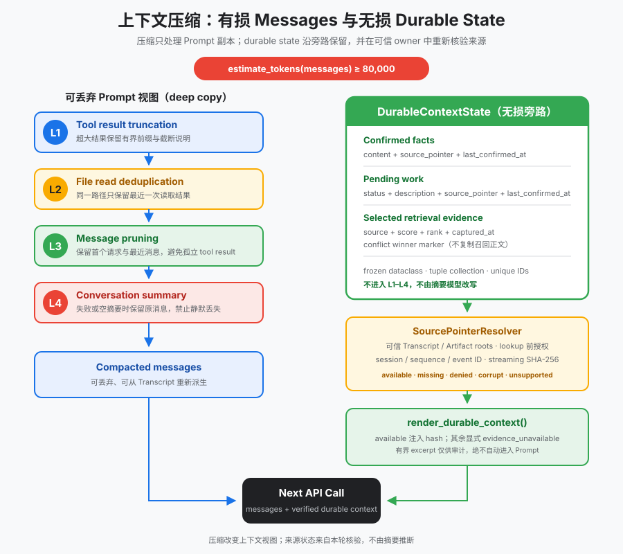
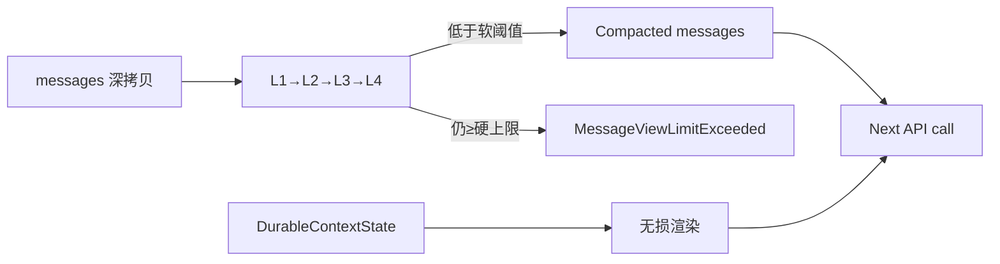

# Context Compact：上下文总会满，要有办法腾地方

> *四层压缩管线：保最新、弃最旧冗余、留摘要；账本旁路不进碎纸机。*
>
> **Harness 层**：上下文管理 — agent 的记忆预算。

s13 解决「**一条**工具输出太大」。本章继续问：对话跑久了，**整段 messages 历史**把窗口撑满怎么办？  
不能乱删早期消息（失忆），也不能不压（API 报错）。

> 配图：`images/s14-context-compact.svg`

## 你将会得到什么

1. 为何分层压缩：先轻后重  
2. 只压 messages 深拷贝；Durable 旁路无损  
3. 四层 L1→L4；软阈值 80k / 硬上限 120k  
4. Pending 仅 harness 结案；done 终态与归档  
5. Source pointer 五态核验（门牌≠乱开路径）  
6. 工具调用成对裁剪；摘要失败保留原文  
7. 压缩≠Memory 写入；只冻已选 hit；串 s15  

---

## 零基础名词表

### messages（聊天草稿本）

| 层 | 说明 |
|----|------|
| **是什么** | 送给模型的对话列表副本 |
| **在本文干什么** | 四层压缩只动这份深拷贝 |
| **怎么区分** | ≠ Transcript 原件；≠ Durable 账本 |

### DurableContextState（便利贴柜子 / 账本）

| 层 | 说明 |
|----|------|
| **是什么** | 已确认事实、未决事项、已选检索证据的结构化状态 |
| **在本文干什么** | 旁路渲染进下一轮；不进有损压缩层 |
| **怎么区分** | 摘要写错也改不了柜子里的字段 |

### 软阈值 / 硬上限

| 层 | 说明 |
|----|------|
| **是什么** | 教学常数：≥80k 开始压；四层后仍 ≥120k 则拒绝请求 |
| **在本文干什么** | 启动压缩 vs fail-closed 不准入 |
| **怎么区分** | 粗估只覆盖 messages，不是完整模型窗口账单 |

### PendingItem（未决待办）

| 层 | 说明 |
|----|------|
| **是什么** | durable 里的待办，状态 open / blocked / done |
| **在本文干什么** | 只有 harness 能结案；done 不能改回 open |
| **怎么区分** | ≠ 摘要里一句「做完了」 |

### Source pointer（来源门牌）

| 层 | 说明 |
|----|------|
| **是什么** | `transcript:…` / `artifact:…` 这类标识，不是随意文件路径 |
| **在本文干什么** | 经可信根 + 授权核验，得到五态 |
| **怎么区分** | 不能拼成路径乱读；非 available 不能假装已验证 |

### 增量摘要

| 层 | 说明 |
|----|------|
| **是什么** | 旧摘要 S0 + 新消息 Δ → 合并成 S1，不必每次塞整本历史 |
| **在本文干什么** | 省摘要成本；durable 仍不参与合并 |
| **怎么区分** | ≠ 把柜子也扔进模型润色 |

---

## 先装进脑子的总图

```text
messages 太厚？
    │
    ├─ < 80k → 不压
    └─ ≥ 80k → 深拷贝后：
         L1 截断工具结果 → 够了就停
         L2 文件读去重   → 够了就停
         L3 修剪旧消息   → 够了就停
         L4 对话摘要
         仍 ≥ 120k → MessageViewLimitExceeded（不请求模型）

DurableContextState ──旁路──> 下一轮 system 区（无损）
```

口诀：**压草稿，不动账本；先轻后重；破硬顶就停手。**

```text
s13：一条输出太大 → 外置
s14：整段历史太长 → 压缩
s15：系统提示怎么拼 → 组装
```

---

## 架构图





---

## 机制 1：四层从轻到重

| 层 | 做什么 | 代价 |
|----|--------|------|
| L1 | 过大 tool_result 截成有界摘要 | 低 |
| L2 | 同一文件多次读 → 只留最新一组交互 | 低 |
| L3 | 修剪旧消息，保最近轮次 | 中 |
| L4 | 模型生成摘要替换旧历史 | 高 |

```python
TOKEN_THRESHOLD = 80_000
HARD_LIMIT = 120_000

def compact_context(messages, durable_state=EMPTY_DURABLE_STATE, ...):
    working = copy.deepcopy(messages)   # 不污染原列表 / Transcript 视图
    validate_tool_protocol(working)
    tokens = estimate_tokens(working)
    if tokens < TOKEN_THRESHOLD:
        return CompactionResult(...)    # 不压

    working, _ = truncate_tool_results(working)   # L1
    if estimate_tokens(working) < TOKEN_THRESHOLD: ...
    working, _ = dedup_file_reads(working)        # L2
    ...
    working, _ = prune_old_messages(working)      # L3
    ...
    working, _ = generate_summary(working, ...)   # L4

    if estimate_tokens(working) >= HARD_LIMIT:
        raise MessageViewLimitExceeded(...)
    return CompactionResult(messages=working, durable_state=durable_state, ...)
```

`durable_state` 原样带回：压缩层不改账本。

### 各层关键参数与代码（对照 README）

**L1**：单条 tool_result 估算 > **5000 tokens** 才截断（有界前缀 +「已截断」提示）。这是压缩层；工具自己还可能先把读文件裁到约 20000 字符。

```python
MAX_TOOL_RESULT_TOKENS = 5000

def truncate_tool_results(messages: list) -> tuple[list, int]:
    validate_tool_protocol(messages)
    saved = 0
    for msg in messages:
        ...
        if tokens > MAX_TOOL_RESULT_TOKENS:
            max_chars = MAX_TOOL_RESULT_TOKENS * 4
            block["content"] = result[:max_chars] + f"\n\n[... 已截断: 原始 {original_len} ...]"
            saved += tokens - MAX_TOOL_RESULT_TOKENS
    validate_tool_protocol(messages)
    return messages, saved
```

**L2**：按 `_read_path` 找「同一文件读多次」，只留最新；删除时按 `tool_use_id` **成对**去掉旧 use+result。

**L3**：默认保留最近 **`KEEP_RECENT_TURNS = 6`** 轮；若裁剪边界劈开一对 tool 交互，会把跨越边界的一侧也去掉，避免半截协议。

**L4**：最贵（一次摘要 API）。切分时若 4 条「最近消息」劈开 tool 对，会把窗口向前扩到完整交互；摘要失败则**原视图不动**。

### 在 Agent 循环里的位置

每次调模型**之前**先压 messages，再核验 pointer、渲染 durable，拼进 system：

```python
def agent_loop(messages, durable_state, resolver):
    while True:
        result = compact_context(messages, durable_state)
        messages = result.messages
        source_resolutions = resolve_durable_sources(result.durable_state, resolver)
        durable_context = render_durable_context(
            result.durable_state,
            source_resolutions=source_resolutions,
        )
        response = client.messages.create(
            system=SYSTEM + "\n\n" + durable_context,
            messages=messages,
            ...,
        )
```

---

## 机制 2：草稿本 vs 柜子（数据结构）

```python
@dataclass(frozen=True)
class DurableFact:
    fact_id: str
    content: str
    source_pointer: str
    last_confirmed_at: str

@dataclass(frozen=True)
class PendingItem:
    item_id: str
    description: str
    source_pointer: str
    last_confirmed_at: str
    reason: str | None = None
    status: str = "open"  # open / blocked / done

@dataclass(frozen=True)
class RetrievalEvidence:
    memory_id: str
    source_id: str
    source_type: str
    source_title: str
    captured_at: str
    score: float
    source_rank: int
    conflict_key: str | None = None

@dataclass(frozen=True)
class DurableContextState:
    facts: tuple[DurableFact, ...] = ()
    pending_items: tuple[PendingItem, ...] = ()
    retrieval_evidence: tuple[RetrievalEvidence, ...] = ()
```

`frozen` + tuple：压缩流程不能就地改字段、乱追加。  
`source_pointer` 可指 s09 Transcript 或 s13 Artifact。

| 可以有损（messages） | 必须无损（Durable） |
|----------------------|---------------------|
| 旧对话细节、重复读取 | 已确认事实 |
| 大工具结果副本 | pending / source pointer |
| 探索过程 | 已选检索的 score/rank/冲突标记 |

---

## 机制 3：Pending 结案与归档

只有 harness 的 `transition_pending_item()` 能改状态（`compact` / `generate_summary` 从不调用）：

| 迁移 | 额外要求 |
|------|----------|
| open → blocked / done | 新 `source_pointer`；blocked 还要 `reason` |
| blocked → open / done | 离开 blocked 清空 `reason` |
| done → * | 终态，抛错 |

渲染：open/blocked 全显示；**done 只显示按时间最新的 `MAX_RENDERED_DONE_ITEMS = 3` 条**，其余折叠为 `done_omitted=<n>`——state 里审计仍在。

真跑 `/pending-demo`：

```text
[before] ship-docs ... status=open
[harness] open -> done
[harness] done -> open rejected
[archive] ship-docs archived_at=...
```

`archive_done_pending_items(state, now=..., older_than=...)` 返回 `(新 state, 审计记录)`。  
审计若落 JSONL：**先写审计，再替换 state**；重放按 item_id 去重。  
模型工具 / 摘要「已完成」不能越权归档。

---

## 机制 4：Source pointer 五态

```text
transcript:<session_id>:<positive_sequence>
artifact:<session_id>:<filename>:<12-or-64-char-sha256>
```

物理根由 harness 配置；授权在查找前执行；拒绝 `..` / 斜杠逃逸等。

| 状态 | Prompt 呈现 |
|------|-------------|
| `available` | `source_status=available` + 完整 evidence SHA-256 |
| `missing` / `denied` / `corrupt` / `unsupported` | `evidence_unavailable=true`（不假装已验证） |

`render_durable_context()` **不注入**核验时读到的 excerpt 正文（防绕过预算）。  
`source_resolutions` 必须与 state 里去重后的 pointer **一一绑定**。  
远端 object store adapter：同一五态 + 前置授权；重定向/过期签名/跨租户 key → 拒绝，不假 `available`。

---

## 机制 5：工具成对 + 摘要失败

入口先 `validate_tool_protocol()`：缺配对、未知/重复/倒序 ID → `ToolProtocolError`，即使未到软阈值也不把坏历史交给 provider。

L2–L4 删除时按 ID **整组**留或整组走。  
L4 摘要失败 → **保留原消息**。  
四层后仍 ≥ 硬上限 → `MessageViewLimitExceeded`（带前后 token / 已执行层，不带正文）。

---

## 机制 6：压缩不是 Memory 写入

```text
Transcript ──派生──> messages ──有损──> compacted
Memory / 已选 hit ──> DurableContextState ──无损渲染──> system
```

`capture_retrieval_evidence()` 只冻**已选** hit（含 score、rank、可选 `conflict_key`）。  
有 `conflict_key` 时渲染为 `conflict_winner=<key>`，否则 `conflict=none`——保存上游裁决，不让摘要模型再判一次。  
正文可变短；选择依据不重审；落选者不因窗口变小翻盘。

---

## 常见误区（教案有则必记）

- 简单删早期消息 → 丢掉用户原始意图  
- 让生成式摘要保管 durable fact → 会改写/漏 pending  
- 压缩后不标注来源 → 难复核  
- pointer 当路径乱读 → 路径遍历 / 跨 session  
- 核验失败仍当「已验证」→ 伪造可用性  
- 把 excerpt 自动灌进 Prompt → 绕过预算与选择边界  
- 原地改 messages → 污染 Transcript 回放  
- 摘要失败仍用错误串顶替 → 丢掉最后可用上下文  
- 只删一半 tool 对 → provider 拒请求  

---

## Token 粗估与生产化方向

教学：`约 4 字符 ≈ 1 token`（粗估；中文/结构化结果易偏）。

| 关注点 | 本章 | 生产化方向 |
|--------|------|------------|
| token 计数 | 4 字符估 | 目标模型 tokenizer；计入 system/tools |
| 工具结果 | 有界前缀 | 头尾保留或外置 Artifact（衔 s13） |
| 摘要失败 | 原消息保留 | 超时、重试、可观测原因 |
| source 核验 | 本地可信根 | 对象存储 adapter、签名、租户策略 |
| 检索证据 | 冻已选元数据 | 持久化 query/decision trace |

**Harness 公共边界**：综合章可复用本章契约；`import` 压缩模块时不应顺带解析调用方 CLI provider——只有直接跑 `code.py` 才拥有那段命令行配置。

---

## 试一下

```bash
cd tracks/harness
python3 -m venv .venv && source .venv/bin/activate
pip install -r requirements.txt
python s14_context_compact/code.py --demo
python s14_context_compact/code.py
# /pending-demo
# stats
```

---

## 练习方向

1. 归档审计 JSONL：先记账再换 state；仅 harness；id 去重。  
2. 增量摘要：吃 Δ 合并进 S0；durable 不参与；用「错摘要 vs 柜子不变」证明。  
3. 远端 resolver：同五态 + 授权；越界不假 available。  
4. 精确 tokenizer 对照粗估偏差。

---

## 边界与下一课

**做了：** 四层压缩、软硬阈值、durable 旁路、pending/归档、pointer 五态、工具原子裁剪、与 Memory 分家。  

**没做：** s15 系统提示分段组装细节；生产对象存储完整实现。

```text
压草稿，不动账本。
先轻后重；破顶停手。
结案归 harness；门牌要核验。
工具成对；落选不翻盘。
```

下一课：**s15 Prompt Assembly** — 运行时分段拼接系统提示。
