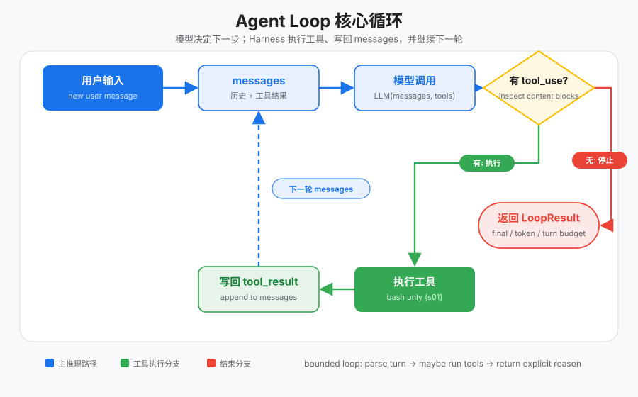
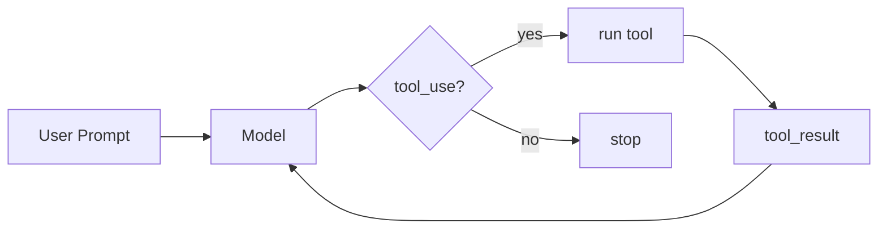

# s01 — Agent Loop

> **状态**：`available`  
> **长文**：[权限无关 · Agent 循环](../../../notes/learn-workbuddy/s01-agent-loop.md)  
> **上游教案**：[learn-workbuddy s01](https://github.com/adongwanai/learn-workbuddy/tree/main/s01_agent_loop)



## 今日目标

跑通最小 `while` agent loop：模型若返回 `tool_use` 则执行工具并把 `tool_result` 喂回；否则结束。能解释停止条件（无工具 / 轮次预算）。

## 代码架构图



## 文件说明

| 文件 | 作用 |
|------|------|
| `code.py` | 本章可跑脚本（`--demo` 离线） |
| `images/` | 循环架构图 |

## 推荐顺序

| 步骤 | 命令 | 你会看到什么 |
|:----:|------|-------------|
| 0 | `cd tracks/harness && pip install -r requirements.txt` | 依赖就绪 |
| 1 | `python3 s01_agent_loop/code.py --demo` | 离线走完一轮 loop |

## 验收命令

```bash
cd tracks/harness
python3 s01_agent_loop/code.py --demo
```

## 验收标准

- 命令退出码 0
- 终端能看到 demo 轨迹（含工具或显式结束），而非立刻 ImportError
