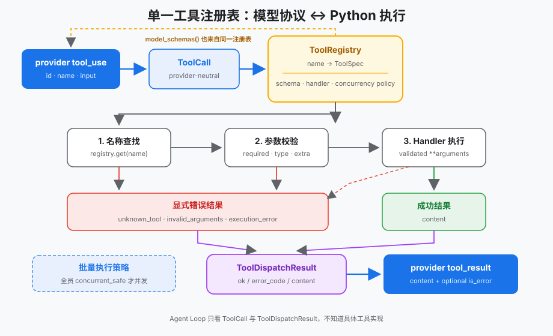
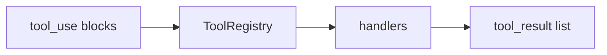

# s02 — Tool Dispatch

> **状态**：`available`  
> **长文**：[工具分发](../../../notes/learn-workbuddy/s02-tool-dispatch.md)  
> **上游教案**：[learn-workbuddy s02](https://github.com/adongwanai/learn-workbuddy/tree/main/s02_tool_dispatch)



## 今日目标

理解「模型点菜、本地炒菜」：按工具名分发到 handler，多工具调用可并发/有序收集结果，再写回协议形状的 `tool_result`。

## 代码架构图



## 文件说明

| 文件 | 作用 |
|------|------|
| `code.py` | 本章可跑脚本（`--demo` 离线） |
| `images/` | 分发架构图 |

## 推荐顺序

| 步骤 | 命令 | 你会看到什么 |
|:----:|------|-------------|
| 0 | 已在 `tracks/harness` 装好依赖 | — |
| 1 | `python3 s02_tool_dispatch/code.py --demo` | 离线分发轨迹 |

## 验收命令

```bash
cd tracks/harness
python3 s02_tool_dispatch/code.py --demo
```

## 验收标准

- 退出码 0
- demo 中出现按工具名分发的执行结果（或显式空工具结束）
