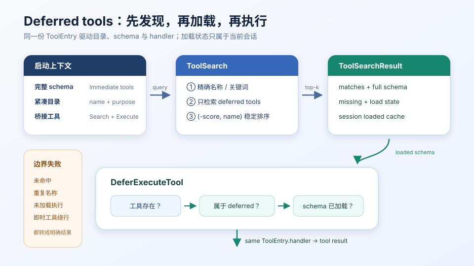
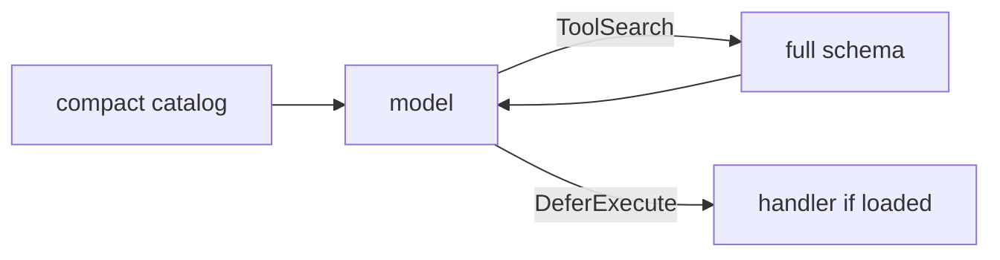

# s03 — Deferred Tool Loading

> **状态**：`available`  
> **长文**：[延迟加载工具 schema](../../../notes/learn-workbuddy/s03-deferred-loading.md)  
> **上游教案**：[learn-workbuddy s03](https://github.com/adongwanai/learn-workbuddy/tree/main/s03_deferred_loading)



## 今日目标

区分「工具能不能被调用」与「工具 schema 是否进入当轮上下文」；看懂延迟加载如何控制进模的说明书集合。

## 代码架构图



## 文件说明

| 文件 | 作用 |
|------|------|
| `code.py` | 本章可跑脚本（`--demo` 离线） |
| `images/` | 延迟加载架构图 |

## 推荐顺序

| 步骤 | 命令 | 你会看到什么 |
|:----:|------|-------------|
| 0 | 已在 `tracks/harness` 装好依赖 | — |
| 1 | `python3 s03_deferred_loading/code.py --demo` | 离线演示 schema 可见性差异 |

## 验收命令

```bash
cd tracks/harness
python3 s03_deferred_loading/code.py --demo
```

## 验收标准

- 退出码 0
- demo 能体现「未加载 / 已加载」对工具可见性的影响（对照长文总图）
