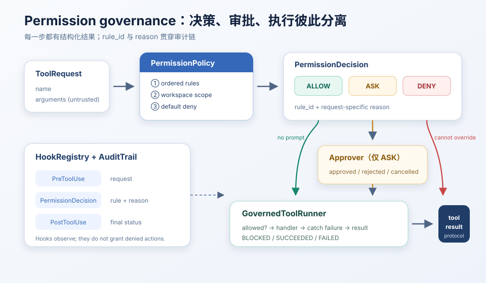
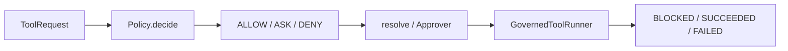

# s04 — Permission & Hooks

> **状态**：`available`  
> **长文**：[权限与 Hooks](../../../notes/learn-workbuddy/s04-permission-hooks.md)  
> **上游教案**：[learn-workbuddy s04](https://github.com/adongwanai/learn-workbuddy/tree/main/s04_permission_hooks)



## 今日目标

把治理拆成三岗：`decide`（规则）→ `resolve`（仅 ASK 问人）→ `run`（allowed 才调 handler）。Hook 只旁路审计，不能把 DENY 改成放行。

## 代码架构图



## 文件说明

| 文件 | 作用 |
|------|------|
| `code.py` | 本章可跑脚本（`--demo` 离线） |
| `images/permission-gates.svg` | 权限流水线示意 |

## 推荐顺序

| 步骤 | 命令 | 你会看到什么 |
|:----:|------|-------------|
| 0 | 已在 `tracks/harness` 装好依赖 | — |
| 1 | `python3 s04_permission_hooks/code.py --demo` | 离线走完策略 / 审批 / 执行 |

## 验收命令

```bash
cd tracks/harness
python3 s04_permission_hooks/code.py --demo
```

## 验收标准

- 退出码 0
- 能对照长文说出：DENY → BLOCKED 且不调 handler；ASK 拒绝 ≠ handler FAILED

## 可选：真模型

```bash
# 配置 .env 后
python3 s04_permission_hooks/code.py --provider deepseek
```
