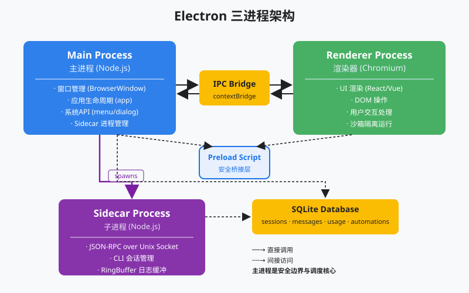

# s05 — Electron Shell

> **状态**：`available`  
> **长文**：[Electron Shell：一个进程不够，要三个](../../../notes/learn-workbuddy/s05-electron-shell.md)  
> **上游教案**：[learn-workbuddy s05](https://github.com/adongwanai/learn-workbuddy/tree/main/s05_electron_shell)



## 今日目标

弄清桌面壳的三进程边界：Main / Renderer / Preload；IPC 只开窄接口；用进程隔离让 UI 不被 agent 长任务拖死。Main 是 lifecycle/router，不是 agent 大脑（大脑在 Sidecar，见 s06）。

## 代码架构图


## 文件说明

| 文件 | 作用 |
|------|------|
| `code.py` | 本章可跑脚本（`--demo` 离线；交互需 Key） |
| `images/electron-arch.svg` | 三进程示意 |
| `images/process-architecture.svg` | 更大进程拓扑（后续章视野） |

## 推荐顺序

| 步骤 | 命令 | 你会看到什么 |
|:----:|------|-------------|
| 0 | 已在 `tracks/harness` 装好依赖 | — |
| 1 | `python3 s05_electron_shell/code.py --demo` | 本章在渐进链路中的位置与新增点 |

## 验收命令

```bash
cd tracks/harness
python3 s05_electron_shell/code.py --demo
```

## 验收标准

- 退出码 0
- 能对照长文说出：请示是 Renderer→Preload/IPC→Main；分进程才不卡；真大脑在 Sidecar

## 可选：真模型

```bash
# 配置 .env 后
python3 s05_electron_shell/code.py --provider deepseek
```
