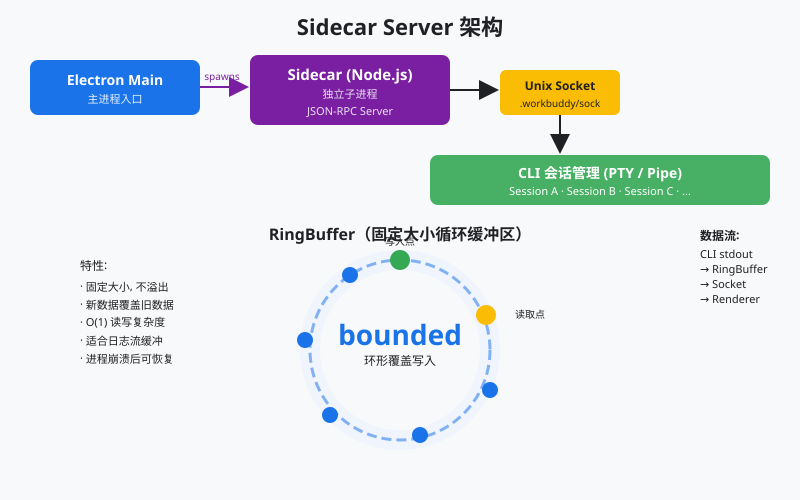
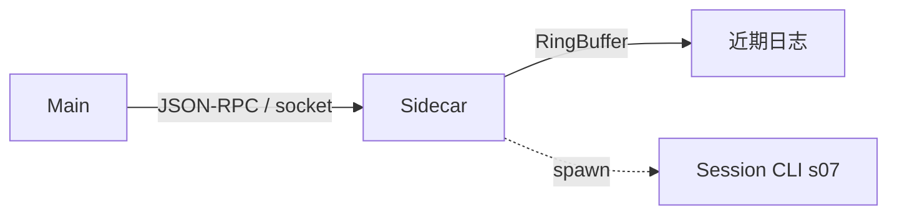

# s06 — Sidecar Server

> **状态**：`available`  
> **长文**：[Sidecar Server：主进程不跑 agent，Sidecar 来跑](../../../notes/learn-workbuddy/s06-sidecar-server.md)  
> **上游教案**：[learn-workbuddy s06](https://github.com/adongwanai/learn-workbuddy/tree/main/s06_sidecar_server)



## 今日目标

弄清 agent 宿主边界：Main 不跑大脑；Sidecar 作控制面；本机 JSON-RPC 传话；有界 RingBuffer 抓近期日志（≠ 审计库）。Session CLI 细节见 s07。

## 代码架构图



## 文件说明

| 文件 | 作用 |
|------|------|
| `code.py` | 本章可跑脚本（`--demo` 离线；交互需 Key） |
| `images/sidecar-arch.svg` | Sidecar 与 Main / Session 关系 |
| `images/sidecar-arch-en.svg` | 英文版配图 |

## 推荐顺序

| 步骤 | 命令 | 你会看到什么 |
|:----:|------|-------------|
| 0 | 已在 `tracks/harness` 装好依赖 | — |
| 1 | `python3 s06_sidecar_server/code.py --demo` | 本章新增：control plane / JSON-RPC / ring buffer |

## 验收命令

```bash
cd tracks/harness
python3 s06_sidecar_server/code.py --demo
```

## 验收标准

- 退出码 0
- 能对照长文说出：为何 agent 离开 Main；`method`/`id`；RingBuffer 满了覆盖旧数据且不当库

## 可选：真模型

```bash
# 配置 .env 后
python3 s06_sidecar_server/code.py --provider deepseek
```
