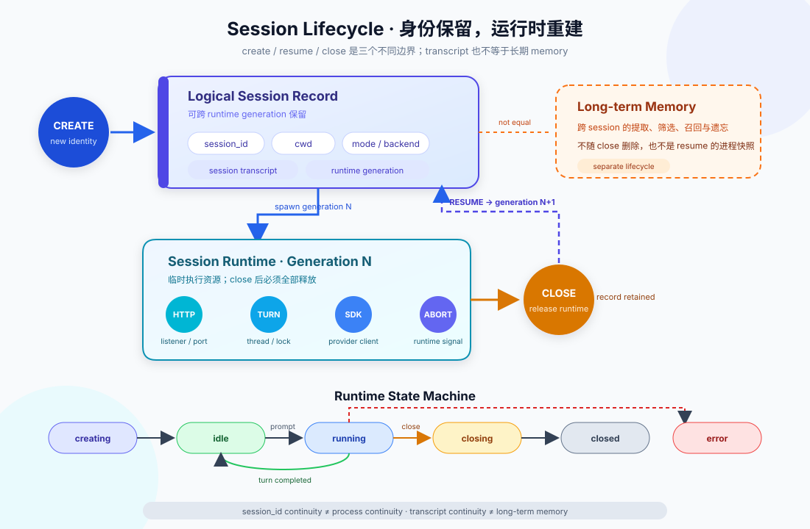
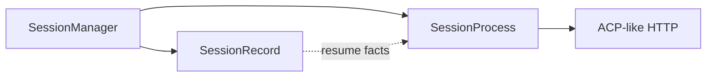

# s07 — Session Management

> **状态**：`available`  
> **长文**：[Session Management：逻辑会话可恢复，运行时必须重建](../../../notes/learn-workbuddy/s07-session-management.md)  
> **上游教案**：[learn-workbuddy s07](https://github.com/adongwanai/learn-workbuddy/tree/main/s07_session_management)



## 今日目标

分清逻辑会话（`SessionRecord`）与运行时（`SessionProcess`）；掌握 create / close / resume / forget；resume 后 generation +1、端口可换；`running` ≠ 存活证明；transcript ≠ 长期 memory；abort ≠ close。

## 代码架构图



## 文件说明

| 文件 | 作用 |
|------|------|
| `code.py` | 本章可跑脚本（`--demo` 章序；无 Key 可跑生命周期命令） |
| `images/session-lifecycle.svg` | 会话生命周期示意 |
| `images/session-lifecycle-en.svg` | 英文版配图 |

## 推荐顺序

| 步骤 | 命令 | 你会看到什么 |
|:----:|------|-------------|
| 0 | `source .venv/bin/activate`（在 `tracks/harness`） | 依赖就绪 |
| 1 | `python s07_session_management/code.py --demo` | 章序：Record/runtime 分离等 |
| 2 | `python s07_session_management/code.py` | 交互：`/sessions`→`/close`→`/resume`→`/forget` |

## 验收命令

```bash
cd tracks/harness
source .venv/bin/activate   # 或已安装 requirements.txt
python s07_session_management/code.py --demo
```

## 验收标准

- `--demo` 退出码 0
- 能对照长文 + 自己跑过的终端说出：同 id、Gen+1、端口可变、forget 后列表空

## 可选：真模型

```bash
python s07_session_management/code.py --provider deepseek
# 发普通文字才会调模型；生命周期命令无需 Key
```
