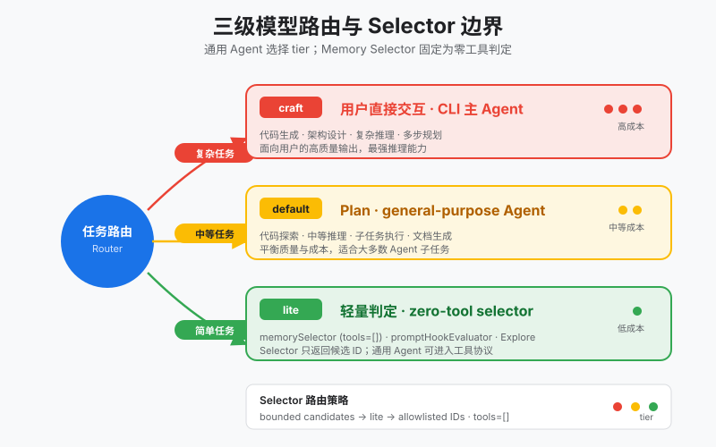

# s08 — Model Routing

> **状态**：`available`  
> **长文**：[Model Routing：用 AI 管理 AI — 便宜粗筛，贵的推理](../../../notes/learn-workbuddy/s08-model-routing.md)  
> **上游教案**：[learn-workbuddy s08](https://github.com/adongwanai/learn-workbuddy/tree/main/s08_model_routing)



## 今日目标

按任务难度做 **lite / default / craft** 分级路由；理解「用 AI 管理 AI」；Memory Selector = zero-tool 内部判定器；用 CostTracker 看清成本；掌握 `auto` / `effort` / 不可用时只降不升。

## 代码架构图


## 文件说明

| 文件 | 作用 |
|------|------|
| `code.py` | 本章可跑脚本（`--demo` 章序；mock 全演示无需 Key） |
| `images/model-routing.svg` | 三级路由示意 |
| `images/model-routing-en.svg` | 英文版配图 |

## 推荐顺序

| 步骤 | 命令 | 你会看到什么 |
|:----:|------|-------------|
| 0 | `source .venv/bin/activate`（在 `tracks/harness`） | 依赖就绪 |
| 1 | `python s08_model_routing/code.py --demo` | 章序：routing / cost / memory selector |
| 2 | `python s08_model_routing/code.py` | 完整 mock：路由表、用 AI 管理 AI、auto、effort、降级、成本对比 |

## 验收命令

```bash
cd tracks/harness
source .venv/bin/activate   # 或已安装 requirements.txt
python s08_model_routing/code.py --demo
```

## 验收标准

- `--demo` 退出码 0
- 能对照长文说出：三级槽位、Selector `tools=0`、分级成本低于全 craft
- 能说明：`auto` 看任务、`agent` 看角色；effort 同档拧油门；挂了只降不升

## 可选：交互壳

```bash
python s08_model_routing/code.py --interactive
# route / auto / effort / down / up / cost
```
