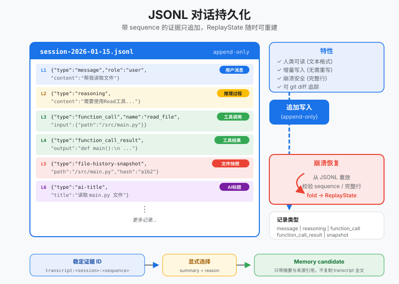
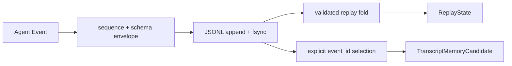

# s09 — JSONL Transcript

> **状态**：`available`  
> **长文**：[JSONL Transcript：证据只追加，运行时状态可重建](../../../notes/learn-workbuddy/s09-jsonl-transcript.md)  
> **上游教案**：[learn-workbuddy s09](https://github.com/adongwanai/learn-workbuddy/tree/main/s09_jsonl_transcript)



## 今日目标

用 append-only **JSONL** 保存会话证据；用 replay fold 派生可丢弃的 `ReplayState`；掌握六种事件、损坏边界、Transcript ≠ Memory、JSONL vs SQLite；可选截断回放与分片索引。

## 代码架构图



## 文件说明

| 文件 | 作用 |
|------|------|
| `code.py` | 本章可跑脚本（`--demo` 章序；三幕 mock 无需 Key） |
| `images/jsonl-transcript.svg` | JSONL 持久化示意 |
| `images/jsonl-transcript-en.svg` | 英文版配图 |

## 推荐顺序

| 步骤 | 命令 | 你会看到什么 |
|:----:|------|-------------|
| 0 | `source .venv/bin/activate`（在 `tracks/harness`） | 依赖就绪 |
| 1 | `python s09_jsonl_transcript/code.py --demo` | 章序：evidence / replay / event ids |
| 2 | `python s09_jsonl_transcript/code.py` | Part1 追加 → Part2 崩溃 → Part3 恢复；10 事件 / 6 messages |

## 验收命令

```bash
cd tracks/harness
source .venv/bin/activate   # 或已安装 requirements.txt
python s09_jsonl_transcript/code.py --demo
```

## 验收标准

- `--demo` 退出码 0
- 能对照长文说出：证据 vs 派生；10 事件为何只有 6 messages
- 能说明：partial tail 可忽略但禁 append；Memory 要 summary + reason

## 可选：交互壳

```bash
python s09_jsonl_transcript/code.py --interactive
# user / assistant / reason / tool / result / title / replay / recover / raw / q
```
