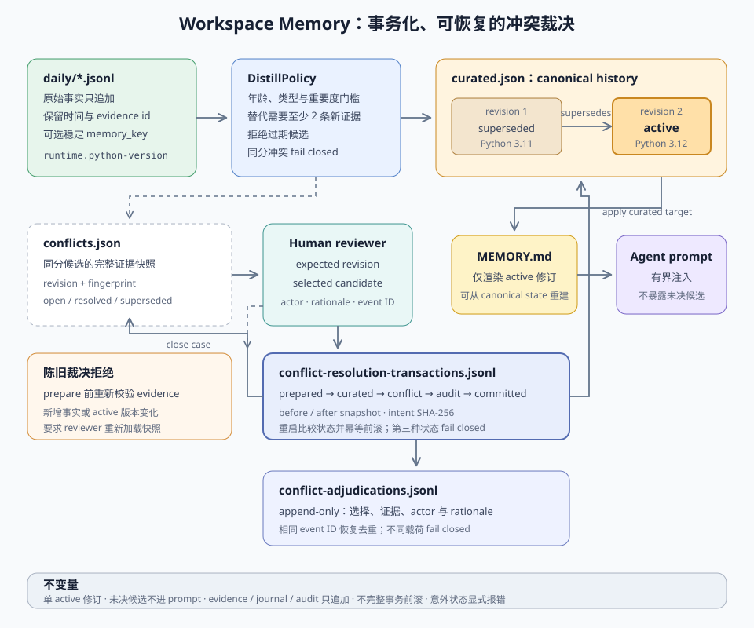
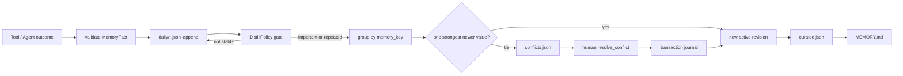

# s10 — Workspace Memory

> **状态**：`available`  
> **长文**：[Workspace Memory：工作日志蒸馏成可恢复的项目记忆](../../../notes/learn-workbuddy/s10-workspace-memory.md)  
> **上游教案**：[learn-workbuddy s10](https://github.com/adongwanai/learn-workbuddy/tree/main/s10_workspace_memory)



## 今日目标

从工作日志蒸馏可恢复的项目记忆：同项目跨会话共享、不同项目不串线；原始事实只追加；稳定且够旧、重要或重复才进长期视图；`memory_key` 冲突域；同强度冲突进 review，只有人类裁决；transaction journal 崩溃后幂等前滚；确认凭据在进程内存。

## 代码架构图



## 文件说明

| 文件 | 作用 |
|------|------|
| `code.py` | 本章可跑脚本（`--demo` 章序；交互壳 + `/confirm-demo` 无需 Key） |
| `images/workspace-memory.svg` | 工作区记忆示意 |
| `images/three-layer-memory.svg` | 三层记忆位置 |

## 推荐顺序

| 步骤 | 命令 | 你会看到什么 |
|:----:|------|-------------|
| 0 | `source .venv/bin/activate`（在 `tracks/harness`） | 依赖就绪 |
| 1 | `python s10_workspace_memory/code.py --demo` | 章序：fact log / distill / conflict / journal |
| 2 | `python s10_workspace_memory/code.py` | 交互：`/confirm` `/today` `/logs` `/confirm-demo` `/recent` |

## 验收命令

```bash
cd tracks/harness
source .venv/bin/activate   # 或已安装 requirements.txt
python s10_workspace_memory/code.py --demo
```

## 验收标准

- `--demo` 退出码 0
- 能对照长文说出：daily 证据 vs curated / MEMORY.md；蒸馏不删旧行
- 能说明：冲突人类裁决；journal 防崩后烂账；确认在进程内存不看日志 `source`

## 可选：交互壳

```bash
python s10_workspace_memory/code.py
# /confirm <kind> <importance> <content>
# /today /logs /recent /memory /distill /conflicts /confirm-demo /q
```
