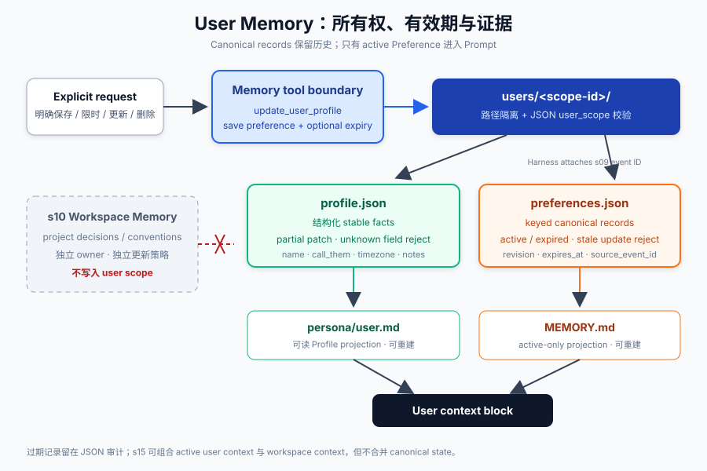
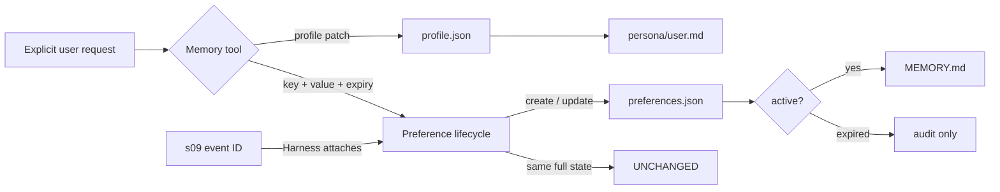

# s11 — User Memory

> **状态**：`available`  
> **长文**：[User Memory：Profile 与 Preference 的用户级边界](../../../notes/learn-workbuddy/s11-user-memory.md)  
> **上游教案**：[learn-workbuddy s11](https://github.com/adongwanai/learn-workbuddy/tree/main/s11_user_memory)



## 今日目标

建立用户级 Profile 与 Preference：Owner=`user_scope`；显式工具改状态；同态重试 no-op；过期留审计不进 Prompt；出处归 Harness；删除墓碑防复活；与 workspace / remote 分权。

## 代码架构图



## 文件说明

| 文件 | 作用 |
|------|------|
| `code.py` | 本章可跑脚本（`--demo` 章序；交互 `/profile` `/memory`） |
| `images/user-memory.svg` | 用户记忆示意 |

## 推荐顺序

| 步骤 | 命令 | 你会看到什么 |
|:----:|------|-------------|
| 0 | `source .venv/bin/activate`（在 `tracks/harness`） | 依赖就绪 |
| 1 | `python s11_user_memory/code.py --demo` | 章序：profile / preference / expiry / tombstones |
| 2 | 临时 HOME 交互或离线 `UserMemory` 烟测 | JSON 真相；投影可读 |

## 验收命令

```bash
cd tracks/harness
source .venv/bin/activate
python s11_user_memory/code.py --demo
```

## 验收标准

- `--demo` 退出码 0
- 能说出：Profile vs Preference；JSON 真相 vs Markdown 投影
- 能说明：UNCHANGED 不涨 revision；过期不进投影；工具无 `source_event_id`；墓碑防复活

## 可选：交互壳

```bash
WORKBUDDY_HOME=/tmp/learn-workbuddy-s11 WORKBUDDY_USER_ID=alice \
  python s11_user_memory/code.py
# /profile /memory /identity /reset-id q
```
