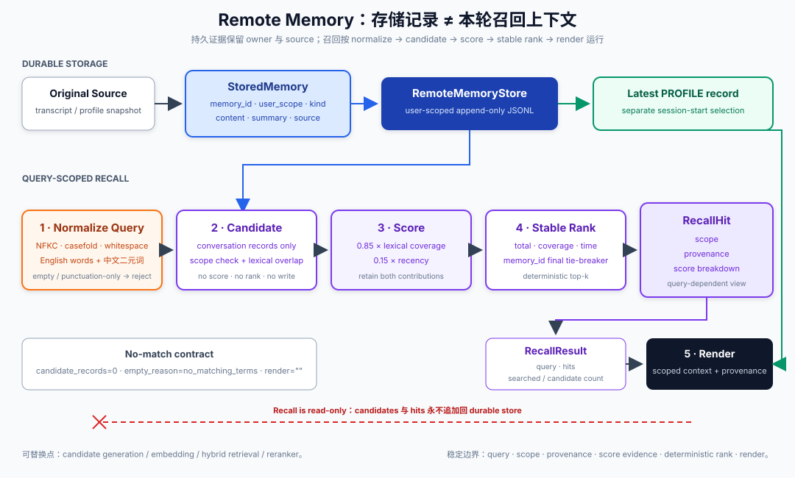
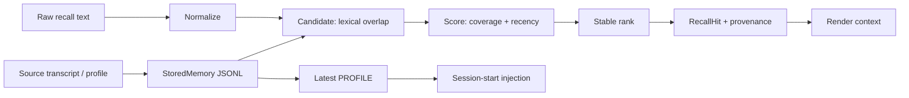

# s12 — Remote Memory

> **状态**：`available`  
> **长文**：[Remote Memory：Stored Record 与 Recalled Context](../../../notes/learn-workbuddy/s12-remote-memory.md)  
> **上游教案**：[learn-workbuddy s12](https://github.com/adongwanai/learn-workbuddy/tree/main/s12_cloud_memory)



## 今日目标

建立远端记忆边界：`StoredMemory`（带 owner / source）与 `RecallHit`（按 query 的候选视图）分离；五阶段召回契约；Profile 启动注入与 conversation 召回隔离；撤回两视图；召回只读。

## 代码架构图



## 文件说明

| 文件 | 作用 |
|------|------|
| `code.py` | 本章可跑脚本（`--demo` 章序；交互 `/retract-demo`） |
| `images/cloud-memory.svg` | Stored vs Recall 示意 |

## 推荐顺序

| 步骤 | 命令 | 你会看到什么 |
|:----:|------|-------------|
| 0 | `source .venv/bin/activate`（在 `tracks/harness`） | 依赖就绪 |
| 1 | `python s12_cloud_memory/code.py --demo` | 章序：Stored / Recall / Profile / retract 边界 |
| 2 | 交互壳输入 `/retract-demo` | 召回 → 撤回 → miss → 审计仍在（无需 Key） |

## 验收命令

```bash
cd tracks/harness
source .venv/bin/activate
python s12_cloud_memory/code.py --demo
```

## 验收标准

- `--demo` 退出码 0
- 能说出：Stored ≠ Recall；五阶段主路径
- 能说明：命中 ≠ 事实 ≠ 必进 Prompt；miss → render `""`；`RecallResult` 契约可换 ranker

## 可选：交互壳

```bash
WORKBUDDY_HOME=/tmp/learn-workbuddy-s12 WORKBUDDY_USER_ID=alice \
  python s12_cloud_memory/code.py
# /retract-demo
```
