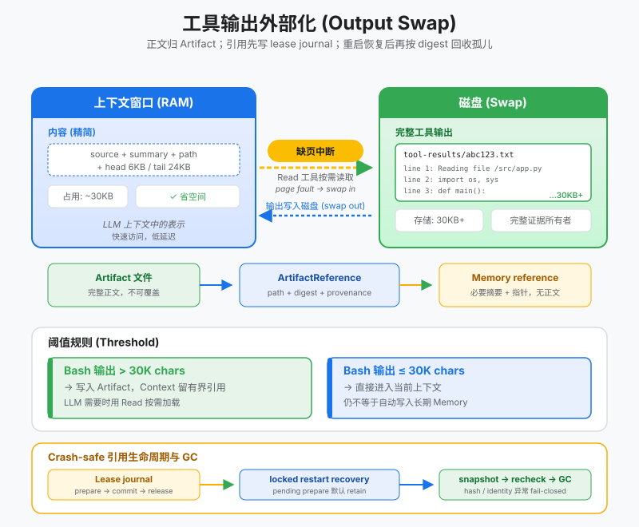
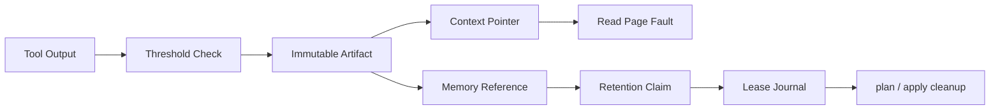

# s13 — Output Externalization

> **状态**：`available`  
> **长文**：[Tool Output Externalization：内存不够，换到磁盘](../../../notes/learn-workbuddy/s13-output-externalization.md)  
> **上游教案**：[learn-workbuddy s13](https://github.com/adongwanai/learn-workbuddy/tree/main/s13_output_externalization)



## 今日目标

大工具输出写成不可变 Artifact；上下文只留指针（摘要 + 预览 + 路径）；Memory 只收瘦引用；无路径 retention claim + journal；generation-fenced 对账；plan/apply 清理 fail-closed；按需读 ≈ 缺页。

## 代码架构图



## 文件说明

| 文件 | 作用 |
|------|------|
| `code.py` | 本章可跑脚本（`--demo` 章序；主演示；`--interactive`） |
| `images/output-externalization.svg` | 外置与换页示意 |

## 推荐顺序

| 步骤 | 命令 | 你会看到什么 |
|:----:|------|-------------|
| 0 | `source .venv/bin/activate`（在 `tracks/harness`） | 依赖就绪 |
| 1 | `python s13_output_externalization/code.py --demo` | 章序：threshold / artifact / page-fault / journal |
| 2 | `python s13_output_externalization/code.py` | 大 grep 外置；缺页读中间行；体积对比 |
| 3 | `python s13_output_externalization/code.py --interactive` | `large` / `read` / `summary` |

## 验收命令

```bash
cd tracks/harness
source .venv/bin/activate
python s13_output_externalization/code.py --demo
python s13_output_externalization/code.py
```

## 验收标准

- `--demo` 与主演示退出码 0（Mock，无需 Key）
- 能说出：Artifact ≠ pointer ≠ Memory 瘦引用
- 能说明：先 PREPARED 再发 Memory；清理 SHA 变则不删

## 可选：交互壳

```bash
python s13_output_externalization/code.py --interactive
# large → read 15998 5 → summary → q
```
