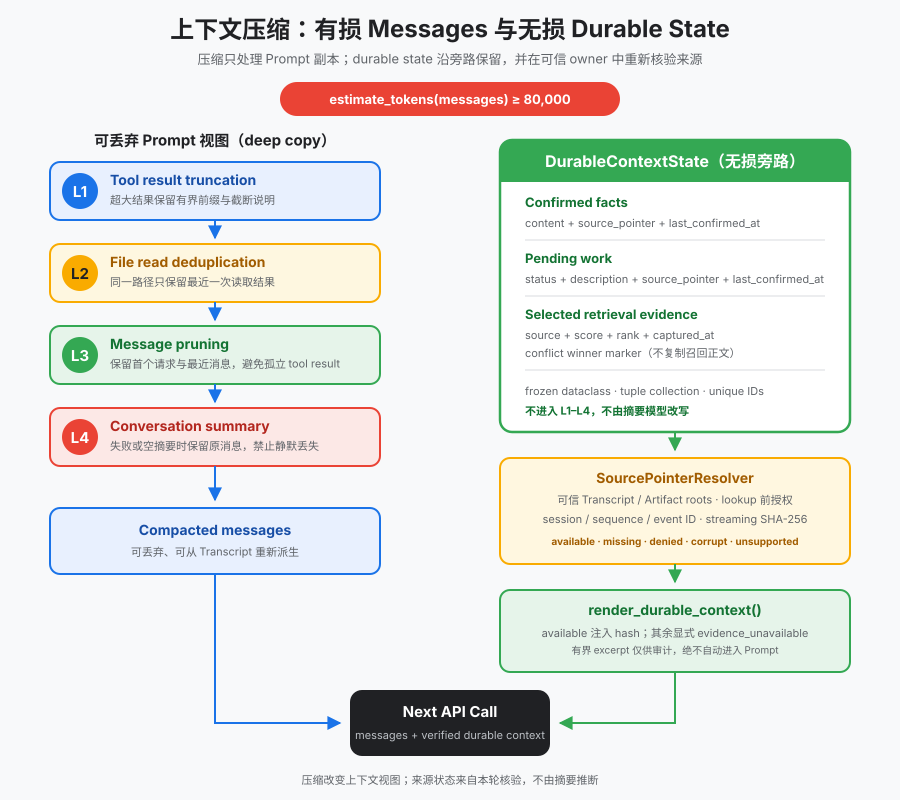
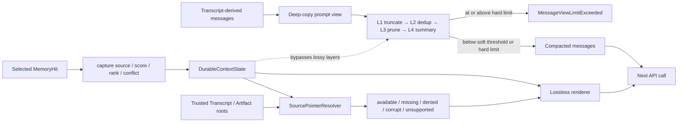

# s14 — Context Compact

> **状态**：`available`  
> **长文**：[Context Compact：上下文总会满，要有办法腾地方](../../../notes/learn-workbuddy/s14-context-compact.md)  
> **上游教案**：[learn-workbuddy s14](https://github.com/adongwanai/learn-workbuddy/tree/main/s14_context_compact)



## 今日目标

上下文总会满，要腾地方：四层压缩（L1→L4）；只压 messages 深拷贝；`DurableContextState` 旁路无损；source pointer 五态核验；不重做召回裁决；工具对原子裁剪。

## 代码架构图



## 文件说明

| 文件 | 作用 |
|------|------|
| `code.py` | 本章可跑脚本（`--demo` 章序；主程序；`stats` / `/pending-demo`） |
| `images/context-compact.svg` | 四层压缩管线示意 |

## 推荐顺序

| 步骤 | 命令 | 你会看到什么 |
|:----:|------|-------------|
| 0 | `source .venv/bin/activate`（在 `tracks/harness`） | 依赖就绪 |
| 1 | `python s14_context_compact/code.py --demo` | 章序：compact / durable / source pointer |
| 2 | `python s14_context_compact/code.py` | 交互壳；输入 `stats` 看 token 估算 |
| 3 | 交互中输入 `/pending-demo` | open→done；done→open 被拒；archive 行（无 Key） |

## 验收命令

```bash
cd tracks/harness
source .venv/bin/activate
python s14_context_compact/code.py --demo
python s14_context_compact/code.py
# 交互：stats · /pending-demo · q
```

## 验收标准

- `--demo` 退出码 0（Mock，无需 Key）
- 能说出：只压 messages 深拷贝；Durable 旁路无损
- 能说明：软阈值 80k 启动、硬上限 120k 拒请求；pending 仅 harness 结案

## 可选：交互壳

```bash
python s14_context_compact/code.py
# stats → /pending-demo → q
```
