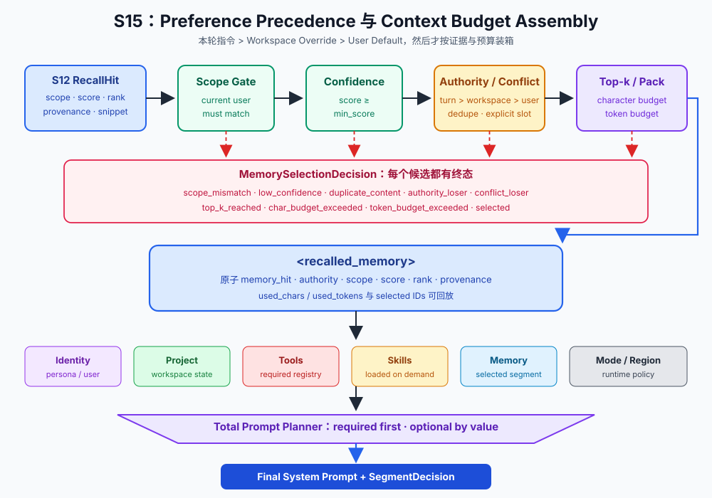
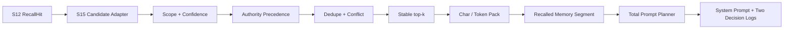

# s15 — Prompt Assembly

> **状态**：`available`  
> **长文**：[Prompt Assembly：从召回候选到预算内上下文](../../../notes/learn-workbuddy/s15-prompt-assembly.md)  
> **上游教案**：[learn-workbuddy s15](https://github.com/adongwanai/learn-workbuddy/tree/main/s15_prompt_assembly)



## 今日目标

从召回候选到预算内上下文：召回≠进 Prompt；先选择再装箱再组装；scope/置信度门禁 → authority → 去重 → 冲突 → top-k/字符·token 装箱 → `<recalled_memory>` → 总 Prompt 片段规划；双决策日志；不重算检索分、不写回长期记忆。

## 代码架构图



## 文件说明

| 文件 | 作用 |
|------|------|
| `code.py` | 本章可跑脚本（`--demo` 章序；`memory` / `memory clear`；总预算 env） |
| `images/prompt-assembly.svg` | 选择与组装示意 |

## 推荐顺序

| 步骤 | 命令 | 你会看到什么 |
|:----:|------|-------------|
| 0 | `source .venv/bin/activate`（在 `tracks/harness`） | 依赖就绪 |
| 1 | `python s15_prompt_assembly/code.py --demo` | 章序：selection / packing / segments |
| 2 | `python s15_prompt_assembly/code.py` → `memory` | authority、原因码、两层预算 |
| 3 | `memory clear` | 清除本轮 recall，防泄漏 |
| 4 | `PROMPT_BUDGET_CHARS=1000 python s15_prompt_assembly/code.py` → `memory` | 第一层 selected、第二层 memory dropped；required 仍在 |

## 验收命令

```bash
cd tracks/harness
source .venv/bin/activate
python s15_prompt_assembly/code.py --demo
python s15_prompt_assembly/code.py
# 交互：memory · memory clear · q
PROMPT_BUDGET_CHARS=1000 python s15_prompt_assembly/code.py
# 交互：memory · q
```

## 验收标准

- `--demo` 退出码 0（Mock，无需 Key）
- 能说出：S12 出分；S15 选择+装箱+组装；不重算分
- 能说明：两套日志；`current_turn` 挤不掉 required；查询结束须 clear

## 可选：紧预算观察

```bash
PROMPT_BUDGET_CHARS=1000 python s15_prompt_assembly/code.py
# memory → dropped=['memory'] 而 base/tools/mode 仍 included
```
